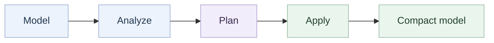

# Architecture

torch-kirigami separates dependency analysis, pruning decisions, and model changes.
A workflow combines these components with training, calibration, and task evaluation.

## From a model to a compact model

The diagram shows the three main stages of pruning.
Analysis finds structural dependencies. Planning selects removals and checks them.
Application changes the model and returns a compact model.

Operator rules define structural effects during analysis. Metrics and strategies guide planning.
Planning checks the final selection. Only application replaces model tensors.

The caller discovers a `CandidateSpace` before automatic planning.
The space contains allowed removal proposals and the axes used for channel budgets.
Manual planning accepts exact tensor selections instead.
Both paths use the same dependency analysis and execution checks.

## Responsibilities

### Dependency analysis

`DependencyGraph.build()` captures one forward with PyTorch FX and example metadata.
Operator rules describe structural relationships between tensor coordinates.
Propagation adds all removals that those relationships require.
Constraints check the complete selection.
Requirements describe changes that execution must handle.

Analysis does not rank candidates or change weights.
An `Impact` reports the removals, constraints, requirements, and diagnostics.
A resolved impact does not guarantee an executable plan or unchanged model outputs.

The `torch_kirigami.dep_graph` package owns capture, structural coordinates,
relations, constraints, operator semantics, and graph queries. It separates
construction from repeated queries:

| Component | Responsibility and lifetime |
| --- | --- |
| `_Analyzer` in `construction.py` | Collect original aliases, capture with FX, apply operator rules, and populate one `DependencyGraphState`. Release temporary value and alias tables on success or failure. |
| `DependencyGraphState` in `graph_state.py` | Own structural tables throughout construction and subsequent queries. It contains neither construction scratch tables nor solver caches. |
| `DependencySolver` in `solver.py` | Own relation and constraint indexes, bounded relation caches, and exact joint propagation for one graph. |
| `DependencyGraph` in `dependency_graph.py` | Provide public queries, inspection copies, model freshness checks, and invalidation. It is initialized with complete records. |

`DependencyGraph.build()` remains the public construction entry. The other components
are internal and import shared records without importing the public graph.
The analyzer creates one `DependencyGraphState`, writes directly into its tables, and
returns that same object. It does not mirror the tables in its own attributes or
copy them into a second record at completion. Only completed data can initialize
`DependencyGraph`; the analyzer cannot be reused after success or failure.
Public queries expose tuples, read-only views, or inspection copies. The data
references the original model and records structural resource settings; it is
neither a weight backup nor a checkpoint.
`Operation` represents one invocation and its rule inputs, avoiding separate call
and context wrappers. `OperatorRule` owns operator-specific declarations;
`OperatorSpec` contains structural facts. `AttributeBinding` reuses `ShapeExpr`
for structural attributes and `TensorEffects` reuses `ArgumentRef` for input writes.
Static physical recipe records live in `operator_recipes.py`, below analysis and
execution, so extensions do not introduce reverse imports.

Within this package, `selection.py` defines coordinates, region unions, and region
shape/gather operations. `relations.py` defines index mappings. `contracts.py` defines constraints
and analysis results. `operation.py`, `registry.py`, and `operators/` define and
register operation semantics. Pruning and sparsity consume these contracts.

`eligibility.py` checks nested native semantics before an optimization reuses
structural computations. It is shared by propagation and planning; it is not a
data-record definition or a general validity check. Extensions that fail this
check still use ordinary analysis. Keeping this helper below both consumers
avoids importing the solver into pruning code.

The construction helper retains only temporary working state in addition to the
single analysis record. The solver owns reusable query indexes and caches; the
public graph owns validation and inspection. Coordinate types and their small
region operations share one module; no separate region facade is needed.

`settings.py` exports one process-global `config` for resource limits, scoring
batches, and cache bounds. It has no scopes or per-owner option objects. Settings
are read when work starts; changes during an operation are unsupported. See
[global configuration](pruning.md#global-resource-configuration) for invalidation
and validation rules.

Package initialization in `dep_graph/__init__.py` performs no eager imports.
Internal consumers import concrete submodules. Public imports such as
`from torch_kirigami import DependencyGraph, Selection` remain available from the
root package. Shared model binding and configuration utilities remain outside
`dep_graph` because capture, physical execution, and persistence all use them.

Each build copies its operator registry tables. There is no global registration
singleton. Rule callables and original model objects retain their identities;
read-only record containers do not make those objects immutable.

### Pruning policy and planning

A `Metric` returns importance scores for candidates.
A `Strategy` chooses candidates under a budget.
`Pruner.plan()` checks the strategy's final choice independently.
It returns a `PruningPlan` only when dependencies, execution checks, and the budget pass.

`Greedy` ranks candidates once during a planning call.
`DynamicGreedy` scores the remaining candidates after each accepted addition.
Neither strategy trains the model or collects calibration data.
The caller supplies gradients or activation statistics before planning when a metric needs them.

A parameter budget limits the final parameter count.
A channel budget limits final logical widths.
These budgets share the same final-size comparison.
Their counting rules differ.

### Model changes and persistence

`Pruner.apply()` prepares replacement tensors before it changes model bindings.
It applies the plan to the original module hierarchy.
It returns that model and a `PruningResult` with parameter and coordinate maps.
Supported changes can update registered tensors and structural module attributes.

A plan stores a decision, not the weights used to score it.
A model checkpoint stores the final compact structure and values.
The caller supplies compatible model code when restoring a checkpoint.

### Training and measurement

The sparsity package supplies differentiable penalties, explicit gates, and parameter operations.
The caller owns the task loss, optimizer, training loop, and phase transitions.
Research workflows also own bias correction and weight reconstruction.
Save their corrected or reconstructed values in the final model checkpoint.

Measurement reports parameter counts, theoretical MACs, and inference latency.
Task accuracy requires separate evaluation with task data.
Fewer parameters or MACs do not guarantee lower latency or preserved accuracy.

## Object lifetimes

A dependency graph records structural assumptions from capture.
Changes to structure, module modes, tracked configuration, or guarded constants can invalidate it.
Ordinary weight updates can preserve the graph when those assumptions remain valid.

After physical pruning:

1. Build a new graph before another planning call.
2. Discover candidates and construct parameter groups from that graph.
3. Construct a new optimizer for the replacement parameters.

The library does not transfer optimizer state automatically.
A saved plan has no live graph binding.
It can apply the same coordinates to another model with compatible structure.

## Extension boundary

One `OperatorRule` describes analysis, candidate axes, effects, and any custom rewrite.
The dependency core does not import pruning policy or sparse-training algorithms.
The pruning layer consumes the dependency contracts.
Sparse-training components consume graph and pruning contracts.
Library modules do not import workflow examples.

Add a rule when an operation needs new structural semantics.
Add a metric when an algorithm needs a different score.
Add a strategy when an algorithm needs a different selection procedure.
A solver with exact selections can submit them through `plan_remove()`.

The [dependency guide](dependency-graph.md) defines analysis records and propagation.
The [pruning guide](pruning.md) defines planning and application contracts.
