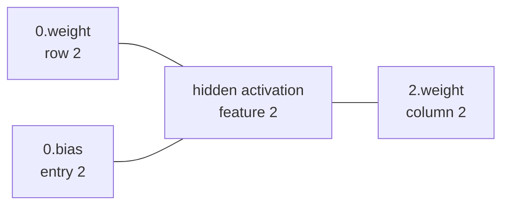
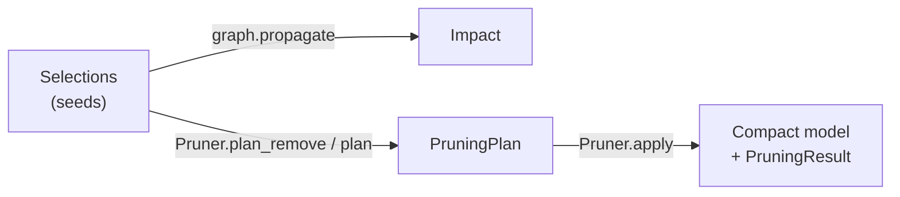
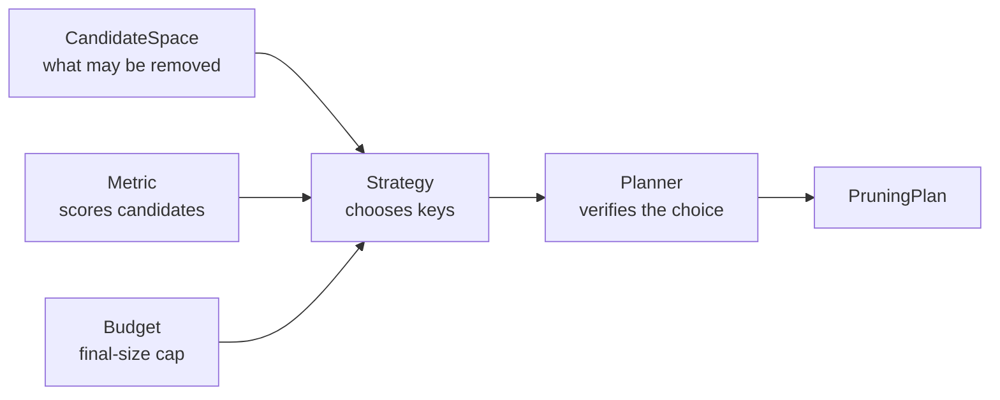
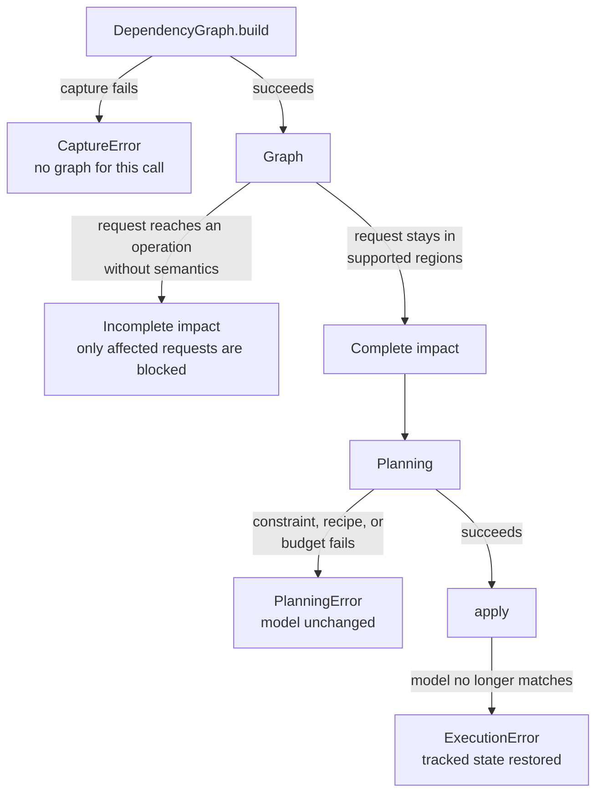

# Core concepts

This page introduces the ideas you need to read every other guide. It
uses one small model throughout:

```python
model = nn.Sequential(nn.Linear(4, 6), nn.ReLU(), nn.Linear(6, 3))
```

## Coupled coordinates

Removing hidden feature 2 from this model is not a single tensor edit. Row 2 of
the first weight, entry 2 of the first bias, feature 2 of the activation, and
column 2 of the second weight all describe the same hidden unit. They must
disappear together, or the compact model no longer computes a valid function.



The dependency graph records these couplings as *relations* between tensor
coordinates. A query starts from the positions you ask to remove, the *seeds*,
and follows relations until no new position is added. The result is the
*closure* of the request.

Every coordinate in a query, a plan, or a report is an **original coordinate**:
an index in the tensor shapes that existed when the graph was built. Position 4
stays position 4 throughout analysis and planning. Compact coordinates exist
only inside the replacement tensors that `apply()` creates.

## Three records, three responsibilities



| Record | Produced by | What it is | What it is not |
| --- | --- | --- | --- |
| `Impact` | `DependencyGraph.propagate()` | The closure of one request, the constraints checked against it, and diagnostics. | An executable plan. It has no recipes and makes no execution checks. |
| `PruningPlan` | `Pruner.plan_remove()` or `Pruner.plan()` | A static decision with tensor and attribute recipes and the model structure it expects before and after. | A model or a weight snapshot. Creating it changes nothing. |
| `PruningResult` | `Pruner.apply()` | The applied plan, the new structure, and maps from old to new parameters and coordinates. | Optimizer state or a new dependency graph. |

A planner builds the `PruningPlan` from an `Impact` and adds the execution
checks: tensor layouts, attribute updates, static call arguments, and shared
bindings. Only `apply()` touches the model.

## Reading an impact

An `Impact` reports two independent properties.

`status` says whether the checked conditions hold:

- `resolved`: no constraint reported a problem.
- `unresolved`: some condition needs more choices or a proof, for example the
  groups of a grouped convolution keep unequal channel counts.
- `conflict`: a required condition fails, for example the request removes a
  protected output feature.

`complete` says whether the graph knows the full influence of the request. An
operation without structural semantics makes the influence incomplete: the
graph cannot say which coordinates the request would affect beyond that point.

| | `complete` is true | `complete` is false |
| --- | --- | --- |
| `resolved` | Structurally valid within the graph's assumptions. | Not possible. Every diagnostic, including one that marks influence incomplete, prevents `resolved`. |
| `unresolved` | Known closure, but another choice is needed, such as balancing groups. | The request reaches an unsupported operation. |
| `conflict` | Known closure that violates a constraint. | A violation, and part of the influence is also unknown. |

A further flag, `irreversible`, is stronger than `conflict`. It means that no
additional removal can repair the violation. Removing a protected axis is
irreversible. An unbalanced group is not, because removing more channels can
balance it.

None of these values proves that a physical rewrite is possible or that the
smaller model computes the same values. Planning checks the first question.
Only measurement can answer the second.

## Who decides what

Automatic planning separates each part of the decision, so that you can replace
any part.



- A `CandidateSpace` lists named removal requests and the logical axes that a
  channel budget counts. It is a menu, not the set of every dependency group in
  the model.
- A `Metric` returns one score per candidate. The built-in greedy strategies
  try lower scores first.
- A `Strategy` chooses candidate keys. It may ask the planning context for
  impacts and budget measurements.
- A budget caps either final logical widths (`ChannelRatio`, `ChannelCount`) or
  the final parameter count (`ParameterBudget`).
- The planner recomputes the final joint impact, compiles recipes, and measures
  the budget itself. A strategy cannot declare a target met.

## How far a failure reaches

A failure does not always mean that the whole model is unsupported. The scope
depends on the stage that fails.



- **Capture.** If FX tracing or metadata execution fails, `build()` raises
  `CaptureError` and there is no graph for that call.
- **Analysis.** If an operation has no structural rule, the graph still exists.
  The graph blocks requests that reach the operation. Independent branches stay
  analyzable. The blocked region can extend beyond the operation itself:
  through the data that feeds it, through shared parameters, and through
  residual additions.
- **Planning.** A manual request is all or nothing. `plan_remove()` never drops
  part of your request to make it pass. Automatic planning can skip candidates
  that fail, but it raises `PlanningError` if it cannot reach the budget. It
  never returns a partial plan.
- **Application.** `apply()` checks the model against the plan's recorded
  structure again. If a check or the commit fails, it restores the bindings and
  attributes that it tracks.

## Snapshots and lifetimes

A graph is a snapshot of one model structure, one set of module modes, and one
set of capture assumptions. Queries check that the model still matches and raise
`StaleGraphError` if it does not. Ordinary weight updates keep the graph valid.

After a nonempty `apply()`:

1. The old graph is invalidated. Build a new graph before the next round.
2. Rebuild everything bound to the old graph: candidate spaces, parameter
   groups, and gate bindings.
3. Create a new optimizer. Replaced parameters are new `nn.Parameter` objects,
   and the library does not migrate optimizer state.

## What a successful result does not promise

- A structurally valid compact model can produce different values from the
  original or a zero-masked copy. LayerNorm, GroupNorm, softmax, and
  attention recompute over the smaller domain.
- Fewer parameters or MACs do not guarantee lower latency or preserved accuracy.
  Measure both on your hardware and task.
- Scores such as magnitude or Taylor are heuristics. They rank candidates. They
  do not predict task loss.
