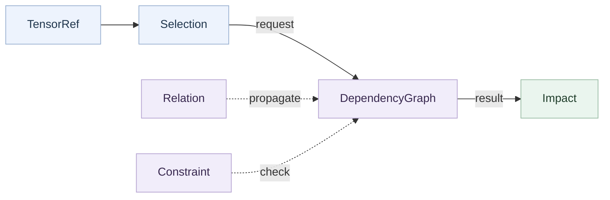
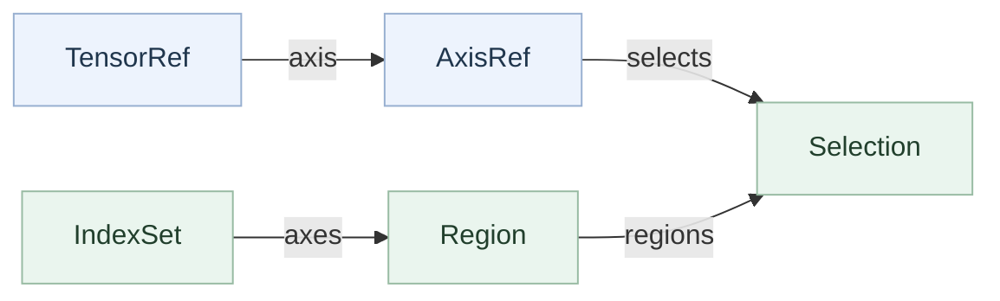
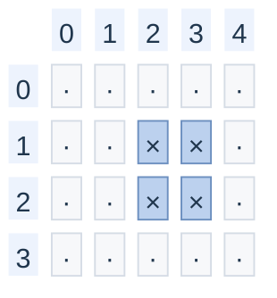
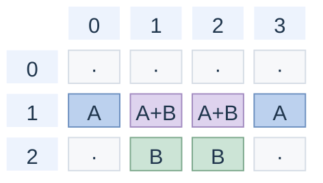
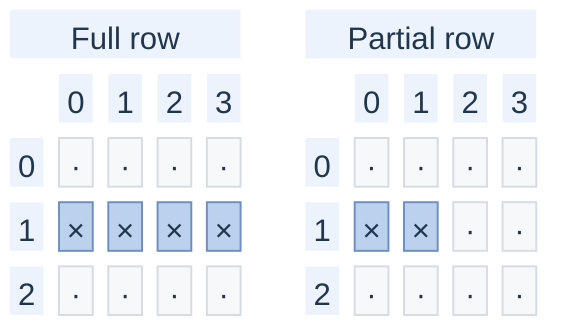
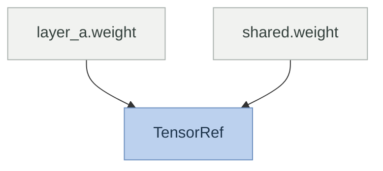
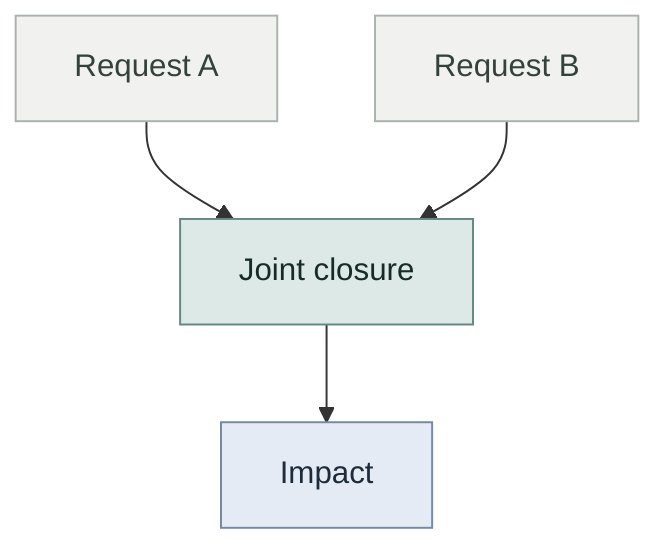

# Dependency graph and coordinates

The dependency graph answers one question: if you remove these tensor positions, which other positions or structural properties must change?

The graph records operator semantics. A query computes the closure of a joint removal request. The graph does not rank candidates, choose a budget, or change model tensors. See [model support](model-support.md) for capture limits and [operator support](operator-support.md) for built-in rules.

The process-global [`config`](pruning.md#global-resource-configuration) controls structural expansion limits, including integer literal capture and ChannelShuffle mapping.
Set these limits before building a graph.
Propagation and planning require the structural settings from construction.
Rebuild the graph after changing those settings.
Cache-size changes alone do not invalidate graphs.

## Main relationships

A `Selection` names positions on one `TensorRef`. `DependencyGraph` follows relations and checks constraints to produce an `Impact`.



Relations add forced removals. Constraints report whether the resulting selection satisfies structural conditions. `Impact` records the affected positions and analysis findings.

## Coordinates and references

All selections use coordinates from the captured model. If a query selects positions 1 and 5, those labels stay 1 and 5 throughout propagation. The pruning layer creates compact coordinates only when it builds replacement tensors.

An FX node identifies one operation call. A `TensorRef` identifies one tensor entity. A `Selection` identifies positions on that entity. These identities differ because one module can run more than once, and several registered paths can refer to the same parameter object.

`IndexSet` stores a normalized union of nonnegative half-open intervals. It merges overlapping and adjacent intervals. Set operations stay symbolic and do not allocate dense masks. The implementation limits interval fragmentation.

`Region` stores a Cartesian product of index sets, one per tensor axis. `Region(())` represents the scalar coordinate. A selection can contain several disjoint regions.

`TensorRef` stores a snapshot-qualified identity, original shape, tensor kind, and registered alias paths. Parameter and buffer references keep their original bindings. Input and intermediate references keep metadata only. A portable reference label does not prove ownership by another live graph.

`AxisRef` identifies one tensor axis. Its constructor normalizes negative dimensions. Its `select(indices)` method selects complete cross-sections across every other axis. It rejects out-of-range positions.

`Selection` is an immutable union of regions on one tensor. Its set operations require the same tensor reference. `fully_selected_indices(dim)` returns only axis positions with complete selected cross-sections. Partial weight-row coverage does not prove that an output channel can be removed.

`compact_shape()` returns the result of ordinary whole-axis compaction when one Cartesian shape can represent the selection. It returns `None` when partition-specific packing may be needed. A declared `PartitionedLayout` can support such a selection.

### Coordinate composition

`TensorRef` identifies the tensor. `AxisRef` identifies one axis and selects complete cross-sections. Regions and index sets describe which positions a selection covers.



Each region contains one index set per tensor axis. A selection binds the union of its regions to one tensor. These arrows describe composition and selection, not inheritance.

### IndexSet uses half-open intervals

An interval includes its start and excludes its stop. The highlighted positions below represent `[1,7)`.

```mermaid
---
config:
  htmlLabels: false
  theme: base
  themeVariables:
    primaryTextColor: "#20364d"
---
block-beta
    columns 8
    p0["0"] p1["1"] p2["2"] p3["3"] p4["4"] p5["5"] p6["6"] p7["7"]
    classDef selected fill:#bcd1ee,stroke:#6c8fbf,color:#20364d
    classDef outside fill:#f7f8fa,stroke:#d5dce5,color:#657386
    class p1,p2,p3,p4,p5,p6 selected
    class p0,p7 outside
```



Position 1 belongs to the interval. Position 7 does not. Construction sorts intervals, discards empty ranges, and merges overlaps or adjacency.

For example, `[1,4)`, `[3,5)`, and `[5,7)` normalize to `[1,7)`. Set operations preserve symbolic intervals without allocating dense masks. The representation limit bounds interval fragmentation.

### Region is a Cartesian product

For a tensor with shape `(4, 5)`, this region selects rows `[1,3)` and columns `[2,4)`. Their Cartesian product selects the four highlighted cells.



Left labels identify rows on axis 0. Top labels identify columns on axis 1. Crosses mark selected cells. One region combines the selected positions from every axis.

### Selection combines regions on one tensor

A selection forms the union of regions on one tensor. Here, region A covers row 1 of a `(3, 4)` matrix. Region B covers rows 1 and 2, with columns 1 and 2.



Blue cells belong only to A. Green cells belong only to B. Purple cells belong to both regions.

The overlap counts once, so the union contains six elements. `Selection` normalizes regions into a disjoint representation. Set operations require the same tensor reference.

### AxisRef selects full cross-sections

Selecting row 1 through `AxisRef` covers the entire row. A selection that covers only part of that row cannot remove it as a complete axis position.



Both matrices have shape `(3, 4)`. Crosses mark selected cells. `fully_selected_indices(0)` returns `{1}` for the left selection and an empty set for the right.

`fully_selected_indices(dim)` checks complete cross-sections in original coordinates. A scope can limit that check to one partition. `compact_shape()` returns an ordinary compact shape only when one Cartesian shape describes the result.

### References keep snapshot identity

Two registered paths can name the same parameter object. They then share one `TensorRef`.



A reference belongs to one graph snapshot. A portable label can resolve a compatible reference, but it does not grant ownership of another live graph.

### Joint requests produce one closure

The query combines related requests before following dependencies. Relations add forced removals until the selection stops growing. Constraints check the accumulated result.



An unresolved balance check can have complete influence. An unknown operation can make influence incomplete. A conflict can still have complete influence when the graph knows which coordinates changed.

## Build and inspect a graph

Implementation modules live in `torch_kirigami.dep_graph`.
The root package, `torch_kirigami`, exports public classes.
Rule authors can import specialized helpers from `torch_kirigami.dep_graph.operators` and its submodules.

Build a snapshot with `DependencyGraph.build(model, args=..., kwargs=..., operators=...)`.
The default registry contains the built-in rules.
Build copies the registry tables, but retains the registered rule instances.
Rule methods must remain deterministic and must not mutate shared state.

The build completes structural records before it constructs the queryable graph.
Calling `DependencyGraph()` without those internal records is not supported.
Construction releases its temporary tables.
The graph owns a solver with local indexes and caches.
Every public propagation request checks model freshness first.
See [the implementation responsibilities](architecture.md#dependency-analysis) for
the internal module boundaries.

```python
import torch
from torch import nn

from torch_kirigami import DependencyGraph, Fixed

model = nn.Sequential(nn.Linear(4, 8), nn.ReLU(), nn.Linear(8, 2)).eval()
graph = DependencyGraph.build(model, args=(torch.randn(1, 4),))

hidden_rows = graph.parameter("0.weight").axis(0)
impact = graph.propagate(
    remove=[hidden_rows.select([1, 5])],
    constraints=[Fixed(graph.parameter("2.weight").axis(0))],
)
assert impact.status == "resolved"
print(graph.explain(impact))
```

The closure includes the selected first-layer rows, their bias and activation positions, and the matching second-layer columns. The requested classifier output remains fixed. The query does not change model tensors.

The main inspection methods are:

| Method | Contract |
| --- | --- |
| `parameter(path)`, `buffer(path)` | Return the graph reference for an original registered path. Aliases of one tensor object return the same reference. |
| `operations(module_path=None)` | Return `Operation` records, including repeated calls to a shared module. The optional path filter accepts original module aliases. |
| `values()`, `metadata(ref)`, `interfaces()` | Return known tensor references, captured shape/stride/dtype/device facts, and external inputs/outputs. The graph does not retain activation tensors. |
| `operator_spec(operation)`, `operator_rule(operation)` | Return a call's structural specification or registered rule. Either query can return `None` when that information is absent. |
| `relations`, `constraints`, `diagnostics`, `shape_expressions` | Inspect the structural facts recorded during build. |
| `tensor(ref)`, `tensor_bindings()`, `bindings(ref)` | Access live registered tensors or their owner slots after freshness checks. The returned tensors are live objects. |
| `constants()`, `constant_guards()` | Inspect lifted FX constants and registered integer tensors whose values act as structural premises. |
| `validate()`, `invalidate()` | Check the source snapshot or explicitly invalidate it. |

`operations()` returns copies of FX nodes and argument containers.
Module paths identify aliases, not the exact Python attribute spelling used by each call.
The `fx_graph` property also returns an inspection copy.
`validate_impact()` checks that an impact belongs to this graph.
It does not create a fresh query or prove that a plan can execute.

## Capture boundary

Build uses FX symbolic tracing followed by metadata execution. Example tensors provide concrete metadata for this capture. They do not specialize tensor-dependent Python branches.

Capture binds copied example inputs and copied registered buffers while it traces and runs metadata.
It restores buffer bindings, module training flags, and protected CPU and initialized-CUDA RNG state on success and failure.
It does not copy parameter storage.
Rules can explicitly permit parameter value updates through `TensorEffects.mutable_parameters`.
Capture warns before those updates execute, and does not roll them back on failure.
Other parameter writes and external side effects remain outside the contract.
Do not use the same model concurrently during capture.

Capture rejects forward hooks, unsupported global registration callbacks, recognized unsafe writes, unsupported tensor storage, zero-element tensor examples or results, and unsupported metadata values. Forward argument binding follows the module's signature and applies defaults.

### Unsupported Python decisions that FX may not detect

Some Python tests can run on FX proxies without creating a graph node. Examples include Tensor identity tests, `isinstance(x, torch.Tensor)`, and runtime-state tests such as `x.grad is None`. These tests can silently select the wrong branch. Successful build does not prove that the model contains no such test. Do not use such models under the current capture contract.

The eager Tensor guard can reject data extraction and metadata reads from computed tensors. It cannot inspect Python tests that operate directly on FX proxies. Capture has no fallback tracer that specializes these decisions from examples.

### Metadata and ordinary tensor references

Capture records metadata reads that Python performs on registered tensors. A `size(dim)` read constrains one axis. A `numel()` read constrains the element count. A whole `shape` or `size()` read constrains the full shape because Python indexing occurs outside FX.

The graph records eager `stride(dim)`, `stride()`, and `is_contiguous()` reads as execution requirements. The final compact layout must preserve the observed result. Rank, dtype, device, and type predicates remain structural premises.

Plain list, tuple, and dictionary attributes can hold tensor references. Capture rejects separate ordinary tensor views into registered storage. Arbitrary custom objects must not hide tensor bindings. Their internal state is outside the fingerprint contract.

Small registered integer tensors can act as structural constants when a rule declares them and capture sees no writes or mutation. The graph guards their values. Register index vectors as buffers when a rule needs their persistent coordinates.

The fingerprint checks detectable tensor identities and layouts, module identities and modes, recognized configuration, hooks, and supported ordinary tensor references. It does not hash ordinary parameter values. Registered integer constants declared by rules receive value guards. Rebuild the graph after structural changes, relevant configuration changes, mode changes, or guarded-constant changes.

## Relations and constraints

Relations describe forced coordinate changes. They are deterministic, monotone, and side-effect free. They do not score or select channels.

| Relation | Contract |
| --- | --- |
| `AxisRelation` | Maps complete scoped axis cross-sections through one or more `BlockMap` records. It propagates in both directions. A map can require a complete source block or propagate when any source position touches a block. |
| `BroadcastRelation` | Maps selections through broadcasting. Reverse propagation removes a shared source position only when the query selects every broadcast copy. |
| `ReshapeRelation` | Maps row-major logical positions between equal-element-count shapes. The operator rule must prove that the captured reshape is valid. The relation does not prove view stride compatibility. |
| `PermuteRelation` | Maps regions through an explicit axis permutation and its inverse. |
| `SliceRelation` | Maps normalized integer indexing and positive-step slices. Operator rules expand ellipses and handle inserted axes separately. Advanced indexing is outside this relation. |

Reshape mapping preserves matching leading and trailing dimensions symbolically.
Only the changed middle dimensions need conversion through row-major offsets.
For example, `[B * V, P, C] -> [B, V, P, C]` keeps the patch and feature coordinates symbolic.
Deleting feature positions does not require one interval for each batch, variable, and patch position.
This optimization preserves exact coordinates. It does not infer Python attribute bindings or establish view stride compatibility.
Mappings that still require excessive fragmentation report `analysis_limit`.

`AxisPort` exposes an axis within an optional region scope. Use a scope for a group or packed projection partition. `BlockMap` describes corresponding contiguous blocks and their completion rules. `PartitionedLayout` describes disjoint original-coordinate partitions that compact separately and concatenate in declared order.

`AxisPort.is_full` reports whether the scope covers the entire original tensor.
An explicit full region has the same coverage as an omitted scope. Optimization
proofs additionally require native records at every nested field.
Value equality alone does not establish the behavior of extension objects.

Constraints check the accumulated closure. They do not add removals. A planner can choose additional candidates to satisfy an unresolved condition.

| Constraint | Contract |
| --- | --- |
| `NonEmpty` | Requires at least one position to remain on an axis. The graph adds this check to structurally used tensors. |
| `Fixed` | Rejects removal of complete positions on a protected axis. |
| `Balanced` | Requires equal retained counts in fixed, disjoint partitions. Unequal counts need more choices. Required empty partitions conflict. |
| `BlockBalance` | Requires equal positive member counts in surviving groups. Entire groups may disappear. Relations must separately map group removal to member removal. |
| `Divisible` | Requires the retained logical axis length to be divisible by a positive factor. It does not choose positions to remove. |
| `Barrier` | Marks influence as incomplete when a selection reaches any referenced tensor. Unknown operations and unsupported storage aliases use barriers. |
| `AxisBarrier` | Marks influence as incomplete when a selection removes complete positions on one unsupported axis. |
| `LayoutConstraint` | Checks whether a tensor use accepts ordinary compaction or its declared scoped partitions. The graph checks each shared use separately. |

`Balanced` checks counts across fixed original partitions. The partitions must be nonempty and disjoint, but they do not need to cover the full axis. Unequal retained counts remain unresolved because the constraint does not select extra positions.

When `Balanced` requires nonempty partitions, removing every position in one partition creates a conflict. Set `nonempty=False` only when an empty partition is valid. The separate `NonEmpty` check still prevents the whole tensor axis from becoming empty.

`BlockBalance` checks surviving groups whose members occupy equal contiguous blocks. Whole groups can disappear. Each surviving group must retain the same positive member count. Relations must separately map a removed group to its member block.

`Fixed` checks full axis positions. A partitioned physical tensor may not prove that its axis stays unchanged. In that case the graph reports an unresolved result. Protect the corresponding logical axis when possible.

`Divisible` checks the retained width of a logical axis. A remainder produces an unresolved diagnostic. The planner may try other candidates, but the constraint itself never chooses them.

`LayoutConstraint` checks every use of a shared tensor independently. A set of allowed partitions from one use cannot authorize another use. Rules should declare scopes on the relation ports that describe each supported partition.

An unsupported operation creates a barrier over its inputs, outputs, bindings, dimension sources, and data ancestors. Unknown operations may use input values as indices or sizes. A coordinate-neutral edge therefore does not prove independence. An unrelated branch can remain analyzable.

Storage aliases also constrain requests. The graph maps repeated references to one registered tensor object onto one `TensorRef`. It adds a barrier when distinct registered tensor objects share nonempty storage. Supported ordinary containers can refer to registered tensors, but arbitrary objects cannot hide those references.

## Query results

Call `propagate(remove=..., constraints=...)` to analyze a joint request. The graph processes accumulated selections until no relation adds a new region. Separate arrivals can jointly complete a block or broadcast fiber, so the query cannot propagate each delta in isolation.

The result is an immutable `Impact`. It contains the original requests, closure selections, diagnostics, requirements, provenance, affected interfaces, and checked constraints. `selection(ref)` returns an empty selection for a known unaffected tensor. `parameters` and `buffers` return affected registered selections, with each shared tensor object represented once.

| Result | Meaning |
| --- | --- |
| `status == "resolved"` | No checked condition produced a diagnostic. |
| `status == "unresolved"` | At least one condition needs proof or additional choices, and no condition conflicts. |
| `status == "conflict"` | At least one required condition fails. |
| `complete` | Every diagnostic reports a known influence range. This is independent of validity. |
| `irreversible` | At least one diagnostic proves that adding removals cannot resolve its conflict under the same graph assumptions and constraints. |

An unbalanced request can be complete but unresolved. A protected-axis violation can be complete but conflicting. An unknown operation can make influence incomplete. A resolved impact is not an executable plan and does not guarantee numerical equivalence.

For example, deleting one channel from one group can produce a complete impact with an unresolved balance diagnostic. A planner may add another channel to balance the groups. The dependency query reports the condition. It does not choose the additional channel.

A request that reaches an unsupported operator can produce an incomplete impact. Planning must not score that impact as though its influence were complete. A conflict has a different meaning: the graph knows the affected coordinates, but a required condition fails.

`Provenance` records the source selection, newly added target regions, and reason for each propagation. `Diagnostic` records a stable category, message, optional operation name, affected references, severity, and whether influence is complete.

`Diagnostic.irreversible` defaults to `False`. A `conflict` describes the current request and does not imply this stronger proof. `Fixed`, `NonEmpty`, and required empty `Balanced` partitions declare irreversible violations. Unequal group counts, divisibility failures, and changed scalar arguments do not declare that proof. Additional removals can sometimes restore a scalar argument, such as a difference between two widths.

Custom constraints can set `irreversible=True` only on a conflict that persists for every superset of the current removals. This declaration requires no registration. It must hold with the graph assumptions and constraints fixed. A false value does not prove that completion exists. The graph reports this information without selecting candidates or compiling model edits.

### Limits and errors

`AnalysisLimitError` means an exact symbolic region exceeded the representation limit. Constructing an oversized user selection can raise this error before propagation starts.

If a relation exceeds the limit during propagation, the graph disables that relation for the query. It adds an incomplete `analysis_limit` diagnostic. The graph does not approximate the missing coordinates.

`CaptureError` means the graph could not trace or execute the model under the capture contract. Build returns no usable graph.

`StaleGraphError` means the source no longer matches tracked snapshot assumptions or a caller invalidated the graph. Rebuild and create new references before analysis.

`UnsupportedOperation` marks a captured call without proven semantics. The graph normally turns it into a barrier and a diagnostic. Other extension errors signal a programming problem and are not silently treated as unsupported behavior.

Caller-supplied constraints run on every query. The graph checks their references against the snapshot. It does not keep their state or diagnostics between queries.

### Joint requests

Selections on the same tensor can arrive through several relations. The graph unions them before it propagates from that tensor again. This matters when two paths complete one logical block or a broadcast fiber.

Submit related removals in one `propagate()` call when their joint effect matters. Separate queries each start from their own request set. Their closure union may differ from the closure of a joint request.

The graph preserves the caller's original request tuple in `Impact.requested`. It coalesces simple same-axis seeds internally when that preserves the exact closure and limit behavior.

## Shape expressions and requirements

`ShapeExpr` records limited dimension provenance. It supports constants, inferred `-1`, unknown sources, tensor dimension/shape/rank/element-count reads, tuples, and integer addition, subtraction, multiplication, floor division, and modulo. It is not a general Python or shape computation IR.

`CallArgumentConstraint` checks whether dimension-derived call arguments keep their captured semantic values. A requirement can authorize a specific argument change by parameter location. The check uses argument location rather than expression identity because one shape expression can feed both a permitted width and a semantic stride.

For example, an upstream width can feed both a reshape size and a slice step. A rule can permit the reshape size to change while the constraint keeps the slice step fixed. A matching expression tree does not make both arguments safe to change.

The supported provenance covers a small set of dimension reads and integer operations. If a rule cannot prove the source of a size or index, it must reject the captured call or guard the original argument. Numeric equality with an observed dimension is not proof of provenance.

`Requirement` describes an edit or execution obligation. It contains a kind, target, determining tensors, detail, immutable named data, and any argument locations the executor may change. Requirements do not mutate the model and do not guarantee that an executor can perform the edit. An executor must implement or reject each activated requirement.

`AttributeBinding(path, expression)` describes a structural module attribute through a `ShapeExpr`.
The compiler evaluates the expression on retained shapes and checks assignments across shared module calls.
Both `OperatorSpec.requirements` and `Impact.requirements` can contain `Requirement` and `AttributeBinding` records.

Requirement payloads accept supported scalar and structural records, slices, and nested sequences. The record freezes nested sequences and rejects opaque mutable objects. `refs` also includes tensor sources embedded in payloads. This lets the graph check ownership for every referenced tensor.

`ArgumentRef` identifies a canonical parameter name and its positional slot. Method positions include the Tensor receiver. Set `variadic=True` when the argument consumes the remaining positional values. Native aliases such as `axis` for `dim` resolve through the same table during analysis and validation.

`CandidateAxis` describes a logical axis and block size for optional candidate discovery. Its stable key does not depend on an FX call name. A registered binding can identify the same logical coordinates across repeated calls. An optional alignment axis can express retained-width constraints when a physical tensor axis uses partitioned packing. Candidate declarations provide discovery information. They do not choose a pruning policy.

`OutputContract` records output layout facts for compact-call validation. `unknown` propagates uncertainty, `contiguous` establishes a layout, `cast` records conversion behavior, and `backend_dependent` leaves output strides unknown. These facts do not authorize changes to semantic scalar arguments.

Unknown layout is conservative. The validator cannot infer a compact stride from the captured CPU or CUDA example. A later `view` can still pass when its operation works for every legal input stride. A merge of distinct non-singleton axes needs a layout proof.

`TensorEffects` identifies written arguments through `ArgumentRef`.
`writes_inputs=()` declares read-only inputs.
`writes_inputs=None` means unknown writes.
`mutable_parameters` permits value-only changes to directly bound registered `nn.Parameter` objects.
Module calls use relative parameter paths, such as `("weight",)`.
Function calls use `ArgumentRef` entries that also appear in `writes_inputs`.
Capture and planning use the same argument resolver, including containers and variadic arguments.
These declarations must preserve tensor identity, shape, layout, dtype, device, and `requires_grad`.
They do not permit writes through unproven parameter aliases or views.
Embedding uses this field for native `max_norm` renormalization.
BatchNorm and InstanceNorm use it when running statistics are directly bound Parameters.
Build warns that declared updates persist and prior gradients may be stale.
Scores read current parameter values.
Declared writes to directly bound buffers need no parameter-update permission.
Capture isolates these buffers. Planning checks their compact calls without changing the original buffers.
Writes through views still need an alias proof.
`outputs_are_fresh=True` guarantees that each tensor result has storage independent of inputs, module state, and other outputs.
It does not guarantee contiguous layout.

Capture uses mutation facts before metadata execution.
The planner uses allocation facts to check alias safety for compact execution.
A rule author must describe effects truthfully.

An operation can return a view even when it succeeds on the example input. A rule must not claim fresh output unless it guarantees independent storage for all supported calls. The executor still checks downstream consumers and alias relationships before it accepts an in-place path.

## Extending operator semantics

Register exact module classes, function objects, or Tensor method names in a local `OperatorRegistry`.
Subclasses do not inherit a module rule automatically.
Implement `OperatorRule.build_spec(operation)`.
Optional methods cover capture checks, tensor effects, and special physical recipes.
The dependency core does not import the pruning executor.

`Operation` describes one captured call.
It supplies the FX node, called module, original module paths, graph identity, and capture-time effects.
It also provides shape expressions, tensor metadata, and small integer constants.
Inspection copies retain graph ownership.

| Accessor | Meaning |
| --- | --- |
| `inputs`, `outputs` | Tensor references from flattened argument and result trees. |
| `args`, `kwargs`, `result` | Argument and result trees with tensor references instead of tensor values. |
| `bindings[name]` | A module parameter or buffer reference. |
| `argument(name, position, ...)` | A normalized positional or keyword argument. |
| `raw_argument(name, position, ...)` | The original FX operand, with the same argument resolution rules. |

`build_spec()` returns an `OperatorSpec` with relations, constraints, requirements, candidate axes, layouts, an output contract, a scalar expression, and guarded integer constants.
The graph returns `None` from `operator_spec(operation)` when a call has no structural specification.
An absent specification differs from an empty specification returned by a rule.

`register()` accepts an exact module class or function.
`register_method()` accepts a Tensor method name.
Duplicate registrations fail.
Inspection tables expose read-only mappings.

Each build copies the tables and retains the rule instances.
Keep those instances unchanged during graph use.
There is no process-global registry.

Use existing descriptors first.
Ordinary parameter cuts, bound attributes, and declared partitions require no custom recipe method.
`build_recipe(operation, spec, impact)` can return special edits, which the compiler combines with standard edits.
Return `None` for no special edits.
Raise `UnsupportedOperation` to reject an unsupported request.

The compiler checks recipes against joint removals and rejects conflicting layouts and shared-attribute updates.
Rules never change weights directly.

Opaque registration is a capture boundary, not a proof of internal semantics. Authors remain responsible for truthful coordinate relations, write/allocation declarations, and original-forward compatibility. See [operator support and extension](operator-support.md) for a runnable example.
