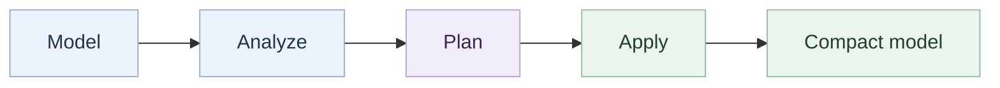

# Architecture

torch-kirigami separates dependency analysis, pruning decisions, and model changes.
A workflow combines these components with training, calibration, and task evaluation.
Use the [API reference](../api/index.md) for public signatures and the guides for usage examples.

## From a model to a compact model

The diagram shows the three main stages of pruning.
Analysis finds structural dependencies. Planning selects removals and checks them.
Application changes the model and returns a compact model.

Operator rules define structural effects during analysis. Metrics and strategies guide planning.
Planning checks the final selection. Only application replaces model tensors.

The caller discovers a `CandidateSpace` before automatic planning.
The space contains allowed removal proposals and the axes used for channel budgets.
Manual planning accepts exact tensor selections instead.
Both paths use the same dependency analysis and execution checks.

## Responsibilities

### Dependency analysis

`DependencyGraph.build()` captures the model's forward with PyTorch FX and example metadata.
Operator rules describe structural relationships between tensor coordinates.
Propagation adds all removals that those relationships require.
Constraints check the complete selection.
Requirements describe changes that execution must handle.

Analysis does not rank candidates or change weights.
An `Impact` reports the removals, constraints, requirements, and diagnostics.
A resolved impact does not guarantee an executable plan or unchanged model outputs.

The `torch_kirigami.dep_graph` package owns capture, coordinates, relations, constraints, operator semantics, and graph queries.
Construction and repeated queries have separate responsibilities:

| Component | Responsibility and lifetime |
| --- | --- |
| `_Analyzer` in `construction.py` | Collect original aliases, capture with FX, apply operator rules, and populate one `DependencyGraphState`. Release temporary value and alias tables on success or failure. |
| `DependencyGraphState` in `graph_state.py` | Own structural tables throughout construction and subsequent queries. It contains neither construction scratch tables nor solver caches. |
| `DependencySolver` in `solver.py` | Own relation and constraint indexes, bounded relation caches, and exact joint propagation for one graph. |
| `DependencyGraph` in `dependency_graph.py` | Accept complete records. Provide public queries, inspection copies, model freshness checks, and invalidation. |

`DependencyGraph.build()` is the public construction entry.
The other components import shared records without importing the public graph.
The analyzer creates one `DependencyGraphState` and returns that same object after construction.
It releases temporary tables on success or failure and cannot run again.

Public queries expose tuples, read-only views, or inspection copies.
The state references the original model and records structural resource settings.
It is neither a weight backup nor a checkpoint.

`Operation` describes one captured call and supplies its inputs to a rule.
`OperatorRule` defines reusable operator semantics.
`OperatorSpec` contains the structural facts that the rule returns for that call.
`AttributeBinding` uses `ShapeExpr` to describe structural attributes.
`TensorEffects` uses `ArgumentRef` to identify input writes.
The [operator guide](../reference/operator-support.md#rule-contract) shows how these records connect.

`operator_recipes.py` defines static records for physical edits.
Dependency analysis can import these records without importing the pruning executor.

Within this package, `selection.py` defines coordinates, region unions, and region
shape/gather operations. `relations.py` defines index mappings. `contracts.py` defines constraints
and analysis results. `operation.py`, `registry.py`, and `operators/` define and
register operation semantics. Pruning and sparsity consume these contracts.

`eligibility.py` checks native records, including nested fields, before an optimization reuses structural computations.
Propagation and planning share this check.
The same module checks model accessors, captured arguments, and registrations before graph queries share freshness validation.
`DependencyGraph` owns the validation scope, including entry, exit, and exception handling.
Extensions that fail this optimization check still use ordinary analysis.
The helper does not import the solver or pruning code.

`settings.py` exports one process-global `config` for resource limits, scoring batches, and cache bounds.
Library operations read settings when work starts.
Do not change settings during an operation.
See [global configuration](../guides/pruning.md#global-resource-configuration) for validation and invalidation rules.

Package initialization in `dep_graph/__init__.py` performs no eager imports.
Internal consumers import concrete submodules. Public imports such as
`from torch_kirigami import DependencyGraph, Selection` remain available from the
root package. Shared model binding and configuration utilities remain outside
`dep_graph` because capture, physical execution, and persistence all use them.

Each build copies its operator registry tables.
There is no global registration singleton.
Rule instances and original model objects retain their identities.
Read-only record containers do not make those objects immutable.

### Pruning policy and planning

A `Metric` returns importance scores for candidates.
A `Strategy` chooses candidates under a budget.
`Pruner.plan()` checks the strategy's final choice independently.
It returns a `PruningPlan` only when dependencies, execution checks, and the budget pass.

`Greedy` ranks candidates once during a planning call.
`DynamicGreedy` scores the remaining candidates after each accepted addition.
Neither strategy trains the model or collects calibration data.
The caller supplies gradients or activation statistics before planning when a metric needs them.

`CandidateFilter` shares native closure and constraint checks between filtering and parameter-group extraction.
Filtering uses irreversible conflicts. Raw group extraction requires complete influence and preserves complete constraint conflicts.

Planning analyzes many overlapping requests, so it reuses structural work. Every
reuse rests on an exact proof, never on an approximation:

- **Identity axes.** `IdentityAxisIndex` in `dep_graph/identity_axes.py` proves
  that two native axis selections imply each other, as when several residual
  producers feed one trunk channel. Their candidate keys, scores, and budget axes
  stay separate. Only the structural analysis is shared. The solver also uses it
  to combine `Divisible` factors on tied axes.
- **Candidate filtering and impact caching.** Consider an accepted request
  followed by one native axis slice. The solver seeds equivalent slices in a
  fixed order on tensors that have no earlier seed. A complete result can then
  serve another request with the same prefix and the same slice on any of those
  tensors. The caller receives an explanation rooted at its own slice. If the
  last tensor already has a seed, or the equivalence class repeats a tensor on
  different axes, the request uses its original key. All remaining relations
  and constraints are still checked. `GroupMagnitude` keeps the ordered
  accepted request in its normalization key because its population queries
  can involve compound seeds outside this proof.
- **Parameter groups.** Extraction returns one group per candidate in input
  order. Identical native requests reuse their parameter selections. The cache
  for equivalent single slices holds at most `impact_cache_size` entries and
  retains only parameter selections. `Pruner` also remembers its latest
  native filtered space to avoid filtering it again after a freshness check.
- **Scores.** Built-in magnitude metrics score equivalent requests together.
  The final order is still `(score, key)`, and `DynamicGreedy` still rescores after
  each accepted addition. `IndependentRanking` reuses single-position statistics
  only when `CandidateFilter` proves that the joint closure is complete, and
  computes conditional statistics only for the positions it proves. Scoring
  does not build the additional parameter positions as a `Selection`. It
  decomposes them into canonical boxes (`canonical_boxes`), which depend only on
  the selected coordinates. Scoring a complete closure needs no second
  bounded selection. Nonfinite weights or missing statistics still produce
  a scoring error. Each box is reduced on its own, so
  intersections count once and the reused scores are bitwise equal to ordinary
  scores. `gather_intervals` gathers the most selective axis first. Each
  `index_select` step allocates the gathered positions times the remaining
  full axes, so a temporary can exceed the box, for example a `[2, n]` slice
  for a `[2, 2]` box. `WeightTaylor` uses its per-axis statistics only when
  the canonical form is one box with a single partial axis. `GroupMagnitude`
  combines the seeds of a candidate as boxes too, so complete slices are
  recognized whatever the seed count. Scores do not depend on batching, so
  when a score batch raises `PlanningError` or `AnalysisLimitError`, the greedy
  strategies score each candidate alone and exclude only those that fail, for
  example the candidates of an axis whose normalization needs an unproved
  position. A batch error that no single candidate reproduces is raised.
- **Shared weights.** Components can share a tensor on different axes, such as
  the rows and columns of a ResNet `conv2.weight`. After removals on one axis,
  `CandidateFilter` proves the joint closure of the other component as the
  accepted closure plus the new slices on each member. Every relation adjacent
  to a member must map that state back into it, and each member tensor must keep
  its compactness and the complete cross-sections of its other axes. Rejections
  and completeness are then checked against that state, and `IndependentRanking`
  reduces the parts of each slice that the accepted closure does not remove.
  Any failed step uses ordinary propagation.
- **Analysis limits.** If incremental propagation exceeds its region limit,
  the solver can still prove a native compound request directly. It adds
  slices implied by the caller's seeds to the coordinates already reached,
  then checks that every adjacent relation maps back into the result. Every
  added coordinate is necessary, and the relation checks establish that the
  closure is complete. Constraints and execution checks still apply. If this
  proof fails, the request keeps its incomplete diagnostic. If the initial
  seeds themselves cannot be merged, direct queries raise `AnalysisLimitError`
  and automatic planning excludes the request.
- **Scoring proofs.** `complete_positions` checks the positions the score
  requires. For `GroupMagnitude`, this includes every surviving position in
  the normalization population. Extension relations use ordinary propagation;
  extension constraints receive the full closure.

A parameter budget limits the final parameter count.
A channel budget limits final logical widths.
These budgets share the same final-size comparison.
Their counting rules differ.

### Model changes and persistence

`Pruner.apply()` prepares replacement tensors before it changes model bindings.
It applies the plan to the original module hierarchy.
It returns that model and a `PruningResult` with parameter and coordinate maps.
Supported changes can update registered tensors and structural module attributes.

A plan stores a decision, not the weights used to score it.
A model checkpoint stores the final compact structure and values.
The caller supplies compatible model code when restoring a checkpoint.

### Training and measurement

The sparsity package supplies differentiable penalties, explicit gates, and parameter operations.
The caller owns the task loss, optimizer, training loop, and phase transitions.
Research workflows also own bias correction and weight reconstruction.
Save their corrected or reconstructed values in the final model checkpoint.

Sparse parameter operations separate preparation from commit and rollback.
An internal `_PreparedWrite` records each assignment's coordinates and copied values before and after the change.
Preparation completes before any assignment changes the model.
Preparation combines finite-value checks after conversion to each destination dtype.
Passing one existing union avoids reconstructing and validating another group.
Live reads and write preparation still check the complete snapshot.
Commit checks the snapshot again.
Regularizer calls still inspect the live graph and current parameter values.

Torch Prisma supplies parameter counts, theoretical FLOPs and MACs, and inference latency.
The pruning package uses its parameter counter for ratio-based parameter budgets.
The workflow adapter selects evaluation mode and restores each module's previous mode.
Measurement forward calls can change inputs, buffers, weights, and random-number state.
See the [measurement guide](../guides/measurement.md) for ownership and execution contracts.
Task accuracy requires separate evaluation with task data.
Fewer parameters or MACs do not guarantee lower latency or preserved accuracy.

## Object lifetimes

A dependency graph records structural assumptions from capture.
Changes to structure, module modes, tracked configuration, or guarded constants can invalidate it.
Ordinary weight updates can preserve the graph when those assumptions remain valid.

After physical pruning:

1. Build a new graph before another planning call.
2. Discover candidates and construct parameter groups from that graph.
3. Construct a new optimizer for the replacement parameters.

The library does not transfer optimizer state automatically.
A saved plan has no live graph binding.
It can apply the same coordinates to another model with compatible structure.

## Extension boundary

One `OperatorRule` defines structural facts, candidate axes, tensor effects, and any special edits for an operator family.
The dependency core does not import pruning policy or sparse-training algorithms.
The pruning layer consumes the dependency contracts.
Sparse-training components consume graph and pruning contracts.
Library modules do not import workflow examples.

Add a rule when an operation needs new structural semantics.
Add a metric when an algorithm needs a different score.
Add a strategy when an algorithm needs a different selection procedure.
A solver with exact selections can submit them through `plan_remove()`.

The [dependency guide](../reference/dependency-graph.md) defines analysis records and propagation.
The [pruning guide](../guides/pruning.md) defines planning and application contracts.
