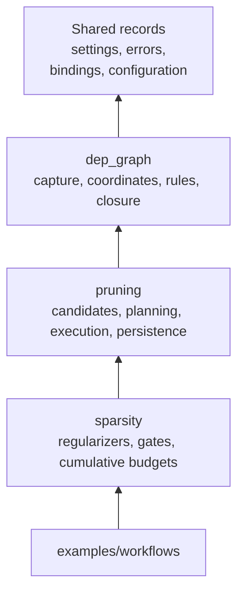
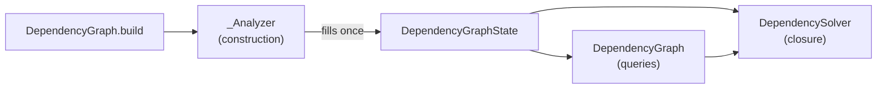

# Architecture

This page is for contributors. It describes how the package is layered, which
module owns which responsibility, and which internal optimizations exist and why
they are safe. The [core concepts](../concepts.md) page covers the same design
from a user's point of view.

## Package layers

Imports flow in one direction. Lower layers define shared records, and higher
layers consume them:

- `dep_graph` never imports pruning policy or sparse training.
- `pruning` consumes dependency contracts but owns no operator semantics.
- `sparsity` consumes graph and pruning records.
- Library modules never import workflow examples.

Shared records live below their consumers. `operator_recipes.py` builds on
`dep_graph.selection` and defines static edit records, so operator rules can
describe edits without importing the pruning executor. Model-binding and module-configuration helpers stay outside
`dep_graph`, because capture, execution, and persistence all use them. Do not
hide a reverse dependency with a local import or `TYPE_CHECKING`.

`dep_graph/__init__.py` performs no eager imports. Internal code imports concrete
submodules. Users import public names from `torch_kirigami`,
`torch_kirigami.pruning`, and `torch_kirigami.sparsity`.

## Dependency analysis

| Component | Responsibility |
| --- | --- |
| `capture.py` | FX tracing, input and buffer isolation, declared write effects, and the metadata run. |
| `_Analyzer` in `construction.py` | Collects aliases, runs capture, applies operator rules, and fills one `DependencyGraphState`. Releases its temporary tables on success or failure and cannot run twice. |
| `DependencyGraphState` in `graph_state.py` | Owns the structural tables for construction and later queries. Holds no scratch tables and no solver caches. |
| `DependencySolver` in `solver.py` | Owns relation and constraint indexes, bounded relation caches, and exact joint propagation for one graph. |
| `DependencyGraph` in `dependency_graph.py` | Public queries, inspection copies, freshness checks, and invalidation. |
| `selection.py`, `relations.py`, `contracts.py` | Coordinates and regions, index mappings, constraints and analysis results. |
| `operation.py`, `registry.py`, `operators/` | The rule contract, registration tables, and built-in rules. |
| `eligibility.py` | Checks that records are native before an optimization reuses structural work. |

Public queries return tuples, read-only views, or copies. The state references the
original model and records the structural settings. It is neither a weight backup
nor a checkpoint.

Each build copies the registry tables. There is no global registration singleton.
Rule instances and model objects keep their identities. Read-only containers do
not make the objects inside them immutable.

## Planning and execution

| Component | Responsibility |
| --- | --- |
| `Pruner` in `pruner.py` | The entry point. Discovers and filters candidates, extracts parameter groups, plans, and applies. |
| `candidates.py`, `candidate_checks.py` | Candidate spaces and the shared proofs that exclude irreversible requests. |
| `PlanningContext` in `planner.py` | The read-only services a strategy uses: impacts, scoring, budget measurement, and recipe compilation. |
| `metrics.py`, `strategies.py`, `ranking.py` | Built-in scores and selection, and exact reuse of `Magnitude` and `GroupMagnitude` scores. |
| `budget.py`, `granularity.py` | Final-size targets and their measurement, and alignment constraints. |
| `rewrite.py`, `recipes.py`, `validation.py`, `layouts.py` | Recipe compilation, coordinate and layout checks, and original-call validation. |
| `state.py`, `plan.py`, `serialization.py` | Structural preconditions, atomic binding updates, portable plans, and closed codecs. |
| `checkpoint.py` | Compact model checkpoints. |

`Pruner.plan()` checks a strategy's final selection independently of the
strategy. `Pruner.apply()` prepares every replacement tensor before it rebinds any
of them. Only `apply()` and `load_checkpoint()` change model structure.

### Structural reuse

Planning analyzes many overlapping requests, so it reuses structural work. Every
reuse rests on an exact proof, never on an approximation:

- **Identity axes.** `IdentityAxisIndex` in `dep_graph/identity_axes.py` proves
  that two native axis selections imply each other, as when several residual
  producers feed one trunk channel. Their candidate keys, scores, and budget axes
  stay separate. Only the structural analysis is shared. The solver also uses it
  to combine `Divisible` factors on tied axes.
- **Candidate filtering and impact caching.** Consider an accepted request
  followed by one native axis slice. The solver seeds equivalent slices in a
  fixed order on tensors that have no earlier seed. A complete result can then
  serve another request with the same prefix and the same slice on any of those
  tensors. The caller receives an explanation rooted at its own slice. If the
  last tensor already has a seed, or the equivalence class repeats a tensor on
  different axes, the request uses its original key. All remaining relations
  and constraints are still checked. `GroupMagnitude` keeps the ordered
  accepted request in its normalization key because its population queries
  can involve compound seeds outside this proof.
- **Parameter groups.** Extraction returns one group per candidate in input
  order. Identical native requests reuse their parameter selections. The cache
  for equivalent single slices holds at most `impact_cache_size` entries and
  retains only parameter selections. `Pruner` also remembers its latest
  native filtered space to avoid filtering it again after a freshness check.
- **Scores.** Built-in magnitude metrics score equivalent requests together.
  The final order is still `(score, key)`, and `DynamicGreedy` still rescores after
  each accepted addition. `IndependentRanking` reuses single-position statistics
  only when `CandidateFilter` proves that the joint closure is complete, and
  computes conditional statistics only for the positions it proves. Scoring
  does not build the additional parameter positions as a `Selection`. It
  decomposes them into canonical boxes (`canonical_boxes`), which depend only on
  the selected coordinates. Scoring a complete closure needs no second
  bounded selection. Nonfinite weights or missing statistics still produce
  a scoring error. Each box is reduced on its own, so
  intersections count once and the reused scores are bitwise equal to ordinary
  scores. `gather_intervals` gathers the most selective axis first. Each
  `index_select` step allocates the gathered positions times the remaining
  full axes, so a temporary can exceed the box, for example a `[2, n]` slice
  for a `[2, 2]` box. `WeightTaylor` uses its per-axis statistics only when
  the canonical form is one box with a single partial axis. `GroupMagnitude`
  combines the seeds of a candidate as boxes too, so complete slices are
  recognized whatever the seed count. Scores do not depend on batching, so
  when a score batch raises `PlanningError` or `AnalysisLimitError`, the greedy
  strategies score each candidate alone and exclude only those that fail, for
  example the candidates of an axis whose normalization needs an unproved
  position. A batch error that no single candidate reproduces is raised.
- **Shared weights.** Components can share a tensor on different axes, such as
  the rows and columns of a ResNet `conv2.weight`. After removals on one axis,
  `CandidateFilter` proves the joint closure of the other component as the
  accepted closure plus the new slices on each member. Every relation adjacent
  to a member must map that state back into it, and each member tensor must keep
  its compactness and the complete cross-sections of its other axes. Rejections
  and completeness are then checked against that state, and `IndependentRanking`
  reduces the parts of each slice that the accepted closure does not remove.
  Any failed step uses ordinary propagation.
- **Analysis limits.** If incremental propagation exceeds its region limit,
  the solver can still prove a native compound request directly. It adds
  slices implied by the caller's seeds to the coordinates already reached,
  then checks that every adjacent relation maps back into the result. Every
  added coordinate is necessary, and the relation checks establish that the
  closure is complete. Constraints and execution checks still apply. If this
  proof fails, the request keeps its incomplete diagnostic. If the initial
  seeds themselves cannot be merged, direct queries raise `AnalysisLimitError`
  and automatic planning excludes the request.
- **Scoring proofs.** `complete_positions` checks the positions the score
  requires. For `GroupMagnitude`, this includes every surviving position in
  the normalization population. Extension relations use ordinary propagation;
  extension constraints receive the full closure.

The planner caches structural results. Built-in metrics can also cache numerical
statistics, such as the normalization energies for `GroupMagnitude` and
per-axis Taylor sums. Their sizes come from
[configuration](../reference/configuration.md).

### Callback safety

The planner checks graph freshness around user callbacks. After selection it also
checks the identities, version counters, and `requires_grad` flags of tracked
tensors. A detected change raises an error. These checks cannot undo arbitrary
side effects of a callback.

`attempt()` counts joint verification calls, including cache hits. Scoring and
ordinary `impact()` queries are not counted. `max_trials` therefore bounds
structural attempts, not runtime.

## Sparse training

The sparsity package provides losses, gates, and parameter operations. The caller
owns the task loss, optimizer, training loop, and phase changes.

Parameter operations prepare every write before they change anything. An internal
`_PreparedWrite` records each assignment's coordinates and the values before and
after. Preparation checks that values stay finite after conversion to each
destination dtype. The commit step checks the snapshot again.

## Extension points

| To change | Extend |
| --- | --- |
| How an operation connects coordinates | An `OperatorRule`, described in [operator support](../reference/operator-support.md#write-an-operator-rule). |
| How candidates are scored | A metric with a `score()` method. |
| How candidates are chosen | A strategy with a `select()` method. |
| An externally solved selection | `Pruner.plan_remove()` with exact selections. |

One rule owns the structural facts, candidate axes, tensor effects, and special
edits of an operator family. The dependency core never learns about pruning
policy, and the pruning layer never learns about specific operators.
