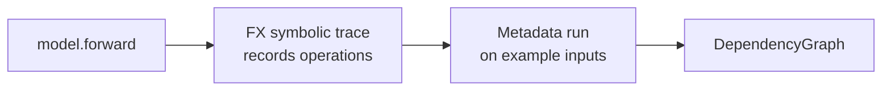
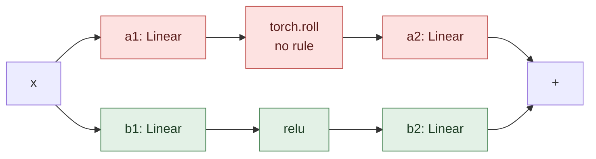

# Model support

Torch Kirigami does not support or reject model *families*. It supports a
specific forward call, captured with specific example inputs, and a specific
removal request on that call. A ResNet that uses only built-in operators may
prune cleanly, while a small custom module with a hardcoded reshape may reject
some requests. This page explains what capture can see, which side effects it
has, how failures are scoped, and how to adapt a model that does not fit.

## How capture works

`DependencyGraph.build(model, args=..., kwargs=...)` captures one call in two
passes:



1. **Symbolic tracing.** PyTorch FX runs `forward` with proxy objects and
   records each operation. Python code that does not touch a tensor runs
   normally and leaves no trace.
2. **Metadata execution.** The recorded graph runs on the example inputs to
   collect shapes, strides, dtypes, and small integer constants. The library
   does not keep activation tensors.

The example inputs supply metadata. They do **not** choose the branch of
data-dependent Python control flow. FX traces the code path that its proxies
take, and the example values do not influence that path.

### Python decisions that FX cannot see

A branch on a tensor *value*, such as `if x.sum() > 0:`, usually makes FX raise
an error, and `build()` reports it as `CaptureError`. Some Python tests do not
raise, because they run on the proxy object itself and produce an ordinary
Python value:

```python
def forward(self, x):
    if isinstance(x, torch.Tensor):  # False for an FX proxy
        return self.fast(x)
    return self.slow(x)
```

FX records the `slow` branch without warning, even though eager execution takes
`fast`. Tensor identity tests (`x is y`), type tests, and runtime-state tests
such as `x.grad is None` behave the same way. A successful build does not prove
that the model contains no such decision, and the library has no fallback that
detects them. Treat a model that makes such decisions in `forward` as outside
the supported contract, or move the decision out of `forward`.

### Side effects of building a graph

Capture is designed to leave the model as it found it, but it is not free of
side effects in every case.

- **Isolated.** Capture runs on copies of the example inputs and the registered
  buffers. Afterwards, it restores buffer bindings, module training flags, and
  the CPU and initialized CUDA random-number states. This happens on success
  and on failure. BatchNorm running statistics, for example, are not updated.
- **Not copied.** Parameters are not copied. An operation that would write to a
  parameter without a declaration makes capture fail before the write happens.
- **Declared parameter updates persist.** Some native operations update
  parameters by design. `nn.Embedding(max_norm=...)` and `F.embedding` with
  `max_norm` renormalize the weight rows that the example indexes. BatchNorm
  and InstanceNorm update their running statistics when the model stores them
  as parameters instead of buffers. Capture permits these declared updates, and
  it issues a Python warning before it runs them. The updated values stay in
  the original model, **even if capture later fails**. Existing gradients are
  kept and may be stale. Magnitude metrics read the updated weights.
  Recompute gradients before you use Taylor scores.

The warning uses Python's `warnings` module. If you turn it into an error, for
example with `warnings.simplefilter("error")`, capture stops before these
updates execute.

Do not use the model from another thread while the graph is being built.

### What capture rejects

`build()` raises `CaptureError` when it meets any of the following:

- Forward hooks, or unsupported global hook registrations.
- An unregistered call with unknown write effects that could reach a parameter
  or an unisolated constant.
- Undeclared parameter writes, Tensor attribute assignment or deletion, and
  inputs or buffers that share storage with parameters.
- Zero-element example tensors or results, unsupported tensor storage, and lazy
  negative views. Use `resolve_neg()` only if `forward` does not depend on the
  flag or on the original aliasing.
- Metadata values other than tensors, `None`, `bool`, `int`, `float`, `str`,
  `torch.dtype`, and `torch.device`, in plain tuples, lists, and dictionaries.

Positional and keyword arguments are bound with the signature of `forward`,
including default values.

## How failures are scoped

Unsupported behavior has different consequences at each stage:

| Stage | What happens | Scope |
| --- | --- | --- |
| Capture | `build()` raises `CaptureError`. | No graph for this call. |
| Analysis | An operation without semantics becomes a *barrier*. Its reasons appear in `graph.diagnostics`. No warning is emitted. | Only requests that reach the barrier are blocked. |
| Manual planning | `plan_remove()` raises `PlanningError` if any part of the request fails. | The whole request. Nothing is dropped silently. |
| Automatic planning | Failing candidates are skipped and listed in `selection_report.exclusions`. An unmet budget raises `PlanningError`. | Individual candidates, then the whole plan if the target is missed. |
| Application | `apply()` checks the model again and raises `ExecutionError` on a mismatch. | The plan. |

A barrier does not block only the one operation. An unknown operation might use
its input values as indices or sizes, so the barrier also covers the data that
feeds it. Shared parameters and residual additions can carry the barrier into
other branches. In the model below, `torch.roll` has no built-in rule. A request
on `a1` reaches it and its impact is incomplete. A request on `b1` stays
complete and can be pruned.



If the two branches added their hidden activations directly, the addition would
couple `a1` and `b1`, and the barrier would block both.

An incomplete impact never authorizes scoring or pruning. The planner does not
treat unknown influence as an empty selection.

## Layouts and views

Compaction can change strides. Convolutions, normalization, padding, and other
backend-dependent operations can return tensors whose compact strides are
unknown. The sample strides seen during capture do not prove the compact
strides, and the validator does not guess them from the device, dtype, or
backend.

When strides are unknown, a later `view` is accepted only if it works for every
legal input stride. Keeping the shape, inserting or removing singleton axes, and
splitting one axis into consecutive factors all qualify. Merging distinct
non-singleton axes does not. Use `reshape(...)` or `contiguous().view(...)` in
that case. Both operations establish a valid layout, but neither fixes a size or
coordinate mapping that is wrong after compaction. Copying can also change
aliasing behavior, so check that nothing relies on the view sharing storage.

## Shapes in Python code

The graph records how sizes reach reshape, view, and slice arguments. Use
`x.size(dim)` when Python needs one dimension that may shrink. Reading the
whole shape, for example `b, c, h, w = x.shape`, guards every dimension, because
the indexing happens outside FX. Hardcoded widths such as `x.view(b, 64, -1)`
block requests that would change that width.

## In-place operations

An in-place call is safe after compaction only if its writes cannot reach data
that another consumer still reads. The planner accepts a value-only write to a
fresh temporary tensor. It can follow calls that return their input unchanged,
so `conv → Identity → ReLU(inplace=True)` passes. An earlier consumer of the
same tensor, or an operation with uncertain storage sharing, prevents that
proof. Size reads and uses of the same tensor after the write still pass. When
the proof fails, the error names the value that the write can reach and, if
present, the earlier consumer.

## Adapting a model

Change the model, then build a new graph. You are responsible for making sure
the adapted model computes what you intend.

| Problem | Adaptation | Keep in mind |
| --- | --- | --- |
| A `view` merges axes without a layout proof. | Use `reshape(...)` or `contiguous().view(...)`. | Preserve shape and element order. Copies change aliasing. |
| A reshape size hardcodes a width that should shrink. | Use `size(dim)`, supported integer arithmetic, or `-1`. | Keep true algorithmic constants fixed. |
| Python reads the whole shape but needs one dimension. | Read `size(dim)` instead. | Any Python decision that uses the value must stay valid after pruning. |
| An in-place call has no alias proof. | Use the out-of-place form. | Nothing may depend on mutation through an alias. |
| Bracket indexing or `index_select` uses an unregistered index tensor. | Register it as a buffer. | Keep it one-dimensional with fixed values. See [bracket indexing](../reference/operator-support.md#bracket-indexing). |
| A hook implements part of `forward`. | Move the behavior into `forward` or into a module with a rule. | Preserve the computation and the gradients. |
| A third-party operation has no rule. | [Register a rule](../reference/operator-support.md#write-an-operator-rule). | The rule's author must prove its coordinates, effects, and lowering. |

## Rebuilding and saving

The graph checks the model structure, tensor identities and layouts, module
modes, recognized configuration, hooks, supported tensor references in plain
containers, and guarded structural constants. It does not hash ordinary weight
values, so training does not invalidate it. Rebuild after any structural change,
mode change, or change to a guarded constant.

A compact checkpoint restores the final structure, but the caller supplies the
model code. Tensor constants that the model keeps outside registered parameters
and buffers are not saved. See [plans and checkpoints](persistence.md).

## Limits of verification

Some behavior can escape the library's checks:

| Limit | What can happen | What you must ensure |
| --- | --- | --- |
| Python tests on proxies | Identity, type, or runtime-state tests choose a branch without a recorded node. | No such decision exists in `forward`. |
| Untracked Python state | Globals, closures, custom object internals, or callbacks change behavior outside the graph. | Structural state lives in modules, parameters, buffers, or plain containers. |
| Different inputs or context | Example metadata does not cover other shapes, layouts, AMP settings, or backends. | Rebuild when these execution assumptions change. |
| Extension rules | The library cannot prove that a custom rule is mathematically true. | Test the rule against an independent compact reference. |
| Concurrent mutation | Other threads or callbacks change the model during build, planning, or apply. | Nothing else mutates the model meanwhile. |
| Smaller domains | Normalization, softmax, attention, and reductions give different values after pruning. | Measure numerical and task-level effects separately. |
