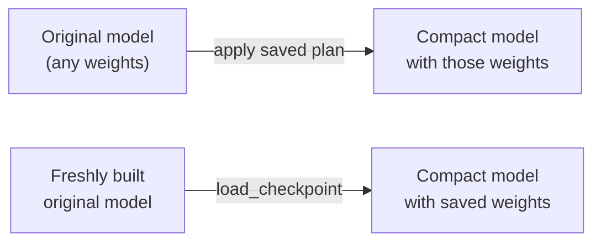

# Plans and checkpoints

There are two artifacts you can save, and they answer different questions:

- A **plan** answers "which coordinates should be removed from a model with this
  structure?" It stores a decision, not weights.
- A **model checkpoint** answers "what does the compact model look like, and what
  are its values?" It stores the final structure and weights, but not the code
  that builds the model.



| Artifact | Contains | Does not contain |
| --- | --- | --- |
| `PruningPlan` | Original-coordinate decision, tensor and attribute recipes, reports, and the expected structure before and after. | Weights, scores, model code, or a graph. |
| Model checkpoint | Final registered tensors, their aliasing, supported module configuration, and extra state. | Model code, the original structure, pruning history, or optimizer state. |
| Training state | Whatever your training loop saves. | Anything the library could check for completeness. |

## Save and replay a plan

A plan converts to basic Python data that `torch.load(weights_only=True)` accepts,
and it loads without importing the model class:

```python
import torch
from torch import nn

from torch_kirigami import DependencyGraph
from torch_kirigami.pruning import Pruner, PruningPlan


def make_model() -> nn.Sequential:
    return nn.Sequential(nn.Linear(8, 12), nn.ReLU(), nn.Linear(12, 4))


model = make_model()
graph = DependencyGraph.build(model, args=(torch.randn(2, 8),))
remove = graph.parameter("0.weight").axis(0).select([1, 3])
plan = Pruner(model, graph=graph).plan_remove([remove])
torch.save(plan.to_dict(), "decision.pt")

restored_plan = PruningPlan.from_dict(torch.load("decision.pt", weights_only=True))
other_model = make_model()
other_model, result = Pruner(other_model).apply(restored_plan)
```

`Pruner(model)` without a graph can only apply plans. `apply()` checks that the
receiving model matches the plan's recorded `before` structure, including module
configuration and guarded constants. A model that has already been pruned no
longer matches, so a nonempty plan cannot be applied to it twice.

Replay uses the receiving model's **current** weights. It does not restore the
weights that were scored, and it does not score again. Use a plan to repeat a
structural decision. Use a checkpoint to restore trained compact weights.

## Save and restore a model checkpoint

```python
from torch_kirigami.pruning import load_checkpoint, save_checkpoint

save_checkpoint(other_model, "compact.pt")
restored = load_checkpoint(make_model(), "compact.pt", map_location="cpu")
```

`save_checkpoint(model, path)` accepts both original and pruned models that
meet the registration and state requirements below.
`load_checkpoint(model, path, map_location=None)` takes a newly constructed
original model, gives it the saved compact shapes, attributes, and values, and
returns the same object. It needs no example input, graph, or operator registry.

You supply the model code. The factory must create the same module classes,
hierarchy, aliases, registered slots, and constructor configuration as the model
that was saved, including custom modules and inserted gates. The loader cannot
create missing modules or repair a different hierarchy.

### What the checkpoint stores

- Every registered parameter and buffer, persistent or not, with its final shape,
  layout, and `requires_grad` flag.
- Aliasing between registered tensors and between shared modules.
- Module configuration that the library manages, such as `in_features`, and
  module training flags.
- The values returned by `get_extra_state()`, as described below.

The format reads registered tensor slots directly. It does not call `state_dict()`
or `load_state_dict()`, and it rejects modules with registered state-dict hooks.
Tensor constants kept outside registered slots are checked as structural
preconditions, but their values are not saved. Create them in the factory, or
register them as buffers.

`map_location` accepts `None`, one device, or a dictionary from source to
destination devices. Per-storage callables are not supported. Device mapping
applies to saved tensors, including those in extra state, but not to constants
that the factory creates.

### Extra state

Modules can implement `get_extra_state()` and `set_extra_state()`. The getter runs
once per module, even if the module is shared, and must not change anything. Its
result must be a bounded, acyclic tree of basic values, plain containers, and
ordinary tensors that weights-only loading accepts. It cannot contain views into
registered tensors. Save an independent clone instead.

Setters run on isolated module shells before the loader commits. They may restore
ordinary attributes, but they must not change registered modules or tensors,
tensor values or layouts, buffer persistence, or hooks. The loader checks this.
It cannot roll back other side effects of a setter.

### What loading rejects

`load_checkpoint()` raises `ExecutionError`, and leaves the target's registered
state unchanged, when:

- the payload or format is invalid;
- the model does not match the saved hierarchy, configuration, or aliasing;
- a target tensor has gradient hooks (register them again after loading);
- the model uses custom tensor subclasses, distinct tensors that share storage,
  state-dict hooks, or layouts whose non-overlap cannot be proved.

Inference mode is disabled while the loader copies state, so restored parameters
take part in ordinary autograd.

## Training state is yours to save

A model checkpoint does not resume training. Save these items yourself when you
need to continue a run:

- optimizer and AMP gradient-scaler state, for an optimizer created on the
  restored parameters;
- epoch, step, and schedule positions (schedules themselves are stateless);
- `CumulativeChannelBudget.state_dict()` and `SelectionWindow.state_dict()`;
- algorithm state, such as selections, original group norms, decay progress, or
  stage flags;
- random-number generator and data-loader state.

Do not save graph-bound objects such as `AxisRef`, `ParameterGroup`, or
`GateBinding`. After restoring or pruning, build a new graph and new bindings.
`CumulativeChannelBudget.load_state_dict(state, graph, space)` checks the saved
state against the new graph before it changes anything.
