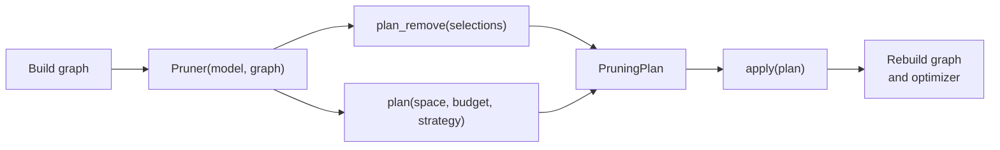
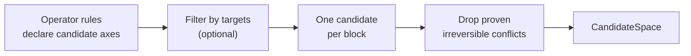
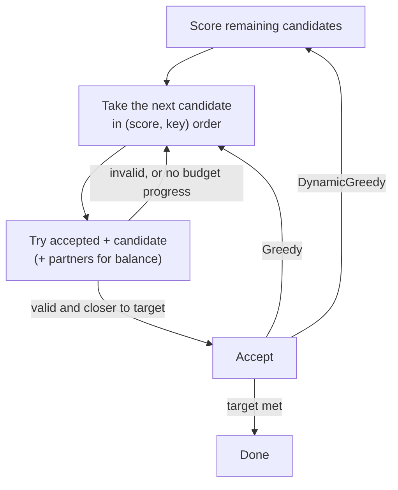
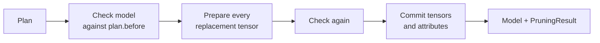

# Structural pruning

This guide covers the `Pruner` workflow in detail: manual requests, candidate
spaces, budgets, metrics, strategies, plans, and application. It assumes you have
read [core concepts](../concepts.md). The
[pruning API reference](../apidocs/torch_kirigami/torch_kirigami.pruning.pruner.md)
lists every argument.

## One pruning round



Each round needs a fresh `DependencyGraph` for the current model. `Pruner` takes
the model and its graph, and it holds the constraints shared by every query and
plan of that round:

```python
pruner = Pruner(
    model,
    graph=graph,
    preserve_io=True,  # default: protect every external input and output axis
    constraints=(),  # extra constraints, for example Fixed(axis)
    granularity=Granularity(),  # retained-width alignment, see below
)
```

With `preserve_io=True`, every axis of every model input and output gets a
`Fixed` constraint, so a plan cannot change the model's interface. Set it to
`False` only if you also control the code that produces the inputs and consumes
the outputs. Operator constraints, such as grouped-convolution balance, stay
active either way.

Planning never changes the model. `pruner.prune(space, budget=..., strategy=...)`
is a shortcut for `pruner.apply(pruner.plan(...))`.

## Manual requests

`plan_remove(selections)` plans exactly the original-coordinate selections you
pass, as one joint request:

```python
import torch
from torch import nn

from torch_kirigami import DependencyGraph
from torch_kirigami.pruning import Pruner

model = nn.Sequential(nn.Linear(8, 12), nn.ReLU(), nn.Linear(12, 4))
inputs = torch.randn(2, 8)
graph = DependencyGraph.build(model, args=(inputs,))
pruner = Pruner(model, graph=graph)

remove = graph.parameter("0.weight").axis(0).select([1, 3])
plan = pruner.plan_remove([remove])
model, result = pruner.apply(plan)
```

The planner never adds, drops, or replaces a seed. If the request is incomplete,
violates a constraint, or cannot be compiled into a safe edit, `plan_remove()`
raises `PlanningError`. If the seeds themselves cannot be merged within
`config.max_parts`, the direct request raises `AnalysisLimitError`. Use this
method when your own algorithm, such as a solver
or a reconstruction method, already knows the exact removal.

## Candidate spaces

Automatic planning chooses among the entries of a `CandidateSpace`:

- `candidates`: named `Candidate(key, remove, axis)` records. Each one is a batch
  of original-coordinate seeds that a strategy may accept or reject as a unit.
- `channel_axes`: the logical axes that channel budgets count. Their original
  widths form the budget's denominator.
- `excluded_channel_axes` and `exclusions`: diagnostics from discovery and
  filtering.

A candidate space is a menu of requests. It is not the set of every dependency
group in the model, and it keeps no reference to the model or graph.

### Discover default candidates



`pruner.discover_candidates(targets=None)` asks the captured operator rules which
axes they declare as candidate domains, and creates one candidate per block on
each axis. The built-in rules declare, among others:

| Module | Default candidate axis |
| --- | --- |
| `Linear` | Output features |
| Ordinary, grouped, and transposed convolution | Output channels |
| Depthwise convolution | One output block per input channel |
| `Embedding` | Embedding features |
| Native `MultiheadAttention` | Embedding features |

The full list is in [operator support](../reference/operator-support.md#default-candidate-axes).
Discovery does not enumerate every axis that can take part in dependency
propagation. A `Linear` input axis can still shrink when an upstream producer
loses a channel, but discovery does not offer it as a starting point. To prune
from another supported axis, build your own candidates or use `plan_remove()`.

`targets` restricts the *entry points* of discovery to modules whose path
matches one of the patterns. Matching uses Python's `fnmatchcase` on the full
module path, so `*` also matches dots: `blocks.*.mlp*` matches both
`blocks.0.mlp.0` and `blocks.0.mlp.2`. Use `blocks.*.mlp.0` to match only the
first one. Targets do not limit how far propagation reaches. A pattern that
matches no module with candidate axes raises `PlanningError`.

Discovery removes only candidates whose impact contains an **irreversible**
conflict, such as an axis protected by `Fixed`. For the example above, the
output features of the final layer are excluded because `preserve_io` protects
them. If every candidate of a domain is excluded, the axis moves to
`excluded_channel_axes` and does not count toward channel budgets. If only some
are excluded, the axis keeps its full original width as the denominator.

Discovery does **not** remove candidates that are merely unresolved, incomplete,
or in conflict for a reason that more removals could fix. A single output
channel of a grouped convolution leaves the groups unbalanced, but two
channels together can be valid. Removing such candidates would hide valid joint
choices.

### Build a custom space

Construct a `CandidateSpace` yourself when the default axes do not match your
policy:

```python
from torch_kirigami.pruning import Candidate, CandidateSpace

graph = DependencyGraph.build(model, args=(inputs,))
pruner = Pruner(model, graph=graph)
axis = graph.parameter("0.weight").axis(0)
candidates = tuple(
    Candidate(f"hidden:{position}", (axis.select([position]),), axis)
    for position in range(axis.tensor.shape[axis.dim])
)
space = pruner.filter_candidates(CandidateSpace(candidates, channel_axes=(axis,)))
```

A candidate's `axis` names the logical domain it belongs to. Metrics such as
`GroupMagnitude` use it for normalization. It does not turn the candidate into an
indivisible block. Relations and constraints decide what must be removed
together. All selections and axes must come from the graph given to `Pruner`.

`pruner.filter_candidates(space)` applies the same irreversible-conflict filter
to a custom space and records rejected keys in `exclusions`. It keeps the
candidate order and every explicit `channel_axes` entry, even if no candidate
remains on an axis. `plan()` runs this filter before it calls the strategy.

### Inspect candidates without planning

- `pruner.impact(candidates)` analyzes the candidates **jointly** and returns one
  `Impact`.
- `pruner.parameter_groups(candidates)` analyzes each candidate **separately**
  and returns one `ParameterGroup` per candidate, in order. It requires complete
  influence. A candidate that violates `Fixed` can still yield a group ready
  for a training penalty. To check whether you can physically remove its
  coordinates, use `plan_remove()`. See [sparse training](sparse-training.md#parameter-groups).

## Budgets

A budget is an upper bound on a final size. The planner measures the final joint
closure. It does not add per-candidate costs, so overlapping effects count once.

| Budget | Caps | Counted over |
| --- | --- | --- |
| `ParameterBudget(max_params)` | Final number of parameter elements. | All unique registered `nn.Parameter` objects in the model. |
| `ChannelRatio(ratio, scope="local")` | Final widths, computed as `floor(width * (1 - ratio))`. | `CandidateSpace.channel_axes`. |
| `ChannelCount(max_channels, channel_axes, scope="local")` | Final widths, given as integers. | The listed axes, which must match the space's `channel_axes` in order. |

Channel budgets and parameter budgets measure different things. In
`Linear(4, 8) → ReLU → Linear(8, 3)`, removing 2 of 8 hidden features is a 25%
channel reduction, but it reduces the parameter count from 67 to 51, which is
about 24%. In deeper models the two ratios can differ much more, because a
channel's parameter cost depends on its neighbors.

### Parameter budgets

`ParameterBudget` counts every element of every unique parameter, including
frozen and protected parameters. Buffers do not count. A shared parameter counts
once. `ParameterBudget.from_ratio(model, 0.3)` converts a reduction fraction of
the current model into an absolute cap. When you prune over several rounds,
compute absolute caps from the initial count yourself so that the ratio is not
applied to an already smaller model.

### Channel budgets

With `scope="local"`, every axis gets its own cap. With `scope="global"`, one cap
applies to the sum of widths, and individual axes can shrink by different
amounts. The ratio must be in `[0, 1)`. Its decimal value is used exactly, so
`ChannelRatio(0.29)` on width 100 gives a cap of 71, not 70.

The denominator is always the original width of each axis in `channel_axes`.
Removals count as complete axis positions in the joint closure. A removal that
shrinks two counted axes counts on both. `ChannelRatio` does not measure
parameters, MACs, latency, or accuracy.

### Unmet targets

If the strategy cannot bring every final size within its cap, planning raises
`PlanningError` and returns no plan. The model is unchanged. A strategy that
stops at its trial limit has not proven that the target is impossible. A cap
above the current size needs no removal. A cap of zero is accepted but is
usually impossible, because `NonEmpty` constraints keep at least one position
on every used axis.

## Retained-width alignment

`Granularity` requires retained widths to be multiples of a factor, for example
to match hardware tile sizes:

```python
from torch_kirigami.pruning import Granularity

graph = DependencyGraph.build(model, args=(inputs,))
alignment = Granularity(default=1, by_type={nn.Linear: 8}, by_path={"2": 1})
pruner = Pruner(model, graph=graph, granularity=alignment)
```

`by_type` matches exact module types. Subclasses do not match. `by_path` matches
exact module paths, and the empty string names the root module. It does not
accept wildcards or prefixes. A path override must name a captured module whose
rule declares candidate axes. When aliases of the same module receive different
factors, construction raises an error.

Alignment adds ordinary `Divisible` constraints to the axes declared by operator
rules. It applies to every request, including manual requests and unchanged
axes, so it can force more removals than the budget asks for. A width of 10 with
factor 4 must lose at least two positions. A factor of 1 adds nothing, and it
cannot cancel an operator's own constraints.

Because every used axis also keeps at least one position, an axis that retains
fewer positions than its factor cannot become aligned again. With factor 8, an
axis that keeps between 1 and 7 positions can only reach zero, which `NonEmpty`
rejects. Such a request is an irreversible `unreachable_alignment` conflict, so
discovery and strategies exclude candidates that would reach it. Axes tied by
identity relations, such as producer rows and consumer columns, share one
retained width. Their factors combine: factors 4 and 6 on the two sides of one
channel act as factor 12. Grouped convolutions, group normalization and
attention heads add balanced partitions to the same check. With three groups and
factor 8, each group must keep a multiple of 8 channels, so a request that leaves
three channels in one 16-channel group is also excluded before trials.

## Metrics

A metric scores candidates. The built-in greedy strategies try lower scores first.

| Metric | Score |
| --- | --- |
| `Magnitude(p=1)` | Sum of absolute values over the affected parameter regions. |
| `Magnitude(p=2)` | L2 norm of the affected parameter regions, treated as one vector. |
| `GroupMagnitude(p=1 or 2)` | Affected energy divided by the mean single-position energy on the candidate's axis. |
| `WeightTaylor("elementwise_abs")` | Sum of `abs(weight * grad)` over the affected regions. |
| `WeightTaylor("joint_abs")` | `abs` of the signed sum of `weight * grad` over the affected regions. |

The three metrics above use the same parameter regions: every parameter that the
candidate's dependency closure touches. These regions include biases,
normalization parameters, and parameters of custom operators. Buffers are
excluded, and shared parameters or overlapping regions count once. There is no
module filter.

### Magnitude

`Magnitude` concatenates all affected parameter values into one vector and takes
its L1 or L2 norm. For L2, it sums squares across all parameters and takes one
square root. It does **not** compute a norm per module and add the norms.

### GroupMagnitude

`GroupMagnitude` normalizes by the candidate's axis, so that axes with large
weights do not dominate a global ranking:

```text
energy(request) = sum(|value| ** p) over the request's affected parameter regions
score(candidate) = energy(candidate) / mean(energy(single position) for each position on candidate.axis)
```

Before any removal is accepted, the denominator uses every position on the axis,
including positions missing from the candidate space. After a step,
`DynamicGreedy` averages over the positions still present. Both numerator and
denominator then count only parameter coordinates that the new removal adds.
For initial energies `[2, 4, 6, 8]` the mean is 5. A candidate made of
positions 0 and 2, with disjoint effects, scores `(2 + 6) / 5 = 1.6`. The score
is not divided by the number of positions. For `p=2` there is no square root,
unlike `Magnitude(p=2)`. Each candidate must select complete slices of its
declared `axis`.

This metric is inspired by
[DepGraph (CVPR 2023), Section 3.3](https://arxiv.org/abs/2301.12900) and the
[Torch-Pruning implementation](https://github.com/VainF/Torch-Pruning/blob/master/torch_pruning/pruner/importance.py).
It uses mean normalization and region deduplication. It does not implement the
paper's sparse training or Top-N normalization, so it is not a reproduction of
that method.

### WeightTaylor

`WeightTaylor` reads the `.grad` that is already stored on each parameter. The
library never calls `backward()`. You choose the loss, its reduction, the
accumulation over batches, and the model mode, and under AMP you must unscale the
gradients before planning. Every affected parameter needs a dense, real gradient.
`joint_abs` lets positive and negative products cancel. That cancellation is
part of its definition.

### Scores are not accuracy guarantees

All built-in scores are heuristics. Parameter scales, activation statistics, and
interactions between layers affect how well a score predicts accuracy loss. Use
`targets`, a custom candidate space, or `Fixed` constraints to limit what can be
removed. These controls do not make a score more predictive.

### Write a custom metric

A metric is any object with this method:

```python
def score(self, context, candidates, *, accepted_impact) -> Sequence[float] | torch.Tensor: ...
```

It must return one finite real score per candidate, in order. A candidate's score
must not depend on which other candidates share its batch or on their order. To
score a joint removal, put several selections into one `Candidate`. When a batch
raises `PlanningError` or `AnalysisLimitError`, the built-in strategies score each candidate alone and
exclude only the ones that fail. If none fails alone, the batch error is raised.

`accepted_impact` is the complete closure of the removals that the strategy has
already accepted. Score only what the candidate adds *on top of* that closure.
Do not subtract two independent totals, because a joint request can affect
regions that neither part affects alone. `parameter_regions()` computes exactly
these additional regions:

```python
import math

import torch

from torch_kirigami.pruning import PlanningError, parameter_regions


class VectorMagnitude:
    """Score a candidate by the L1 norm of the one-dimensional parameters it removes."""

    def score(self, context, candidates, *, accepted_impact):
        values = {ref: tensor.detach() for ref, tensor in context.graph.tensor_bindings()}
        scores = []
        for candidate in candidates:
            regions = parameter_regions(context, candidate, accepted_impact=accepted_impact)
            vectors = [s for s in regions if len(s.tensor.shape) == 1]
            if not vectors:
                raise PlanningError(f"{candidate.key!r} removes no one-dimensional parameter")
            scores.append(
                math.fsum(
                    values[s.tensor][list(region.axes[0])].abs().sum(dtype=torch.float64).item()
                    for s in vectors
                    for region in s.regions
                )
            )
        return scores
```

Here, `parameter_regions()` returns one nonempty `Selection` per affected
parameter, in original coordinates. It raises `PlanningError` if the influence is
incomplete. Constructing the additional regions can also raise `AnalysisLimitError`
if their representation exceeds `max_parts`. Complete constraint violations
alone do not prevent extraction, because a strategy may
still repair them. The example raises when a candidate removes no vector
parameter, rather than scoring it as unimportant. The
[BN-guided workflow](https://github.com/ZaberKo/torch-kirigami/blob/main/examples/workflows/bn_guided_pruning.py)
uses the same pattern with explicit BatchNorm scales.

A metric owns any statistics it collects, and it must not change the model or
run training. Unknown influence must never be scored as zero importance.

## Strategies

A strategy chooses which candidate keys to accept. The library provides two
greedy strategies:



- `Greedy(metric, max_trials=10_000)` scores every candidate once, against an
  empty accepted set, and visits them in `(score, key)` order.
- `DynamicGreedy(metric, max_trials=10_000)` scores the remaining candidates
  again after every accepted step, against the new accepted closure.

Both strategies accept a step only if the joint request is complete, satisfies
its constraints, compiles into recipes, and lowers the unmet part of the budget.
When a candidate alone would leave a `Balanced` or `Divisible` constraint
unresolved, the strategy tries to add low-scoring partners in the same step. All
candidates of one step use scores from before that step.

`DynamicGreedy` rescoring happens on the same model. It does not physically
prune, retrain, or recollect gradients or activations between steps. Rescoring
costs more and does not guarantee better accuracy. Each rescan also checks
every remaining candidate against the new accepted set. Proofs that the change
does not affect can be reused from the candidate filter cache. See
[Scoring and caches](../reference/configuration.md#scoring-and-caches).

`max_trials` limits joint verification attempts, not score queries. When a
strategy reaches the limit before the target, planning raises `PlanningError`.

### Write a custom strategy

A strategy implements `select(context) -> StrategyResult`. The `PlanningContext`
fixes the graph, candidates, budget, and constraints for one call, and provides
queries:

| Query | Purpose |
| --- | --- |
| `impact(remove)` | Analyze a joint request. |
| `attempt(remove)` | Same as `impact`, and increments `trials`. Use it to count your own work. |
| `require_complete(impact)` | Raise `PlanningError` for incomplete influence. |
| `score(metric, candidates, accepted_impact=None)` | Validated scores. The default baseline is the empty request. |
| `compile(impact)` | Compile recipes without allocating weights. Raises `PlanningError` if execution is not supported. |
| `remaining(impact)`, `deficit(impact)`, `within_budget(impact)` | Measure the final sizes against the budget. Local excesses do not cancel. |
| `require_budget(impact)` | Raise `PlanningError` if a cap is missed. |

`StrategyResult(keys, stop_reason, exclusions)` lists accepted keys in order, a
stop reason (`target_reached`, `exhausted`, or `trial_limit`), and optional
reasons for rejected keys. The planner treats this result as a proposal. It
rejects unknown or duplicated keys, recomputes the final joint impact, compiles
it, and measures the budget itself. A strategy cannot declare that a target was
met.

The planner also checks that the strategy did not change the graph, tensor
bindings, version counters, or `requires_grad` flags. It raises an error if they
changed, but it cannot undo other side effects of user code.

## Plans

A `PruningPlan` is an immutable, portable record:

| Field | Content |
| --- | --- |
| `analysis` | The request, the propagated selections, and diagnostic reasons, in original coordinates. |
| `selected` | Accepted candidate keys. Empty for manual plans. |
| `selection_report` | `SelectionReport` for channel budgets, `ParameterReport` for parameter budgets: original sizes, caps, measured results, trials, and exclusions. |
| `recipes`, `attributes` | Tensor replacements and module attribute assignments. |
| `before`, `after` | The model structure that `apply()` expects and produces. |
| `notes` | Configuration notes and execution guidance. |

`plan.explain()` formats these fields for review. A plan contains no weights, no
model, no graph, and no scores. Training the model after planning does not change
which coordinates the plan removes. To decide again with new weights, build a new
graph and plan again. To save a plan, see [plans and checkpoints](persistence.md).

## Applying a plan



`apply(plan)` does not trace, score, or run `forward`. It validates the plan,
checks that the model still matches `plan.before`, prepares every replacement
tensor, checks again, and then commits tensors and attributes. If the commit
fails, it restores the bindings, attributes, and structural metadata that it
tracks. It cannot undo concurrent changes or side effects of other code.

The structure check covers module types, aliases, registered slots,
configuration, tensor shapes and layouts, and guarded constants. Weight values are
not part of it, so a plan can be applied to a compatible model whose weights have
changed since planning. The receiving model's current weights are used as they
are.

After application:

- The module object is the same, but each replaced parameter is a new
  `nn.Parameter`. `result.parameter_map` maps old parameters to new ones.
  `result.coordinate_maps` maps original regions to compact regions.
- Aliases of one registered parameter stay aliases. Distinct tensors that share
  storage are not supported when pruning must replace them.
- Gradient hooks are not transferred. `apply()` rejects a tensor with hooks that
  it needs to replace, so remove the hooks first and register them again on the
  new tensors.
- The graph is invalidated. Build a new graph and a new optimizer. Optimizer state
  is not migrated.

## Execution checks

A complete, resolved impact is necessary but not sufficient for physical pruning.
The forward code is not rewritten, so planning must prove that the original
`forward` still runs correctly on the compact tensors. It checks:

- tensor layouts and partitioned storage, such as grouped convolution weights;
- module attributes, such as `in_features`, and that shared modules receive
  consistent values;
- static call arguments, such as slice bounds, index tensors, and reshape sizes,
  which must still select the same original coordinates;
- view and stride requirements, which are treated conservatively when strides
  are unknown;
- shared bindings and storage aliases.

Any failure raises `PlanningError` with a diagnostic. `reshape`, `contiguous()`,
or a small change to the model sometimes makes a rejected request valid, but
these changes can also change behavior. See
[model support](model-support.md#adapting-a-model).

## Errors

| Error | Raised when |
| --- | --- |
| `PlanningError` | The request is incomplete, violates a constraint, has no verified recipe, or misses its budget. No plan is produced and the model is unchanged. |
| `AnalysisLimitError` | A direct request, such as `plan_remove()`, cannot merge its seeds within the selection limit. |
| `ExecutionError` | `apply()` received an invalid plan, the model does not match the plan's structure, a tensor to replace has hooks, or the commit failed. |
| `StaleGraphError` | The graph no longer matches the model, or it was invalidated by a previous `apply()`. |

If the model already meets the budget, a strategy can return an empty selection.
The planner still checks the empty request, constraints, and execution
requirements.
