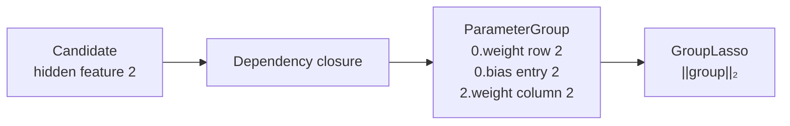
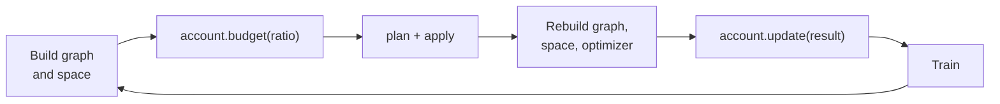

# Sparse training and iterative pruning

Many pruning methods train the model before or between pruning steps: they
penalize groups of weights, learn gates, push selected weights toward zero, or
prune a little in each round. `torch_kirigami.sparsity` supplies the building
blocks for these methods. It does not own a training loop.

| Component | The library provides | You decide |
| --- | --- | --- |
| `Pruner.parameter_groups`, `ParameterGroup`, `unique_groups` | The parameter regions that each candidate would remove. | Which candidates and parameters to penalize. |
| `GroupLasso`, `GroupSquaredL2`, `ScaleL1` | A scalar loss computed from current parameter values. | Task loss, loss weight, optimizer, and schedule. |
| `ChannelGate`, `GateBinding`, `GateMagnitude` | Explicit activation gates, their dependency links, and a gate score. | Where to insert gates and how to train them. |
| `scale_groups_`, `zero_groups_`, `set_group_norms_` | Validated in-place updates of selected regions. | When to apply them and how to handle the optimizer. |
| `CumulativeChannelBudget` | Per-round channel caps relative to the original widths. | The number of rounds and what happens between them. |
| Schedules, `selection_similarity`, `SelectionWindow` | Stateless schedules and selection-stability statistics. | Step counters, thresholds, and stage changes. |

The [workflow examples](https://github.com/ZaberKo/torch-kirigami/blob/main/examples/workflows/README.md)
combine these components with pretrained ImageNet models.

## Parameter groups

A *parameter group* is the set of parameter regions that one removal would
delete. For a hidden feature of an MLP, that is one row of the producer weight,
one bias entry, and one column of the consumer weight. Penalizing the group as a
whole pushes all of these values toward zero together.



### One group per candidate

`pruner.parameter_groups(candidates, parameter_filter=None)` analyzes every
candidate separately and returns one `ParameterGroup` per candidate, with the
candidate's key, in input order. For native candidates without a parameter
filter, repeated requests can reuse their parameter selections:

```python
import torch
from torch import nn

from torch_kirigami import DependencyGraph
from torch_kirigami.pruning import Pruner

model = nn.Sequential(nn.Linear(8, 12), nn.ReLU(), nn.Linear(12, 4))
x = torch.randn(2, 8)
graph = DependencyGraph.build(model, args=(x,))
pruner = Pruner(model, graph=graph)
space = pruner.discover_candidates()
groups = pruner.parameter_groups(space.candidates)
assert [group.key for group in groups] == [c.key for c in space.candidates]
```

Extraction requires complete influence and raises `PlanningError` for any
candidate whose impact is incomplete or whose group would be empty. It never
skips a candidate. A complete impact can violate a constraint and still yield a
group. Extraction does not compile execution recipes.

Use candidates that can actually be pruned. `discover_candidates()` already
excludes proven irreversible conflicts, such as protected outputs. For a custom
space, call `pruner.filter_candidates(space)` first. Do not remove every
candidate that is unresolved on its own, because several candidates can
satisfy a balance condition together. Extraction deliberately keeps any
candidate you pass, so that a training objective can include fixed structure
on purpose. Penalizing such a group does not make its removal legal.

`parameter_filter(ref, parameter)` receives each affected parameter's
`TensorRef` and live `nn.Parameter`. Return `True` to keep its regions in the
group. Buffers are always excluded. The filter changes only these groups. It does
not affect metric scores or which parameters physical pruning removes.

### Equivalent groups

Two different candidates can remove exactly the same parameters. For example,
removing producer row 2 and removing consumer column 2 have the same closure.
Extraction returns both groups, because each candidate has its own key.

`unique_groups(groups)` keeps the first group of each set of equivalent groups,
in input order. Groups are equivalent when they come from the same graph and
select the same parameter coordinates. Partially overlapping groups stay
separate. Call it when the objective should count each region set once, and
assign coefficients afterwards so that they align with the returned groups.

### Joint groups

`parameter_groups()` analyzes candidates one at a time. To penalize a joint
removal as one group, analyze it jointly and build the group yourself:

```python
from torch_kirigami.pruning import ParameterGroup

impact = pruner.impact(space.candidates[:2])
assert impact.complete and impact.parameters
joint = ParameterGroup(graph, impact.parameters)
```

The joint closure can contain regions that neither candidate reaches alone. One
joint group contributes one norm. Two separate groups contribute a sum of two
norms, which is a different objective.

### Live bindings

A group stores coordinates, not values. `group.bindings()` returns the current
`(Parameter, Selection)` pairs after checking that the graph is still valid.
Optimizer steps do not invalidate a group. A structural change, a replaced
parameter, or anything else that makes the graph stale does.

## Regularizers

Each regularizer returns a scalar tensor. Let `W_g` be the current values selected
by group `g`, and `a_g` its coefficient (default 1):

| Regularizer | Value |
| --- | --- |
| `GroupLasso(groups, coefficients=None)` | Sum of `a_g * norm(W_g, 2)` across groups |
| `GroupSquaredL2(groups, coefficients=None)` | Sum of `0.5 * a_g * norm(W_g, 2)**2` across groups |
| `ScaleL1(graph, parameters)` | Sum of absolute values of the listed one-dimensional parameters |

Within one group, every coordinate counts once. Across groups, there is **no**
deduplication, averaging, or size normalization: each supplied group adds its own
term. Passing the same group twice with coefficients 1 and 2 gives the same loss
as passing it once with coefficient 3.

`ScaleL1` takes parameter paths or `TensorRef` values, for example
`ScaleL1(graph, ("bn.weight",))` for a BatchNorm scale. This is the network
slimming penalty. `ScaleL1` does not decide which parameters are scales, and it
does not rank or prune anything.

A regularizer reads current values on every call, keeps the autograd connection,
and supports first-order gradients. It does not call `backward()`, change
parameters or gradients, or read optimizer state. Frozen parameters still count.
All groups must share one graph and one device, and the selected parameters must
be dense, real, floating-point, and finite. The result is float64 if any selected
parameter is float64, and float32 otherwise. Subclasses can override
`penalty(values)` to define a different per-group penalty.

### In a training loop

This step continues the example above:

```python
from torch_kirigami.pruning import unique_groups
from torch_kirigami.sparsity import GroupLasso

target = torch.randn(2, 4)
regularizer = GroupLasso(unique_groups(groups))
optimizer = torch.optim.AdamW(model.parameters(), lr=1e-3)

optimizer.zero_grad()
loss = nn.functional.mse_loss(model(x), target) + 1e-4 * regularizer()
loss.backward()
optimizer.step()
```

The regularizer is an ordinary loss term, so gradient accumulation, AMP, and
clipping work as usual. When you average over `N` micro-batches, scale the sparse
term the same way as the task loss so that it is not counted `N` times. Under AMP,
add the losses before scaling, and unscale before clipping.

For Taylor scores, collect task-only gradients in a separate pass, and choose the
model mode explicitly. Evaluation mode, for example, leaves BatchNorm statistics
unchanged.

## Activation gates

`ChannelGate(size, axis, trainable=True)` multiplies one activation axis by a
learnable scale and a fixed binary mask, `x * weight * mask`. Both start at one.

```python
from torch_kirigami import OperatorRegistry
from torch_kirigami.sparsity import ChannelGate, register_gate_operators

model = nn.Sequential(nn.Linear(8, 12), ChannelGate(12, axis=-1), nn.Linear(12, 4))
operators = register_gate_operators(OperatorRegistry.default())
graph = DependencyGraph.build(model, args=(x,), operators=operators)
```

Register the gate rule before you build the graph. The rule links the gate's
activation axis to its weight and mask, and updates the gate's `size` attribute
during compaction. A gate declares no candidate axis of its own. It shrinks when
a neighboring layer's candidate removes the gated positions.

- `set_mask(mask)` installs a binary mask. It does not shrink the model.
- `trainable=False` freezes the scale but keeps the module and its checkpoint
  structure.
- The library does not insert gates for you.

`GateBinding(graph, path).candidates(pruner, candidates)` returns the candidates
whose closure removes at least one weight of that gate. `GateMagnitude(bindings)`
scores a candidate by the sum of `abs(weight * mask)` over the gate positions it
newly removes, and raises for a candidate that removes no bound gate. With
`Greedy`, gates are scored once. With `DynamicGreedy`, they are scored again after
each accepted step. Neither strategy trains the gates during selection.

After pruning, the retained gates keep their learned values. Restore a
checkpoint into a model factory that places the same gates.

## Parameter operations

These functions modify selected parameter values in place under `torch.no_grad()`.
Call them outside a forward or backward pass, usually right after
`optimizer.step()`.

| Function | Effect |
| --- | --- |
| `scale_groups_(groups, factor)` | Multiply the union of the groups once by a finite, nonnegative factor. |
| `zero_groups_(groups)` | Set the union to zero. No mask is kept. |
| `set_group_norms_(groups, targets)` | Rescale each group to a target L2 norm. Groups must be disjoint, unless equivalent groups share the same target. |

Scaling and zeroing apply to the union once, so overlapping regions are not
changed twice. A zero vector cannot be given a positive norm, because it has no
direction.

Each operation validates and prepares every value before it writes, and restores
the original values if a write fails. Gradients and optimizer state are not
touched. Momentum can therefore regrow zeroed weights. Apply the operation again
after each step, or use a mask, if zeros must stay. Distinct tensors that share
storage are rejected when an update could reach both.

## Iterative pruning with cumulative budgets

Pruning `ChannelRatio(0.2)` three times does not remove 60% of the original
channels. Each round applies the ratio to the current, already smaller width and
rounds again. `CumulativeChannelBudget` keeps the original widths and turns a
cumulative ratio into absolute caps for each round:



For original width `W` and cumulative ratio `r`, the cap is `floor((1 - r) * W)`.
With `scope="global"` the cap applies to the sum of the original widths. If an
earlier round already met the cap, the next round removes nothing more.

```python
import torch
from torch import nn

from torch_kirigami import DependencyGraph
from torch_kirigami.pruning import CandidateSpace, Greedy, GroupMagnitude, Pruner
from torch_kirigami.sparsity import CumulativeChannelBudget

model = nn.Sequential(nn.Conv2d(3, 8, 1), nn.ReLU(), nn.Conv2d(8, 4, 1))
x = torch.randn(1, 3, 8, 8)
graph = DependencyGraph.build(model, args=(x,))
pruner = Pruner(model, graph=graph)
space = pruner.discover_candidates()
account = CumulativeChannelBudget(graph, space, scope="local")

for ratio in (0.1, 0.2, 0.3):
    budget = account.budget(graph, space, ratio)
    round_space = CandidateSpace(space.candidates, budget.channel_axes)
    plan = pruner.plan(round_space, budget=budget, strategy=Greedy(GroupMagnitude()))
    model, result = pruner.apply(plan)
    graph = DependencyGraph.build(model, args=(x,))
    pruner = Pruner(model, graph=graph)
    space = pruner.discover_candidates()
    account.update(result, graph, space)
    # Train here, with a new optimizer.
```

Only successfully applied plans count. A failed plan leaves the accounting
unchanged. The budget requires candidate axes on named parameters, and it checks
at every step that the rebuilt graph describes the same domains and the expected
widths. A domain whose last candidates become blocked keeps its original
denominator through the rebuilt space's `excluded_channel_axes`. Custom candidate
spaces must recreate the same logical domains on each new graph.

`state_dict()` and `load_state_dict(state, graph, space)` save and restore the
accounting. Loading validates the state against a fresh graph and space before it
changes anything.

## Schedules and selection stability

Schedules are stateless functions of a step that you supply:

| Schedule | Value at `step` |
| --- | --- |
| `Constant(value)` | Always `value`. |
| `Linear(start, end, finish, *, begin=0)` | Linear interpolation from `begin` to `finish`, clamped outside that range. |
| `Polynomial(start, end, finish, begin=0, power=1.0)` | Polynomial interpolation with the given positive power, clamped. |
| `Piecewise(points)` | The value of the latest milestone at or before `step`. The first milestone must be step 0. |

`selection_similarity(left, right)` compares two selections given as mappings from
a stable domain name to retained positions. It returns the mean, over domains, of
the Jaccard similarity of the retained sets. Each domain has equal weight,
whatever its width. `SelectionWindow(size)` averages the last `size` adjacent
comparisons. It returns `None` until it has `size + 1` selections. Call `reset()`
after physical pruning, because the coordinates change.

## Training state

A compact model checkpoint stores the model, not the training run. Save the rest
yourself at a step boundary:

- optimizer and AMP gradient-scaler state;
- epoch, step, and schedule positions;
- `CumulativeChannelBudget.state_dict()` and `SelectionWindow.state_dict()`;
- algorithm state such as current selections or original group norms;
- random-number generator and data-loader state.

Graph-bound objects such as `AxisRef`, `ParameterGroup`, and `GateBinding` belong
to one graph and cannot be saved for reuse. After restoring or pruning, build a
new graph and new bindings. See [plans and checkpoints](persistence.md).

## About the workflow examples

The ImageNet workflows combine these components to implement ideas from network
slimming, group sparsity, growing regularization, soft filter pruning, gate
decorators, and stability-driven search. Each workflow implements a selected part
of a paper, with its own candidate scope, scoring, and training schedule. None of
them claims to reproduce a paper's recipe or published accuracy. The
[workflow README](https://github.com/ZaberKo/torch-kirigami/blob/main/examples/workflows/README.md)
lists, for each entry, what it implements and what it omits.
