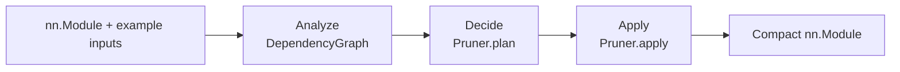

# Torch Kirigami

Torch Kirigami performs structured pruning on PyTorch models. It removes whole
channels, features, or attention heads together with every tensor slice that
depends on them, and then rewrites the original `nn.Module` so that the smaller
model runs without masks.

The library splits this work into three separate steps:



- **Analyze.** `DependencyGraph` captures one forward call with PyTorch FX and
  records which tensor coordinates are coupled. It answers "if I remove these
  positions, what else must go?" It never decides what to remove.
- **Decide.** `Pruner` turns a request, or a candidate set with a metric, a
  strategy, and a budget, into a `PruningPlan`. A plan is a static,
  checked decision. Planning does not change the model.
- **Apply.** `Pruner.apply()` executes a plan and physically replaces tensors
  and updates module attributes. This is the step that changes the model's
  structure.

You keep control of training, calibration data, gradients, and evaluation. The
library supplies dependency analysis, selection building blocks, and safe model
surgery.

## Where to start

- [Getting started](getting-started.md) prunes a small model by hand and with a
  policy, then trains, saves, and restores it.
- [Core concepts](concepts.md) explains coordinates, impacts, plans, and how
  failures are scoped.
- [Model support](guides/model-support.md) describes what FX capture can and
  cannot see, and how to adapt a model.

## Guides and reference

- [Structural pruning](guides/pruning.md): candidates, metrics, strategies,
  budgets, and plans.
- [Sparse training](guides/sparse-training.md): group penalties, gates,
  parameter operations, and cumulative budgets.
- [Plans and checkpoints](guides/persistence.md): what each artifact stores and
  how to restore it.
- [Measurement](guides/measurement.md): parameter, MAC, and latency measurement
  through Torch Prisma.
- [Dependency graph](reference/dependency-graph.md): selections, relations,
  constraints, and query results.
- [Operator support](reference/operator-support.md): built-in rules and how to
  write your own.
- [Configuration](reference/configuration.md): process-wide resource limits.
- [API reference](api/index.md): generated from source docstrings.

The [ImageNet workflow examples](https://github.com/ZaberKo/torch-kirigami/blob/main/examples/workflows/README.md)
combine these pieces with pretrained models. Each one documents how it differs
from the paper that inspired it.

```{toctree}
:caption: Start here
:maxdepth: 1
:hidden:

getting-started
concepts
guides/model-support
```

```{toctree}
:caption: User guides
:maxdepth: 1
:hidden:

guides/pruning
guides/sparse-training
guides/persistence
guides/measurement
```

```{toctree}
:caption: Reference
:maxdepth: 1
:hidden:

reference/dependency-graph
reference/operator-support
reference/configuration
api/index
```

```{toctree}
:caption: Development
:maxdepth: 1
:hidden:

development/architecture
development/index
development/verification
```
