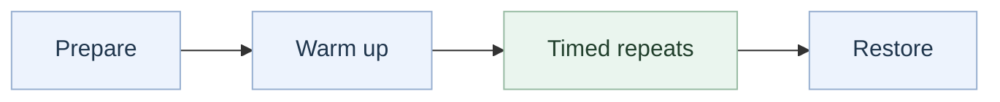

# Complexity and latency measurement

`torch_kirigami.measurement` measures an eager PyTorch model on CPU or CUDA. It reports registered parameter elements, multiply-accumulates (MACs), nominal FLOPs, and inference latency. It does not require a dependency graph and does not select a pruning policy.

The package exports its public API from `measurement/__init__.py`.
Its implementation uses four modules:

- `complexity.py`: parameter counts, operation counts, and coverage diagnostics.
- `formulas.py`: operation formulas, registration mappings, and counting conventions.
- `latency.py`: compilation, warmup, and timed inference.
- `execution.py`: shared input preparation, isolation, and state restoration.

Complexity and latency measurement both use execution preparation.
Complexity measurement also uses the formula declarations.
These imports form a one-way dependency graph.

## Basic use

`count_parameters(model)` needs no input and does not execute the model. It counts unique registered `Parameter` objects, including frozen and unused parameters. It excludes buffers. Distinct `Parameter` objects count separately even when they share storage. Zero weights and masks do not reduce the count. Physical tensor sizes determine parameter count.

For MACs and latency, pass the eager model and an example input:

```python
import torch
from torch import nn

from torch_kirigami.measurement import calculate_model_complexity, measure_module_latency

model = nn.Sequential(nn.Linear(8, 12), nn.ReLU(), nn.Linear(12, 4)).eval()
x = torch.randn(2, 8)
result = calculate_model_complexity(model, (x,))
latency_ms = measure_module_latency(model, (x,), warmup=5, repetitions=20)
print(result.params, result.macs, result.flops)
print(result.uncovered_ops)
print(f"Batch latency: {latency_ms:.3f} ms")
```

Both measurement functions accept one input or positional arguments as a tuple or list. Use `input_kwargs` for keyword arguments. They accept nested tensor containers. They preserve repeated input and container identities across positional and keyword arguments. Wrap a list in an outer positional-argument tuple when the model expects one list argument.

Device transfer preserves supported container types, including `torch.Size`, named tuples, and dictionaries with default factories. Containers whose contents need no transfer retain their isolated identity, including references shared with ordinary model attributes.

When the caller omits `device`, measurement uses the device of the first registered model tensor. A model with no tensors uses CPU. Move all parameters and buffers to the selected device before measurement. Measurement does not move the model. The API supports CPU and CUDA only.

Measurement isolates inputs from model execution and preserves repeated input identity. It supports storage-sharing views that already use the selected device. It rejects cross-device transfer of separate views because transfer would break their storage relationship. Move the shared base and recreate its views on the target device first.

## Parameter, MAC, and FLOP definitions

`calculate_model_complexity()` returns a `ModelComplexity` record.

| Field | Definition |
| --- | --- |
| `params` | Elements in unique registered Parameter objects, including frozen parameters |
| `macs` | Dense matrix and convolution MACs for the supplied batch and executed path |
| `flops` | Nominal arithmetic from native, local, and external registered formulas |
| `uncovered_ops` | Dictionary of operator names with incomplete or uncertain counting coverage, under `macs` and `flops` |

One dense MAC contributes two FLOPs in the convention used here.
Matrix products and convolutions contribute MACs, including the matrix products in attention.
Bias additions, normalization, activations, pooling, and elementwise work do not contribute MACs.
Zero weights, masks, causal attention masks, and kernel fusion do not reduce the dense theoretical MAC count.

FLOPs also include supported bias, elementwise, reduction, and normalization arithmetic.
The counter records dense MACs before adding this extra arithmetic.
It never divides the unrestricted FLOP total by two.
Each formula invocation must return a nonnegative Python integer before aggregation.
Invalid external formulas fail measurement, with execution state restored.
Coverage diagnostics match individual calls through profiler scopes.
A counted call does not establish coverage for another call with the same operator name.

`uncovered_ops` always contains `macs` and `flops` keys in measurement results.
Each value is a sorted tuple of unique operator names.
A name can occur under both keys. Repeated calls do not duplicate names.
A nonempty tuple means coverage is incomplete or unverified under that convention.
An empty tuple means the counter found no coverage issue.
These names describe measurement coverage, not pruning support or execution failure.
The dictionary is mutable. Its tuple values are immutable.
Known operations with no MAC work, such as normalization and pooling, do not cause MAC diagnostics.
An unimplemented FLOP formula can still cause a FLOP diagnostic.
Opaque work without profiler events remains outside both coverage checks.

For example, a Linear followed by GELU can report:

```python
{"macs": (), "flops": ("aten::gelu",)}
```

The matrix product contributes MACs. GELU contributes no matrix/convolution MACs, but its FLOP formula remains uncovered.
JSON serialization represents the tuples as arrays.

### Nominal arithmetic conventions

These counts describe a declared arithmetic algorithm, not instructions or latency.
They do not model compiler folding or implementation-specific reduction algorithms.

| Operation | FLOP convention |
| --- | --- |
| Add, subtract, multiply, divide | One per output element, including broadcast expansion. Nonunit add/sub scaling adds one multiplication per element. |
| `addcmul`, `addcdiv` | Two operations per output element. A nonunit value scale adds one multiplication per element. |
| Negation, abs, exp, log, sqrt, rsqrt, reciprocal, power | One per output element. Transcendental operations are nominal units, not hardware costs. |
| Sum over a nonempty group of K elements | K - 1 additions |
| Mean over a nonempty group of K elements | K - 1 additions and one division |
| Softmax over K elements | K subtractions, K exponentials, K - 1 additions, and K divisions |
| Log-softmax over K elements | 4K arithmetic operations, excluding maximum comparisons |
| LayerNorm and GroupNorm | Per group: 5K + 2 operations using centered variance and reused centered values. Each affine weight or bias adds K operations. |
| BatchNorm with stored statistics | Two operations per channel for epsilon/rsqrt, then two per input element. Each affine weight or bias adds one per element. |
| Fused matrix bias and scaling | Count the output addition when beta is nonzero. Count each nonunit, nonzero beta scale and each nonunit alpha scale separately. |
| Convolution bias | One addition per output element |
| Comparisons, ReLU, index selection, data movement | Zero floating-point arithmetic under this convention |

Training-statistic updates, pooling, GELU, and other unimplemented arithmetic remain explicit FLOP coverage gaps.
Fused attention formulas that count only QK and AV also retain a FLOP diagnostic.
Integer arithmetic does not contribute FLOPs.
Complex arithmetic has no general conversion to real scalar FLOPs and remains unverified.
External registered formulas can define another convention. Check those registrations before comparing environments.
Matrix formulas used for MAC conversion must retain the two-FLOPs-per-dense-MAC convention.

Coverage describes the observed execution path. It cannot establish the cost of opaque Python or native code that did not expose countable operations. Pass an eager module, not a compiled wrapper. Counting uses a math attention backend so fused attention does not hide its matrix work. Timing uses the normal attention backend.

Counting runs in eval mode with gradients disabled, outside inference mode.
It temporarily disables the public MHA fast path and selects math SDPA.
Both attention switches return to their previous settings after success or failure.
Do not change these process-wide switches concurrently with measurement.
Latency measurement retains the normal attention paths.

Local formulas supplement the native counter for dot products and matrix-vector products, including biased forms.
They do not change PyTorch's global formula registry.
Scalar scaling and bias additions contribute FLOPs but remain outside the MAC convention.
Equivalent in-place arithmetic and matrix forms reuse these formulas.
Safe softmax uses the same nominal arithmetic as softmax.
See the [operation audit](measurement-audit.md) for the enumerated surface, execution checks, and remaining boundaries.

Composite operations contribute through their exposed kernels.
For example, PyTorch simplifies a length-one einsum inner product into elementwise multiplication.
That implementation contributes zero MACs under this convention.
An explicit dot product contributes one MAC.
The counter does not reconstruct a representation-independent mathematical cost.
For FLOPs, that singleton multiplication contributes one operation.

## Latency definition

`measure_module_latency()` returns the median duration of one forward for the entire supplied batch, in milliseconds. `repetitions` must be a positive integer. `warmup` must be a nonnegative integer.

| Device | Timing method |
| --- | --- |
| CPU | `time.perf_counter()` around each forward |
| CUDA | Events on the selected device's current stream, with synchronization before and after measurement |

Input transfer, state isolation, compilation, the first compiled call, and warmup are outside the timed region. Compilation requires `compile=True`. `compile_kwargs` passes options such as `backend` and `mode` to `torch.compile`. Compilation errors propagate. Each call creates a wrapper for the supplied model. Measure the compact eager model again after pruning.



Preparation and warmup happen before timing. Preparation includes input transfer, state isolation, and requested compilation, including its first call. Restoration happens after timing.

Only timed forwards contribute to the reported latency. Each measurement covers the complete supplied batch. The result reports the median duration.

The result measures model execution. It does not include data loading or end-to-end application latency.

## State and interpretation

Both functions restore module training flags, registered buffer names and values, isolated inputs, and PyTorch random-number state after success or failure. Latency also restores the garbage collector's enabled state. Forward execution must not change parameter values. Measurement does not isolate arbitrary Python side effects. Do not train or mutate the same model concurrently.

The isolation covers registered buffers that the forward adds, removes, or replaces. It also covers buffer persistence flags and buffers whose value is `None`. Measurement restores those registrations after a failed forward as well as a successful one.

The input tree can share tensors with ordinary model attributes. Measurement isolates and temporarily rebinds those tensors with the inputs. Keep model-owned tensors and their shared inputs on the same device before measurement.

Compare a baseline and compact model with the same input shape, batch size, dtype, device, thread count, compilation options, warmup, and repetitions. MACs and latency cover the full supplied batch, so report the batch size. Lower parameter count or MACs do not guarantee lower latency. Kernel choice, shape alignment, launch overhead, and hardware use can affect latency.

The [workflow examples](../examples/workflows/README.md) report parameter counts, MACs, FLOPs, latency, and settings with validation accuracy. They report MAC and FLOP coverage gaps separately. They use a batch-one example for measurement. Validation loader batch size and training batch size are separate settings. Inspect the corresponding coverage gaps before interpreting a MAC or FLOP reduction.
