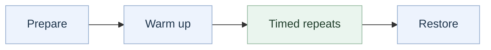

# Complexity and latency measurement

`torch_kirigami.measurement` measures an eager PyTorch model on CPU or CUDA. It reports registered parameter elements, multiply-accumulates (MACs), native counter FLOPs, and inference latency. It does not require a dependency graph and does not select a pruning policy.

## Basic use

`count_parameters(model)` needs no input and does not execute the model. It counts unique registered `Parameter` objects, including frozen and unused parameters. It excludes buffers. Distinct `Parameter` objects count separately even when they share storage. Zero weights and masks do not reduce the count. Physical tensor sizes determine parameter count.

For MACs and latency, pass the eager model and an example input:

```python
import torch
from torch import nn

from torch_kirigami.measurement import calculate_model_complexity, measure_module_latency

model = nn.Sequential(nn.Linear(8, 12), nn.ReLU(), nn.Linear(12, 4)).eval()
x = torch.randn(2, 8)
result = calculate_model_complexity(model, (x,))
latency_ms = measure_module_latency(model, (x,), warmup=5, repetitions=20)
print(result.params, result.macs, result.flops, result.unsupported_ops)
print(f"Batch latency: {latency_ms:.3f} ms")
```

Both measurement functions accept one input or positional arguments as a tuple or list. Use `input_kwargs` for keyword arguments. They accept nested tensor containers. They preserve repeated input and container identities across positional and keyword arguments. Wrap a list in an outer positional-argument tuple when the model expects one list argument.

When the caller omits `device`, measurement uses the device of the first registered model tensor. A model with no tensors uses CPU. Move all parameters and buffers to the selected device before measurement. Measurement does not move the model. The API supports CPU and CUDA only.

Measurement isolates inputs from model execution and preserves repeated input identity. It supports storage-sharing views that already use the selected device. It rejects cross-device transfer of separate views because transfer would break their storage relationship. Move the shared base and recreate its views on the target device first.

## Parameter, MAC, and FLOP definitions

`calculate_model_complexity()` returns a `ModelComplexity` record.

| Field | Definition |
| --- | --- |
| `params` | Elements in unique registered Parameter objects, including frozen parameters |
| `macs` | Dense matrix and convolution MACs for the supplied batch and executed path |
| `flops` | Native counter total for registered formulas. It is not a complete model FLOP count. |
| `unsupported_ops` | Observed operations whose MAC coverage could not be verified |

One MAC counts as two FLOPs in the convention used here. Matrix products and convolutions count, including the matrix products in attention. Bias additions, normalization, activations, pooling, and other elementwise work do not count. Zero weights, masks, causal attention masks, and kernel fusion do not reduce the dense theoretical count.

The counter can include formulas for operations beyond matrix products and convolutions. Those formulas can contribute to `flops` without contributing to `macs`. The implementation converts only audited matrix and convolution formulas into MACs. It does not divide the unrestricted FLOP total by two. Therefore `flops` can equal `2 * macs` for common models, but this equality is not guaranteed.

`unsupported_ops` describes MAC coverage only. A nonempty tuple means that complete MAC coverage could not be established. It does not prove that each listed operation omitted MACs. An empty tuple does not prove complete FLOP coverage. Known operations with no MAC work, such as ReLU and pooling, do not cause this warning.

Coverage describes the observed execution path. It cannot establish the cost of opaque Python or native code that did not expose countable operations. Pass an eager module, not a compiled wrapper. Counting uses a math attention backend so fused attention does not hide its matrix work. Timing uses the normal attention backend.

## Latency definition

`measure_module_latency()` returns the median duration of one forward for the entire supplied batch, in milliseconds. `repetitions` must be a positive integer. `warmup` must be a nonnegative integer.

| Device | Timing method |
| --- | --- |
| CPU | `time.perf_counter()` around each forward |
| CUDA | Events on the selected device's current stream, with synchronization before and after measurement |

Input transfer, state isolation, compilation, the first compiled call, and warmup are outside the timed region. Compilation requires `compile=True`. `compile_kwargs` passes options such as `backend` and `mode` to `torch.compile`. Compilation errors propagate. Each call creates a wrapper for the supplied model. Measure the compact eager model again after pruning.



Preparation and warmup happen before timing. Preparation includes input transfer, state isolation, and requested compilation, including its first call. Restoration happens after timing.

Only timed forwards contribute to the reported latency. Each measurement covers the complete supplied batch. The result reports the median duration.

The result measures model execution. It does not include data loading or end-to-end application latency.

## State and interpretation

Both functions restore module training flags, registered buffer names and values, isolated inputs, and PyTorch random-number state after success or failure. Latency also restores the garbage collector's enabled state. Forward execution must not modify parameter values. Measurement does not isolate arbitrary Python side effects. Do not train or mutate the same model concurrently.

The isolation covers registered buffers that the forward adds, removes, or replaces. It also covers buffer persistence flags and buffers whose value is `None`. Measurement restores those registrations after a failed forward as well as a successful one.

The input tree can share tensors with ordinary model attributes. Measurement isolates and temporarily rebinds those tensors with the inputs. Keep model-owned tensors and their shared inputs on the same device before measurement.

Compare a baseline and compact model with the same input shape, batch size, dtype, device, thread count, compilation options, warmup, and repetitions. MACs and latency cover the full supplied batch, so report the batch size. Lower parameter count or MACs do not guarantee lower latency. Kernel choice, shape alignment, launch overhead, and hardware use can affect latency.

The [workflow examples](../examples/workflows/README.md) report parameter counts, MACs, unsupported operations, latency, and settings with validation accuracy. They use a batch-one example for measurement. Validation loader batch size and training batch size are separate settings. Inspect unsupported operations before interpreting a MAC reduction.
