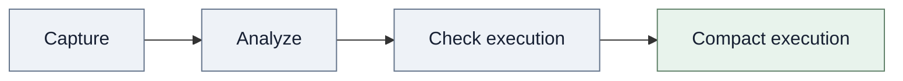

# Operator support and extension

Support applies to one captured call, its arguments, the requested axes, and the resulting compact execution. A rule may not support every overload or requested removal.

Rules match exact module classes, function objects, and Tensor method names. A custom subclass does not inherit a base module's rule. An opaque registration keeps a callable boundary where FX supports it. The rule author then owns that boundary's semantics.

## Support stages

A call can pass capture and still lack a structural rule. A rule can propagate coordinates while a constraint rejects the requested change. A valid dependency result can still lack a safe model edit.

Capture records the call. Analysis follows coordinate changes. Execution checks establish whether the library supports the proposed compact structure. See [dependency graph](dependency-graph.md) for shared records and [model support](model-support.md) for lifecycle limits.



Support applies to one captured call and one requested change. Passing one gate does not prove that later gates can accept the change.

## Built-in families

This table lists the main structural behavior and the primary boundary for each family. Exact registrations live in the built-in registry.

| Family | Structural behavior | Main boundary |
| --- | --- | --- |
| Linear | Module and functional input/output features, weight rows/columns, and bias. Functional rank-one weights have a supported rule. | Exact registered spelling. Original call arguments must remain valid. |
| Convolution | Conv and ConvTranspose 1D–3D, including ordinary, grouped, and depthwise channels. Partitioned weights compact by group and retain group order. | Spatial and kernel axes stay fixed. Group constraints apply. |
| Normalization | BatchNorm, LayerNorm, GroupNorm, InstanceNorm, RMSNorm, PReLU, and `normalize`. Affine parameters and statistics follow feature axes. | GroupNorm keeps its group count and balances retained channels. Normalization uses the compact domain. |
| Embedding | Feature width and downstream consumers. | Vocabulary rows stay fixed. Forward mutates weights when the caller sets `max_norm`. Capture rejects that option. |
| Pooling and interpolation | Batch/channel correspondence. Supported max-pooling values and indices remain paired. | Spatial coordinates stay fixed. |
| Padding | Coordinate correspondence on axes that padding does not change. | Padded or cropped axes stay fixed, even if output size matches input size. |
| Elementwise operations | Registered arithmetic, comparisons, activations, broadcasting, `where`, and `masked_fill`. | Exact registered spellings. Mutation and alias checks still apply. |
| Casts and storage calls | Coordinate correspondence for dtype/device conversion, clone, detach, and contiguous. | A call can alias input storage. View and copy behavior must satisfy alias checks. |
| Matrix operations | `matmul`, `mm`, `bmm`, `addmm`, and `baddbmm` map free, contracted, and broadcast batch axes. | Original ranks and call semantics must remain valid. |
| Einsum | Explicit equations with free and contracted labels, including supported ellipsis broadcasting. | Requires an explicit string output. Rules reject repeated labels inside an operand and do not support diagonal semantics. |
| Concatenation and partitioning | `cat`, `stack`, `split`, `chunk`, and `unbind` map offsets and captured ports. | Stack/unbind port counts stay fixed. Other call arguments must preserve retained coordinates. |
| Indexing | Static basic slices, `narrow`, and `index_select` coordinate maps. | Basic slices need positive steps. `index_select` needs a registered constant integer vector. The vector is not rewritten. |
| Shape transforms | Permute, transpose, reshape/view, flatten, squeeze/unsqueeze, and supported shape provenance. | Incompatible sizes, changed rank, or unproved view strides reject affected requests. |
| Repeat and expand | `repeat`, `tile`, `repeat_interleave`, `expand`, `expand_as`, and `broadcast_to` map repeated blocks or broadcast fibers. | Repeat factors must be positive static integers. `repeat_interleave` needs scalar repeats and an explicit axis. `expand_as` depends on the template shape. |
| Grouped coordinate transforms | GLU, ChannelShuffle, PixelShuffle/Unshuffle, and batched 2D Unfold/Fold. | Shuffle patterns must be compatible. Pixel and Unfold/Fold spatial or kernel positions stay fixed. |
| Reductions and softmax | Sum, mean, product, extrema, logsumexp, softmax, and log_softmax distinguish reduced from retained axes. | The operation recomputes on the compact domain. Position-index outputs are not generally covered. |
| Scaled dot-product attention | Q/K contractions, V width, batch/head broadcasting, masks, and supported grouped-query attention changes. | Head axes must be explicit. Causal Q/K token axes stay fixed. |
| Native `MultiheadAttention` | Packed or separate projections with balanced embedding-width changes. | Head count, batch/token axes, masks, and attention-weight axes stay fixed. The rule does not delete whole heads at unchanged external width. |
| `ChannelGate` extension | An explicitly registered activation axis, trainable scale, and fixed mask shrink together. | Call `register_gate_operators()`. Gates do not add a default budget domain. |

## Default candidate axes

Dependency rules and candidate discovery are separate contracts. The default registry declares candidate axes for these module types:

| Module | Default entry axis | Candidate unit |
| --- | --- | --- |
| `Linear` | Output features, weight axis 0 | One feature |
| Ordinary or grouped Conv1d/2d/3d | Output channels, weight axis 0 | One channel. A valid request may need a balanced group of candidates. |
| ConvTranspose1d/2d/3d | Logical output-channel axis | One channel, subject to group constraints |
| Depthwise convolution | Logical output-channel axis | One complete output block for an input channel |
| `Embedding` | Embedding width, weight axis 1 | One feature |
| Native `MultiheadAttention` | Embedding width, output-projection weight axis 0 | One feature. Fixed heads require balanced changes. |

Functional calls and most coordinate or normalization rules provide dependencies without a default candidate axis. For example, propagation from an upstream output can select Linear input axes. A custom rule can declare another axis with `CandidateAxis`.

Candidate size describes how discovery forms requests. Relations and constraints determine whether combined requests are valid. Native MHA does not generate whole-head deletion candidates. Grouped ConvTranspose uses the full logical output width as its budget domain, even though its physical weight dimension stores a per-group width.

## Attention domains

Native MHA width pruning and explicit-head attention pruning use different contracts.

Native MHA ties the output projection to query/output width and to packed or separate projections. It keeps the head count fixed and balances retained features across original head partitions. It does not delete internal heads while keeping external embedding width unchanged.

An explicit SDPA graph exposes head axes. Rules can describe full KV-group removal or valid changes to the query-head multiplier. With `is_causal=True`, Q/K token positions stay fixed because token deletion changes the implicit triangular mask. KV-cache maintenance is outside this library.

## Structural validity and numerical references

For a linear hidden channel followed by a compatible elementwise operation, a dense masked model can provide an independent reference for physical removal.

Place the mask where it represents contributions from every selected channel.

Normalization, softmax, reductions, and attention can recompute statistics or probabilities over a smaller domain. A dense masked output is generally not an equivalent reference. Use a compact reference model or a formula evaluated on retained coordinates.

Unknown operators and unsupported axes block requests that reach them. They do not invalidate every independent branch. Tensor-dependent Python control flow, dynamic index remapping, quantized or sparse storage compaction, RNN/PackedSequence, MoE routing, and optimizer-state migration have no general built-in support.

## Implementing an operator rule

Prefer a small declarative `OperatorSpec`. Reuse existing relations, constraints, requirements, candidate axes, and layouts. Keep third-party-specific definitions outside the dependency core.

This example registers a module that multiplies each input coordinate by a fixed scalar. The rule preserves coordinate identity and declares fresh output storage. It has no attributes or parameters to rewrite.

```python
import torch
from torch import fx, nn

from torch_kirigami import (
    CallEffects,
    DependencyGraph,
    OperationContext,
    OperatorRegistry,
    OperatorRule,
    OperatorSpec,
    ReshapeRelation,
)
from torch_kirigami.pruning import Pruner


class Half(nn.Module):
    def forward(self, input: torch.Tensor) -> torch.Tensor:
        return input * 0.5


def analyze_half(context: OperationContext) -> OperatorSpec:
    return OperatorSpec(
        relations=(
            ReshapeRelation(
                context.inputs[0], context.outputs[0], reason="same element coordinates"
            ),
        ),
    )


def half_effects(node: fx.Node, module: nn.Module | None) -> CallEffects:
    return CallEffects(fresh_output=True)


registry = OperatorRegistry.default()
registry.register(Half, OperatorRule(analyze_half, effects=half_effects))

model = nn.Sequential(nn.Linear(4, 8), Half(), nn.Linear(8, 2)).eval()
x = torch.randn(2, 4)
graph = DependencyGraph.build(model, args=(x,), operators=registry)
pruner = Pruner(model, graph=graph)
plan = pruner.plan_remove([graph.parameter("0.weight").axis(0).select([1, 5])])
pruner.apply(plan)
assert model[0].out_features == model[2].in_features == 6
assert model(x).shape == (2, 2)
```

This rule proves semantics only for `Half`. Equal input/output shapes do not prove coordinate independence, alias behavior, or reduction semantics for another operation.

### Rule contract

An `OperatorRule` can provide four callbacks or behaviors:

| Part | Contract |
| --- | --- |
| `preflight(node, module)` | Reject recognized unsafe calls before metadata execution. |
| `effects(node, module)` | Declare input mutation and fresh output storage before output metadata exists. |
| `analyze(context)` | Return pure structural facts in an `OperatorSpec`. |
| `lower(context)` | Optionally return declarative recipes. Return `None` to use shared compilation. Do not mutate the model. |

Native rules can opt into meta execution for compact-call validation. Third-party rules use declared output facts by default. A rule can cache a meta output only when that output is fresh, non-mutating, and depends only on argument metadata and captured module configuration.

An operator spec can include relations, constraints, requirements, candidates, partitioned layouts, an output contract, a shape expression, and registered integer constants. Register structural integer tensors as buffers so the graph can guard their values.

For a parameterized affine module, relate input features to weight columns and output features to weight rows and bias positions. Add a requirement when the module stores width in an attribute. Use scopes and `PartitionedLayout` for packed or grouped storage. Use a stable candidate key for a logical channel domain. Add a registered binding when repeated calls share that logical coordinate system.

Supply an alignment axis when a physical candidate axis uses partitioned packing and cannot determine retained logical width. The alignment axis must belong to the graph and match the seed's original width. Relations must couple both axes.

Implement custom lowering only when shared descriptors cannot express a required edit. Return declarative recipe records from the pruning package. Every activated requirement must be implemented or rejected. See [pruning](pruning.md) for physical lowering and plan behavior.

### Proof obligations

| Area | Rule author must establish |
| --- | --- |
| Coordinates | Relations map original positions in both directions, including complete blocks and broadcast fibers. |
| Constraints | Unsupported axes, balance, and nonempty conditions are explicit. |
| Effects | Reject recognized writes before execution. Match allocation declarations to actual storage behavior. |
| Shape provenance | Permitted argument changes use exact argument locations. Other semantic parameters remain unchanged. |
| Bindings | Parameters and buffers use registered references. Structural integer constants have value guards. |
| Lowering | Implement or reject every activated requirement. Preserve the original call semantics. |
| Persistence | A compatible model factory and the same extension definitions can restore the compact model. |

## Validation

Direct rule tests check coordinate mappings. They do not prove capture or physical execution. New built-in rules need independent expected-coordinate cases and family tests for meaningful alternatives and boundaries.

Cross-layer changes need public `DependencyGraph.build()` → `Pruner.plan()` → `Pruner.apply()` coverage, including post-pruning forward and backward behavior. Add save/load coverage when a rule adds persistent structure. Rejected requests must preserve parameter values, identities, attributes, and relevant state.
