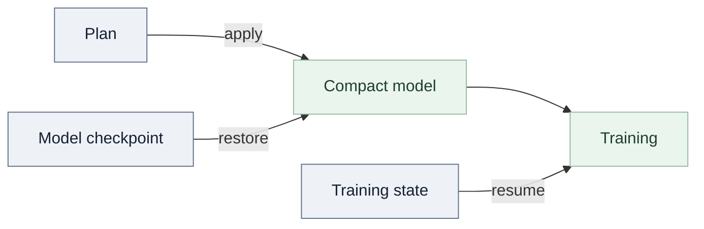

# Plans, model checkpoints, and training state

Plans apply a pruning decision. Model checkpoints restore saved model values. Training state restores the caller's progress.



Plan application uses the receiving model's current values. Checkpoint restoration uses the saved compact values. Neither artifact restores training progress. The caller restores training state separately, after creating an optimizer for the restored parameters.

| Artifact | Contains | Does not contain |
| --- | --- | --- |
| `PruningPlan` | Original-coordinate decision, recipes, reports, and before/after structure. | Weights, model code, graph, or scoring callbacks. |
| Model checkpoint | Final registered tensors, supported configuration, and aliases. | Constructor code, pruning history, optimizer, or training progress. |
| Training checkpoint | State selected by the training application. | An automatic guarantee that external state is complete. |

## Save and replay a plan

A plan can be serialized as basic data and loaded without importing the model class.

```python
import torch
from torch import nn

from torch_kirigami import DependencyGraph
from torch_kirigami.pruning import Pruner, PruningPlan


def make_model() -> nn.Sequential:
    return nn.Sequential(nn.Linear(8, 12), nn.ReLU(), nn.Linear(12, 4))


model = make_model()
graph = DependencyGraph.build(model, args=(torch.randn(2, 8),))
remove = graph.parameter("0.weight").axis(0).select([1, 3])
plan = Pruner(model, graph=graph).plan_remove((remove,))
torch.save(plan.to_dict(), "decision.pt")

portable = torch.load("decision.pt", weights_only=True)
restored_plan = PruningPlan.from_dict(portable)
other_model = make_model()
other_model, result = Pruner(other_model).apply(restored_plan)
```

The receiving model must match the plan's original structural preconditions, including supported configuration and guarded constants. Applying a nonempty plan to an already compact model normally fails those preconditions.

A plan records coordinates, not the weights used for scoring. Replay uses the receiving model's current values. It does not recompute importance or restore the scoring weights. Use a model checkpoint when you need the saved compact values.

## Save and restore a model checkpoint

```python
from torch_kirigami.pruning import load_checkpoint, save_checkpoint

save_checkpoint(other_model, "compact.pt")
restored = load_checkpoint(make_model(), "compact.pt", map_location="cpu")
```

`save_checkpoint(model, path)` accepts an ordinary, pruned, or restored module. `load_checkpoint(model, path, map_location=None)` modifies and returns the supplied module. It needs no example input, graph, operator registry, or pruning history.

The factory must create the original module classes and hierarchy. It must preserve module aliases, registered slots, and constructor configuration. Loading restores the final tensor shapes and library-managed structural attributes. It cannot create missing model code or repair a different module hierarchy.

The checkpoint stores parameters, persistent buffers, and nonpersistent registered buffers. It preserves registered aliases, supported layouts, parameter `requires_grad`, module sharing, and saved module configuration, including training flags. `map_location` accepts no value, a destination device, or a source-to-destination device map. The loader does not support per-storage callable mappings.

The checkpoint restores the final model structure. It does not save the original structure or the sequence of pruning rounds.
It does not store the example inputs used to capture a graph.
It does not store ordinary tensor constants that the model keeps outside registered slots.
Create those constants with compatible values and devices in the factory.

The format stores raw registered tensor slots. It does not call `state_dict`, `load_state_dict`, or their module overrides. The loader does not support registered state-dict hooks. It checks ordinary tensor constants as structural preconditions, but it does not save their values. Register a constant as a buffer when the checkpoint must own it.

## Extra state and transaction limits

Paired `get_extra_state` and `set_extra_state` methods can save ordinary application data. A shared module has one canonical entry. Its getter and setter run once. The getter must be read-only. Getter side effects are not rolled back.

Extra state must be a bounded, acyclic tree of supported basic values, plain containers, and ordinary tensors accepted by weights-only loading. It cannot contain references or views into registered tensor storage. Save a basic representation or an independent tensor clone. Rebuild application objects in `set_extra_state`.

Load checks the payload and prepares tensor replacements before it changes the destination model. Extra-state setters run on isolated module shells. They may restore ordinary data. They must preserve registered module and tensor bindings, tensor values and layouts, buffer persistence, and runtime hooks. Load checks these conditions before commit. Arbitrary external side effects from callbacks remain outside the transaction guarantee.

The loader disables inference mode while it reads and copies state. Restored parameters can participate in ordinary autograd.
Device mapping applies to serialized storages, including tensors in extra state. It does not move constants created by the factory.

Loading rejects target tensors with gradient hooks because replacement would discard those hooks. Register hooks on the restored tensors.
Pruning rejects hooks only on tensors it replaces.
The API does not support custom parameter or tensor subclasses.
It does not support distinct tensor objects that share storage.

It does not support registered state-dict hooks or layouts whose non-overlap it cannot prove.
The API supports aliases of the same ordinary Parameter or buffer.

Payload errors and factory mismatches raise `ExecutionError` before the loader commits ordinary registered state.
Checkpoint changes should include success and failure coverage for aliases, buffers, and saved values.
Round-trip checks should compare outputs and sharing relationships, not only tensor shapes.

## Training state is caller-owned

A model checkpoint restores a model. It does not resume sparse training. Save training state at a clear boundary outside an in-flight backward graph. Include the state required by the algorithm:

- Optimizer state and AMP gradient-scaler state.
- Epoch, optimizer-step, and schedule-position counters.
- `CumulativeChannelBudget.state_dict()` and `SelectionWindow.state_dict()` when used.
- Algorithm selections, original group norms, decay progress, and stage flags.
- RNG state and needed sampler or data-loader progress.

Pure schedules such as `Linear` and `Polynomial` do not track a step. Save their configuration and the caller's position. A parameter operation does not manage momentum. Save the optimizer policy used by the algorithm.

Do not use live `AxisRef`, `ParameterGroup`, or `GateBinding` objects instead of rebinding. Graph references belong to one graph snapshot. After restore or pruning, create fresh bindings and check saved component state against them. `CumulativeChannelBudget.load_state_dict(state, space)` checks the candidate domain and structure before changing state. `SelectionWindow.load_state_dict(state)` checks window compatibility and stored similarities. Reset the window when coordinates change.

Plan replay and checkpoint restoration have different value expectations. Plan replay uses the receiving model's current weights. Checkpoint loading restores saved values. Review both success and failure paths when changing these contracts.
