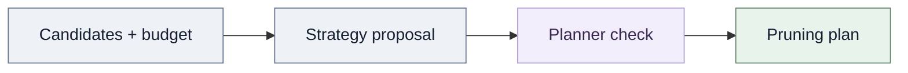
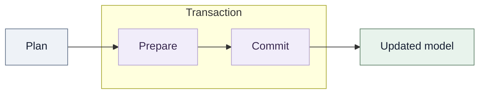

# Structural pruning

Structural pruning changes tensor shapes and module attributes in an existing PyTorch model. The graph finds coupled coordinates. A planner checks a joint removal and creates static recipes. Apply executes those recipes on the original module.

Read the [dependency graph guide](dependency-graph.md) for coordinate propagation and constraints. Read [operator support](operator-support.md) for registered rules and supported operations.

## Lifecycle and ownership

Build a fresh `DependencyGraph` for each pruning round. Pass the original model and graph to `Pruner`. Planning does not compact weights or mutate the model.

`plan_remove(remove)` plans the exact manual request. It does not add, remove, or replace seeds. An invalid request raises `PlanningError`.

`plan(space, budget=..., strategy=...)` selects from an explicit `CandidateSpace`. `prune(...)` calls `plan(...)` and then `apply(...)`. Neither method discovers candidates unless the caller first calls `discover_candidates()`.

`PruningPlan` stores portable analysis facts, selected keys, budget results, tensor recipes, attribute recipes, and before/after structure. It stores no model, live graph, scoring callback, or tensor values. `apply(plan)` checks the target model, prepares replacements, and then commits them. It returns the same module object. Replaced parameters are new `Parameter` objects.

After a nonempty apply, rebuild the graph, candidate space, and graph-bound groups. Recreate the optimizer. The optimizer still refers to old parameter objects. The library does not migrate optimizer state.



The strategy proposes candidate keys. The planner independently checks their joint effects, recipes, and final sizes against the budget. The strategy's proposal still requires this independent check.

Apply uses a transaction that separates preparation from commit.



Apply checks the plan and target before allocation. It prepares every replacement before it changes model bindings. If commit fails, it restores tracked bindings, attributes, and structural metadata. The transaction does not cover concurrent mutation or arbitrary callback side effects.

## Manual and automatic selection

This example removes two hidden features from a small model. The request uses coordinates from the fresh graph.

```python
import torch
from torch import nn

from torch_kirigami import DependencyGraph
from torch_kirigami.pruning import Pruner

model = nn.Sequential(nn.Linear(8, 12), nn.ReLU(), nn.Linear(12, 4))
inputs = torch.randn(2, 8)
graph = DependencyGraph.build(model, args=(inputs,))
pruner = Pruner(model, graph=graph)
remove = graph.parameter("0.weight").axis(0).select([1, 3])
plan = pruner.plan_remove((remove,))
model, result = pruner.apply(plan)
```

The default `preserve_io=True` protects every external input and output axis with `Fixed` constraints. Use `preserve_io=False` only when you control the resulting interfaces. Additional constraints apply to manual and automatic requests.

## Candidate space and discovery

### Default candidate entry axes

`discover_candidates(targets=None)` explicitly finds entry axes declared by captured operator rules. It does not enumerate every tensor axis.

Discovery performs these steps:

1. Read candidate domains from captured operator rules.
2. Optionally filter entry points by module path patterns in `targets`.
3. Deduplicate matching logical domains.
4. Exclude domains proved fully protected by external interfaces.
5. Create one candidate per declared block.

A target filters entry points. It does not limit dependency propagation or constraints. An unmatched pattern raises `PlanningError`.

Linear and ordinary convolution rules declare output-feature or output-channel axes. For `Linear(4, 6) → ReLU → Linear(6, 3)`, default discovery offers the six hidden features. With interface protection, it excludes the final three output features. Selecting one hidden feature also removes the matching consumer input column.

Distinct declared domains can have overlapping effects. Propagation finds those effects jointly. Use custom candidates or `plan_remove` to request another supported entry axis.

`CandidateSpace` contains explicit candidates, counted channel axes, and optional discovery exclusions. It retains no graph or model. Candidate order matches score order. Channel-axis order matches local budget order. Packaging candidates into blocks does not change the budget denominator.

`Candidate(key, remove, axis=None)` names one batch of original-coordinate seeds. Its `axis` describes a logical domain. It does not make the candidate an indivisible structural block. Relations and constraints define required coupling.

`Pruner.impact(candidates)` analyzes a joint candidate batch. `Pruner.parameter_groups(candidates)` extracts complete parameter regions for sparse training. Both methods require explicit candidates.

You can also construct a candidate space directly. Use this when the operator rules do not declare the entry axis that your policy needs.

```python
from torch_kirigami.pruning import Candidate, CandidateSpace

model = nn.Sequential(nn.Linear(8, 12), nn.ReLU(), nn.Linear(12, 4))
graph = DependencyGraph.build(model, args=(torch.randn(2, 8),))
pruner = Pruner(model, graph=graph)
axis = graph.parameter("0.weight").axis(0)
candidates = tuple(
    Candidate(f"hidden:{position}", (axis.select([position]),), axis)
    for position in range(axis.tensor.shape[axis.dim])
)
space = CandidateSpace(candidates, channel_axes=(axis,))
```

Explicit axes remain in the budget even when their candidates overlap or when a constraint protects an axis. A candidate's selections and axis must refer to tensors in the graph supplied to `Pruner`.

## Budgets

A budget is an upper bound on final size. The planner measures the final joint closure. It does not add independent candidate costs.

### Whole-model parameter budget

`ParameterBudget(max_params)` caps the final number of elements in unique registered parameters. Frozen and protected parameters count. Buffers do not count. A shared parameter counts once. Joint row and column removals count through the resulting tensor shape.

```python
from torch_kirigami.pruning import Greedy, Magnitude, ParameterBudget

plan = pruner.plan(
    space,
    budget=ParameterBudget(max_params=120),
    strategy=Greedy(Magnitude()),
)
```

Planning measures verified recipe shapes. It does not allocate compact weights. `ParameterBudget.from_ratio(model, pruning_ratio)` converts a whole-model reduction fraction into an absolute cap using the initial unique parameter count. The finite ratio must be in `[0, 1)`. Its decimal representation defines the rounded-down target. Reuse absolute caps from one initial count across multiple rounds.

### Logical channel budgets

`ChannelRatio(ratio, scope="local")` and `ChannelCount(max_channels, channel_axes, scope="local")` cap final widths on explicit logical axes.

| Budget | Local scope | Global scope |
| --- | --- | --- |
| `ChannelRatio` | One rounded-down final-width cap per axis. | One rounded-down cap on the sum of widths. |
| `ChannelCount` | One nonnegative cap per axis, in axis order. | One nonnegative cap on the sum of widths. |

The ratio must be finite and in `[0, 1)`. The supplied decimal value defines exact integer rounding. For example, a ratio of `0.29` and a width of 100 gives a cap of 71. A global budget adds no local caps.

The channel denominator uses the original widths in `CandidateSpace.channel_axes`. The planner counts actual removed positions in the joint closure. Overlapping effects count once on one axis. A removal that changes two counted axes contributes to both widths. Protected axes are not silently removed from an explicit denominator.

For local scope, `ChannelCount` needs one integer cap per axis. Its order must match `channel_axes`. For global scope, it needs one integer cap for the sum. `ChannelRatio` computes an equivalent integer cap from original widths. Ratios are not allowances that the planner subtracts from already-pruned widths.

A target above the current size needs no additional removal. A zero target can be structurally impossible. Empty dimensions remain invalid when a constraint requires them to be nonempty.

All automatic plans must meet their target. If search ends above the cap, planning raises `PlanningError` and returns no plan. The model remains unchanged. A trial limit or exhausted greedy search does not prove infeasibility. A channel `SelectionReport` records original widths, targets, actual removals, scope, trials, and exclusions. A parameter budget uses `ParameterReport` with exact before and after counts.

`ChannelRatio` measures channels. It does not measure parameters, MACs, latency, or accuracy. `ParameterBudget` measures parameters only. Hardware-dependent latency needs isolated measurements outside this planner.

## Retained-width alignment

`Granularity` adds ordinary `Divisible` constraints on widths declared by operator rules. It does not change candidate blocks, scores, or budget denominators.

```python
from torch_kirigami.pruning import Granularity

alignment = Granularity(
    default=1,
    by_type={nn.Conv2d: 8, nn.Linear: 8},
    by_path={"2": 1},
)
pruner = Pruner(model, graph=graph, granularity=alignment)
```

Factors must be positive integers. Type matching uses exact module types. Path matching uses exact original module paths. Paths do not support wildcards or prefixes. The empty path names the root module.

A path override must name a captured module whose rule declares candidate axes. An override on one alias configures the shared module object. Conflicting overrides on aliases raise an error. A factor of one adds no constraint and cannot cancel an operator constraint.

Alignment applies to changed and unchanged widths, including manual requests and protected axes. It can require more pruning than the budget requests. A width of 10 with factor 4 needs at least two removals. The final width is 8. Planning raises if it cannot both meet the budget and satisfy alignment.

## Scoring and strategy contracts

A metric implements `score(context, candidates, *, accepted_impact)`. It returns one finite real score per candidate. The planner prefers lower scores. Metric batches are a computation detail. A candidate's score must not depend on batch size, order, or other batch members. A single `Candidate` may contain multiple selections for a joint score.

`accepted_impact` is the complete dependency closure of accepted removal requests. It includes effects such as consumer input columns removed by producer output channels. Built-in metrics combine accepted seeds with the candidate seeds, then subtract parameter regions already removed. Do not subtract two total scores. Joint requests can activate effects absent from isolated requests.

| Metric | Score |
| --- | --- |
| `Magnitude(p=1)` | Sum of absolute values in affected parameter regions. |
| `Magnitude(p=2)` | L2 norm of affected parameter values, including the square root. |
| `GroupMagnitude(p=1 or 2)` | Affected recognized weight energy divided by mean single-position energy on the surviving declared axis. |
| `WeightTaylor("elementwise_abs")` | Sum of `abs(weight * gradient)` over affected parameter regions. |
| `WeightTaylor("joint_abs")` | Absolute value of the signed `weight * gradient` sum over the joint influence. |

`Magnitude` and `WeightTaylor` include bias and normalization parameters by default. Their `parameter_filter(ref, parameter)` can exclude parameters. `GroupMagnitude` includes recognized Linear, convolution, BatchNorm, and LayerNorm weights, including supported functional calls. It excludes bias and buffers. Its filter can further restrict those weights. The metric counts each affected region and shared parameter once.

`GroupMagnitude` requires each candidate to select complete slices of its declared axis. Its reference population contains every surviving position on that axis, even if the candidate space offers only a subset. Its score is a heuristic. It does not estimate task loss or guarantee accuracy. A nonzero joint score with a zero single-position baseline requires a custom metric.

`WeightTaylor` reads current real parameters and dense gradients. The caller owns loss reduction, accumulation, and AMP unscaling. The metric does not call `backward()` or estimate per-example Fisher information. `elementwise_abs` sums absolute products. `joint_abs` applies the absolute value after summing signed products, so cancellation is part of its definition.

Incomplete influence raises an error. The metric does not treat unsupported regions as having zero importance. Metrics and strategies must not mutate the model or fixed planning constraints.

## Static and dynamic greedy search

`Greedy(metric, max_trials=10_000)` computes scores once against the empty request. It visits candidates by `(score, key)` order. It accepts only complete joint requests that satisfy constraints, compile into executable recipes, and lower the unmet budget deficit.

`DynamicGreedy(metric, max_trials=10_000)` uses the same checks. It rescores unselected candidates after each accepted complete commitment. It scores against the accepted joint impact. It does not physically compact or recalibrate the model during planning. Dynamic rescoring can cost more and does not guarantee better accuracy.

For built-in `GroupMagnitude`, proved independent axis components use batched weight
statistics on the parameters' devices. Dynamic selection recomputes normalization
over the surviving positions after each commitment. Ordinary convolution scopes
that cover an entire tensor qualify; partial group partitions do not. Nested
extension objects in mappings, constraints, or candidate selections use ordinary
analysis and scoring. A failed optimization proof does not make the model
unsupported. Every accepted combination still requires joint execution checks.

A commitment can contain several candidates to satisfy a grouping constraint. Their scores come from before that full commitment. A candidate's score does not need to predict whether its joint combination is valid. The strategy checks the combination before acceptance.

The trial limit bounds joint verification attempts. Score queries and projected checks do not count. A limit reached before the target causes `PlanningError`, not a partial plan. `StrategyResult` contains selected candidate keys, a stop reason, and optional exclusions. The planner independently checks keys, final budget, recipes, and execution requirements. A strategy cannot assert that a budget is met.

The planner passes a `PlanningContext` to the strategy. It exposes the fixed graph, candidates, budget, channel axes, and constraints. It also provides impact, score, compile, budget, and report queries. Ordinary callers receive it through `Strategy.select(context)`.

### PlanningContext queries

The context fixes the graph snapshot and policy inputs for one planning round. A strategy must not change those premises.

| Query | Contract |
| --- | --- |
| `impact(remove)` | Analyze the joint original-coordinate selections. |
| `attempt(remove)` | Analyze one trial and increment the trial counter. |
| `require_complete(impact)` | Reject an influence range that the graph cannot fully determine. |
| `score(metric, candidates, accepted_impact=None)` | Return aligned finite scores. The default baseline is the empty request. |
| `remaining(impact)` | Measure final resource sizes in budget order. |
| `deficit(impact)` | Measure the remaining reduction needed. Local excesses do not cancel. |
| `within_budget(impact)` | Check every final-size cap. |
| `require_budget(impact)` | Raise `PlanningError` when a final cap is not met. |
| `compile(impact)` | Check tensor and attribute recipes without allocating compact weights. |
| `report(impact, result)` | Build a report from measured sizes and strategy diagnostics. |

`attempt()` counts joint verification calls, including cache hits. Scoring and ordinary `impact()` queries do not count. A strategy's `max_trials` therefore limits structural attempts, not total runtime or metric work.

The planner checks graph freshness around user callbacks. It also checks tracked tensor identities, version counters, and `requires_grad` flags after selection. A detected change raises an error. These checks do not undo arbitrary callback side effects.

### Custom metrics

A custom metric can use the `MetricContext` protocol. It provides the graph and the impact queries needed to score candidates. A metric does not need to import `PlanningContext`.

Use `context.impact((*accepted_impact.requested, *candidate.remove))` to analyze the full conditional request. Then subtract the accepted parameter regions from the candidate's parameter influence. The built-in metrics follow this rule.

The score result must contain exactly one value per candidate. Values must be finite real numbers. A tensor result must be one-dimensional and real. The planner checks the result after every call.

Metrics own any statistics that they collect. They must not run training or change model values. Calibration data, loss reduction, and gradient scaling remain caller responsibilities.

An extension metric can define a different relevance score. It must still use complete influence. It must document whether it includes bias, buffers, or shared roles. It must also state how it treats accepted removals and batch independence.

### Strategy results and reports

`StrategyResult.keys` contains distinct registered candidate keys in accepted order. The planner rejects unknown keys and duplicate keys. A key cannot appear in both `keys` and `exclusions`.

`stop_reason` describes the strategy's search. It can be `target_reached`, `exhausted`, or `trial_limit`. It does not prove that a target is feasible. The planner measures the final result independently.

For channel budgets, `SelectionReport` records axes, original widths, removed counts, final caps, scope, trials, and exclusions. Its `remaining` property gives final widths in axis order. Its `shortfall` reports excess final channels. A valid automatic plan has zero shortfall.

For parameter budgets, `ParameterReport` records the original and final counts, cap, trials, limit status, and exclusions. `target_met` compares the measured final count with the cap.

Exclusions explain why the strategy did not select a key. They can report incomplete influence, a failed constraint, an execution restriction, or a search limit. They are diagnostics, not an exhaustive trace of every attempted combination.

## Plan records and explanations

`plan.analysis` stores the resolved original-coordinate request and propagated selections. It also stores reasons and a portable tensor catalog. `analysis.selection(ref)` rejects references that do not belong to that catalog.

`plan.selected` stores the automatic candidate keys. Manual plans have no selected keys. `plan.selection_report` stores measured final sizes and search diagnostics.

`plan.recipes` lists tensor replacements. `plan.attributes` lists verified attribute assignments. `plan.before` and `plan.after` describe the model structures that apply expects before and after the change.

`plan.notes` contains configuration notes and execution guidance. `plan.explain()` formats the analysis status, measured target, replacements, attributes, notes, and exclusions for review.

`PruningPlan.to_dict()` exports basic data. `PruningPlan.from_dict(data)` checks the envelope and recipe consistency without loading model code. Apply repeats structural checks against its target model.

`PruningResult` returns the applied plan, final structure, parameter replacements, coordinate maps, and report messages. It does not include optimizer state or a dependency graph.

The plan is a fixed decision. Changes to weights after planning do not change its selected coordinates. If you need new scores or a new decision after training, build a fresh graph and plan again.

## Failure behavior

`PlanningError` means that the planner could not establish a valid executable request under the current constraints and budget. Read the diagnostic before changing a policy.

An incomplete impact means the graph cannot determine all affected coordinates. Do not treat missing influence as an empty selection. Add supported operator semantics or choose a different request.

A complete impact can still fail constraints or recipe compilation. Examples include an empty required dimension, an incompatible partition layout, a changed static index, or a forward operation that cannot be proved valid after compaction.

Manual planning raises when the exact request fails. Automatic planning raises when the target remains unmet. Neither path returns a partially valid plan.

If the starting model already meets its target, the strategy can return an empty plan. The planner still checks the empty request, constraints, and execution requirements.

The plan separates analysis from execution. It does not promise that arbitrary user code has no external side effects. Extension callbacks must avoid model mutation and manage their own external effects.

`ExecutionError` reports a plan precondition, allocation, commit, or state validation failure. Application restores tracked bindings and attributes after ordinary commit failures. It cannot restore concurrent changes or arbitrary external effects.

## Recipe validation and application

Complete dependency analysis is necessary but not sufficient for execution. Planning also checks tensor layouts, attributes, static arguments, shared bindings, and the affected original forward. Unsupported execution cases raise `PlanningError` with a diagnostic.

A custom operator lowerer receives `RewriteContext` and returns a `RewriteResult`. The result must supply verified tensor or attribute recipes and acknowledge every requirement. A custom lowerer owns the proof that the original forward remains valid. Acknowledging a requirement does not remove its meaning.

`RewriteContext.spec` exposes the operator's shared structural description. `compact_shape(ref)` returns an ordinary rectangular result shape. It raises when a tensor requires a partitioned layout.

Every requirement supplied to the lowerer must appear in `RewriteResult.handled`. The lowerer can also supply output strides when it proves them. Those strides help check downstream views. They do not replace checks on shapes, coordinates, or aliases.

The standard lowering path handles declared layouts and attributes. A custom rule can add operator-specific recipes. It must not mutate the model. The dependency graph does not call the lowering function during propagation.

Planning checks the affected original forward with compact metadata where the rule declares that evaluation. It checks static indices and slices against original coordinates. It rejects a static argument when compaction would make it select different values.

Planning treats unknown stride behavior conservatively. A shape proof alone does not prove that a view can merge non-singleton axes. Use `reshape` or an explicit contiguous conversion when copying is acceptable, then rebuild the graph.

A `TensorRecipe` describes retained regions in original coordinates. It may concatenate ordered regions to express a partitioned layout. Planning verifies the mapping against the joint impact. A plan contains no compact tensor data.

Application checks plan consistency and the model's original structure. It allocates all replacements before committing bindings and attributes. It preserves aliases of the same registered Parameter. It does not support distinct tensor objects that share storage when pruning requires their replacement.

The commit restores tracked bindings, attributes, and structure after ordinary failures. It is not a transaction for concurrent mutation or arbitrary callback side effects. Rebuild the graph and optimizer after apply. The result exposes parameter and coordinate maps for caller-owned integrations.

`apply()` checks the plan schema and before/after structures independently of the graph that issued the plan. It checks the target module before allocation and again before commit.

The plan's before-state includes module types, aliases, registered slots, configuration, and tensor shapes and layouts. Ordinary weight updates do not invalidate that structure. Guarded constants retain values as structural preconditions.

Application preserves the module object's identity. It does not preserve identity for replaced parameters. The returned `parameter_map` connects each replaced parameter to its new parameter. `coordinate_maps` describe retained source regions and their compact destinations.

Remove tensor gradient hooks before replacing a parameter or buffer. Application rejects a hooked tensor that it needs to replace. Register the hook on the new tensor after apply.

Unsupported relationships raise an error before commit when the planner cannot prove a safe replacement. Examples include unsupported tensor subclasses, conflicting recipes for shared bindings, and storage relationships that cannot be preserved.

A plan can run on a compatible original structure whose weights changed after scoring. Apply uses the receiving model's current weights. It does not recalculate importance. See [persistence](persistence.md) for plan replay and model checkpoint behavior.
