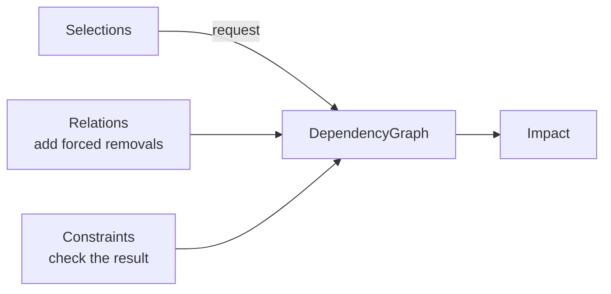
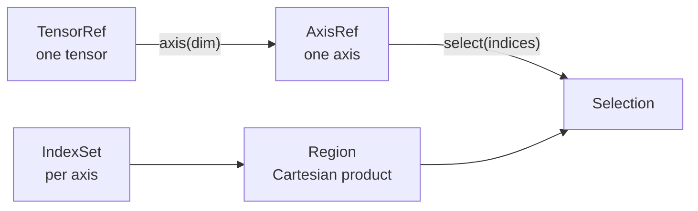
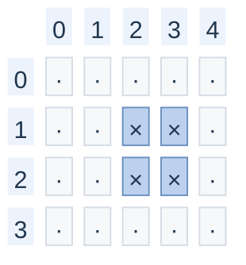
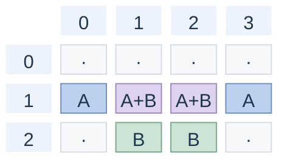
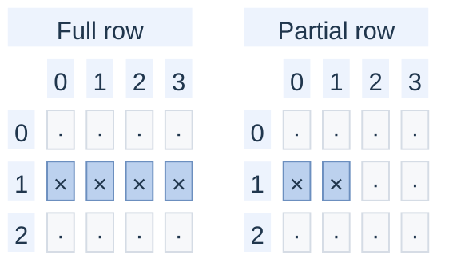
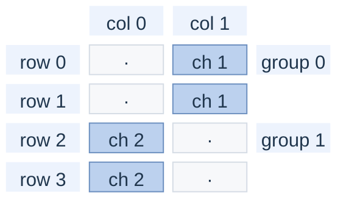
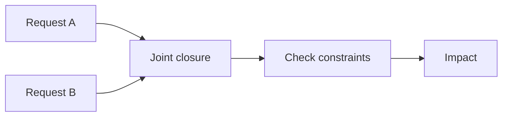

# Dependency graph

The dependency graph answers one question: *if these tensor positions are removed,
which other positions must also be removed, and which structural conditions
must still hold?* It records operator semantics and computes the closure of a
request. It does not rank candidates, choose a budget, or change the model. The
[API reference](../apidocs/torch_kirigami/torch_kirigami.dep_graph.dependency_graph.md)
lists every method.



Relations add positions that must be removed together. Constraints check the
accumulated result but never add positions. The `Impact` records both.

## Build and query a graph

```python
import torch
from torch import nn

from torch_kirigami import DependencyGraph, Fixed

model = nn.Sequential(nn.Linear(4, 8), nn.ReLU(), nn.Linear(8, 2)).eval()
graph = DependencyGraph.build(model, args=(torch.randn(1, 4),))

hidden_rows = graph.parameter("0.weight").axis(0)
impact = graph.propagate(
    remove=[hidden_rows.select([1, 5])],
    constraints=[Fixed(graph.parameter("2.weight").axis(0))],
)
assert impact.status == "resolved"
print(graph.explain(impact))
```

The closure contains rows 1 and 5 of the first weight, the matching bias entries
and activation features, and columns 1 and 5 of the second weight. The extra
`Fixed` constraint protects the classifier outputs for this query only.

`DependencyGraph.build(model, args=..., kwargs=..., operators=...)` captures one
call, as described in [model support](../guides/model-support.md#how-capture-works).
`operators` defaults to the built-in rules. Each build copies the registry tables
but keeps the rule instances, so rules must be deterministic and must not change
shared state. Construct graphs only through `build()`.

### Inspection methods

| Method | Returns |
| --- | --- |
| `parameter(path)`, `buffer(path)` | The `TensorRef` of a registered tensor. All aliases of one tensor object return the same reference. |
| `operations(module_path=None)` | One `Operation` per captured call, including repeated calls to a shared module. |
| `values()`, `metadata(ref)`, `interfaces()` | Known tensor references, captured shape, stride, dtype, and device, and the external inputs and outputs. Activations are not kept. |
| `operator_spec(operation)`, `operator_rule(operation)` | The structural facts and the rule for a call, or `None` when the call has none. |
| `relations`, `constraints`, `diagnostics` | The structural facts recorded during build. `diagnostics` lists barriers from unsupported operations. |
| `tensor(ref)`, `tensor_bindings()`, `bindings(ref)` | Live registered tensors and their owning module slots, after a freshness check. |
| `constants()`, `constant_guards()` | Lifted FX constants and registered tensors whose values guard the analysis. |
| `validate()`, `invalidate()` | Check that the model still matches the snapshot, or mark the graph stale. |
| `explain(impact)` | A readable summary of an impact. |

`operations()` and `fx_graph` return inspection copies, so changing them does not
change the graph.

### Freshness

A graph records the model structure, tensor identities and layouts, module modes,
recognized configuration, hooks, tensor references held in plain containers, and
guarded constants. Queries that analyze or read the live model check these first
and raise `StaleGraphError` on a mismatch: `validate()`, `propagate()`,
`affected_operations()`, `validate_attribute_changes()`, and the live-tensor
accessors `tensor()`, `tensor_bindings()` and `bindings()`. Snapshot accessors
such as `metadata()`, `operations()`, `relations`, `operator_spec()` and
`explain()` only read recorded data and do not check freshness. Ordinary
training updates preserve graph validity. Changing a registered tensor value
used as a structural constant, such as a fixed index, invalidates the graph.
`Pruner.apply()` invalidates its graph when it replaces a tensor or edits an
attribute. An empty plan leaves the graph usable.

The structural limits of the process-wide [configuration](configuration.md) are
also recorded at build time. Queries reject a graph when those limits have
changed since it was built.

## Coordinates

All selections use **original coordinates**, the indices of the captured tensor
shapes. Positions 1 and 5 keep those labels throughout propagation and planning.
Compact coordinates exist only inside the replacement tensors that
`Pruner.apply()` creates.



- `TensorRef` identifies one tensor in one graph snapshot: its kind (parameter,
  buffer, input, or intermediate value), original shape, and registered paths.
  Two paths that name the same parameter object share one `TensorRef`.
- `AxisRef` names one axis of a tensor. `axis.select(indices)` selects complete
  cross-sections at those positions.
- `IndexSet` is a sorted union of half-open integer intervals.
- `Region` is a Cartesian product with one `IndexSet` per tensor axis.
- `Selection` is a union of regions on one tensor.

These types stay symbolic. They never allocate dense masks. Use
`graph.identity_axes.equivalent_axes(axis)` to find axis slices that imply
one another in the captured graph. The solver and planner use the same index.

### IndexSet: half-open intervals

An interval includes its start and excludes its stop. The highlighted cells
show `[1, 7)`:

```mermaid
---
config: {"htmlLabels": false, "theme": "base", "themeVariables": {"primaryTextColor": "#20364d"}}
---
block-beta
    columns 8
    p0["0"] p1["1"] p2["2"] p3["3"] p4["4"] p5["5"] p6["6"] p7["7"]
    classDef selected fill:#bcd1ee,stroke:#6c8fbf,color:#20364d
    classDef outside fill:#f7f8fa,stroke:#d5dce5,color:#657386
    class p1,p2,p3,p4,p5,p6 selected
    class p0,p7 outside
```



Construction sorts intervals, drops empty ones, and merges overlapping or adjacent
ones, so `[1, 4)`, `[3, 5)`, and `[5, 7)` become `[1, 7)`.

### Region: a Cartesian product

On a `(4, 5)` tensor, the region with rows `[1, 3)` and columns `[2, 4)` selects
four cells:



The labels on the left are rows (axis 0), and the labels on top are columns
(axis 1). `Region(())` is the single coordinate of a scalar.

### Selection: a union of regions

A selection combines several regions on one tensor. Region A covers row 1 of a
`(3, 4)` tensor. Region B covers rows 1–2 and columns 1–2:



The overlap counts once, so the selection has six elements. `Selection`
normalizes its regions into a disjoint form. Set operations (`union`,
`subtract`) require both operands to refer to the same tensor.

### Complete cross-sections

Removing an axis position requires its complete cross-section. Both selections
below touch row 1, but only the left one covers all of it:



`fully_selected_indices(0)` returns `{1}` for the left selection and nothing for
the right one. Partial coverage of a weight row never proves that an output
channel can be removed.

### Partitioned tensors

A removal is not always "the same index list on one axis". In a grouped
convolution, the weight's input axis holds a *per-group* position, so one input
channel of the layer corresponds to a different weight region in each group.

Take `Conv2d(2, 4, 1) → ReLU → Conv2d(4, 4, 1, groups=2)`. The second weight has
shape `(4, 2, 1, 1)`: output rows 0–1 belong to group 0 and read input channels
0–1, and rows 2–3 belong to group 1 and read input channels 2–3. Removing input
channels 1 and 2 selects a different column in each group:



The selection is the union of two regions, rows `[0, 2)` × column 1 and rows
`[2, 4)` × column 0. No column is fully selected, so `compact_shape()` returns
`None`. The convolution rule declares a `PartitionedLayout`, so the planner
compacts each group separately and concatenates the results into shape
`(4, 1, 1, 1)`.

The grouped convolution also adds a `Balanced` constraint. Removing only input
channel 1 leaves the groups with one and two channels, and the impact is
`unresolved`. Removing channels 1 and 2 together resolves it.

## Relations

A relation maps a selection on one tensor to the selections it forces on others.
Relations are deterministic and side-effect free, and they never score or select
anything.

| Relation | Maps |
| --- | --- |
| `AxisRelation` | Complete cross-sections between axes, through one or more `BlockMap` records, in both directions. A block map can require a complete source block or propagate as soon as any position of the block is touched. |
| `BroadcastRelation` | Through broadcasting. In the reverse direction, a shared source position is removed only when every broadcast copy is removed. |
| `ReshapeRelation` | Row-major positions between shapes with the same element count. The rule must prove the reshape is valid. The relation does not prove stride compatibility for views. |
| `PermuteRelation` | Through an axis permutation and its inverse. |
| `SliceRelation` | Through integer indexing, positive-step slices, and `None` axes. The rule expands `...` before creating it. |

`AxisPort` names an axis, optionally restricted to a region *scope*, such as one
group or one slice of a packed projection. `BlockMap` relates contiguous blocks
of two ports. `PartitionedLayout` describes disjoint partitions that compact
separately and concatenate in a declared order.

If propagation reaches the fragment limit, the graph can still prove a native
compound request by checking the complete set of forced coordinates against
every adjacent relation. If that proof fails, the query reports an incomplete
`analysis_limit` diagnostic.

## Constraints

A constraint checks the accumulated closure. For a fixed configuration, the same
selected coordinates must give the same diagnostic. The solver can reuse a
result, so the number of calls to `check()` can vary. Only the planner can
add candidates to satisfy an unresolved constraint.

| Constraint | Requires |
| --- | --- |
| `NonEmpty` | At least one position remains on an axis. The graph adds it to every structurally used tensor. |
| `Fixed` | No complete position is removed from a protected axis. |
| `Balanced` | Equal retained counts in fixed, disjoint partitions of an axis, as in grouped convolution or GroupNorm. |
| `BlockBalance` | Surviving groups keep the same positive number of members. Whole groups may disappear. |
| `Divisible` | The retained width is a multiple of a factor. |
| `Barrier` | Marks influence as incomplete if a selection reaches any referenced tensor. Unsupported operations and storage aliases create barriers. |
| `AxisBarrier` | Marks influence as incomplete if a selection removes complete positions on one unsupported axis. |
| `LayoutConstraint` | A tensor use accepts ordinary compaction or its declared partitions. Each use of a shared tensor is checked separately. |

Some details matter in practice:

- `Balanced` partitions must be nonempty and disjoint, but need not cover the
  axis. Unequal counts are `unresolved`. By default, emptying a whole partition is
  a `conflict`. Pass `nonempty=False` only when an empty partition is valid.
- `Fixed` checks complete axis positions. On a partitioned physical tensor it may
  be unable to prove that a logical axis is unchanged, and then reports
  `unresolved`. Protect the logical axis when you can.
- `Divisible` reports a remainder as `unresolved`. It never chooses which
  positions to remove.
- An unsupported operation creates a barrier over its inputs, outputs, bindings,
  dimension sources, and data ancestors, because it might use input values as
  indices or sizes.
- If two distinct registered tensors share storage, the graph adds a barrier over
  both.

Constraints that you pass to `propagate()` apply to that query only. The graph
checks that they refer to its own tensors.

## Query results

`graph.propagate(remove=..., constraints=...)` analyzes all selections as **one
joint request**. Relations keep adding positions until the selection stops
growing:



A joint request can differ from the union of two separate ones. Two paths can
each touch half of a block, or half of a broadcast fiber, and only together
complete it. Submit removals that belong together in one call.

The result is an immutable `Impact`:

| Field | Meaning |
| --- | --- |
| `requested` | The selections you submitted, unchanged. |
| `selections`, `selection(ref)` | The closure. `selection(ref)` returns an empty selection for an unaffected tensor of this graph. |
| `parameters`, `buffers` | Affected registered selections. A shared tensor object appears once. |
| `diagnostics` | Problems found, each a `Diagnostic` with a `code`, `message`, `severity`, and `complete` flag. |
| `requirements` | Edits that execution must perform or reject, such as attribute updates. |
| `provenance` | For each propagation step: the source selection, the added regions, and the reason. |
| `interfaces` | Affected external inputs and outputs. |
| `status` | `resolved`, `unresolved`, or `conflict`. |
| `complete` | Whether every diagnostic still knows the full influence range. |
| `irreversible` | Whether some conflict is proven to persist under every larger request. |

`status`, `complete`, and `irreversible` are independent. An unbalanced group is
complete but unresolved. A protected-axis violation is complete and an
irreversible conflict. An unsupported operation makes the impact incomplete. See
[core concepts](../concepts.md#reading-an-impact) for the combinations.

`irreversible` is a strong claim. `Fixed`, `NonEmpty`, and emptied `Balanced`
partitions declare it. Unequal group counts, divisibility remainders, and changed
scalar arguments do not, because further removals can sometimes repair them, for
example by restoring a difference between two widths. One combination is proven
jointly: when an axis has `NonEmpty` and native `Divisible` constraints, a
positive retained size below the least common multiple of their factors can only
shrink to zero. Identity-equivalent axes, such as the rows of a producer and the
columns of its consumer, always keep the same positions. Their factors are
therefore combined even when they are declared on different axes. Native
`Balanced` partitions on such axes join the proof: each partition must keep the
same count, at most its smallest current count, and positions outside the
partitions keep at most their current count. When no such choice gives a
positive multiple of the factor, the state is a dead end. For example, with
three groups of 16 channels and factor 8, retained counts `(2, 3, 3)` can only
shrink to two per group, six channels in total, which is not a multiple of 8.
Each `Balanced` constraint is checked on its own, so dead ends that need several
of them together stay reversible. The solver reports one irreversible
`unreachable_alignment` conflict per set of such axes.
A custom constraint may set
`Diagnostic(..., severity="conflict", irreversible=True)` only when the violation
holds for every superset of the current removals, with the same graph and
constraints. Candidate filtering trusts that declaration.

## Shape provenance and requirements

Operator rules need to know where sizes and indices come from, so they can tell
whether pruning changes them.

`ShapeExpr` records a small set of dimension sources: constants, inferred `-1`,
tensor dimension, shape, rank, and element-count reads, tuples, and integer
`+`, `-`, `*`, `//`, and `%`. It is not a general Python or shape IR. A value that
merely equals an observed dimension does not count as derived from it.

`CallArgumentConstraint` checks that dimension-derived call arguments keep their
captured meaning. A rule can permit a particular argument, identified by its
position, to change. If one upstream width feeds both a reshape size and a slice
step, the rule can let the reshape size change while the slice step stays fixed.

`Requirement` describes an obligation for the execution layer: a kind, a target,
the tensors that determine it, and immutable data. `AttributeBinding(path,
expression)` is a requirement that sets a module attribute, such as
`in_features`, from a `ShapeExpr` evaluated on the retained shapes. The compiler
checks the declared uses of a shared attribute, including calls on untouched
branches. For example, a shared `nn.Unflatten` preserves its inferred `-1`
factor. A fixed factor may change only when all declared uses agree.
Requirements never change
the model themselves, and the executor must implement or reject each one.

## Errors

| Error | Meaning |
| --- | --- |
| `CaptureError` | `build()` could not trace or run the model under the capture contract. There is no graph. |
| `StaleGraphError` | The model no longer matches the snapshot, or the graph was invalidated. Rebuild it and all references obtained from it. |
| `AnalysisLimitError` | Constructing a selection or merging the initial seeds of a direct query exceeds the configured limit. If relation propagation cannot complete within the limit, the impact carries an `analysis_limit` diagnostic. |
| `UnsupportedOperation` | Raised by a rule that cannot analyze a call. The graph turns it into a barrier. Other exceptions from a rule propagate as programming errors. |

To extend the graph with new operations, see
[operator support](operator-support.md#write-an-operator-rule).
