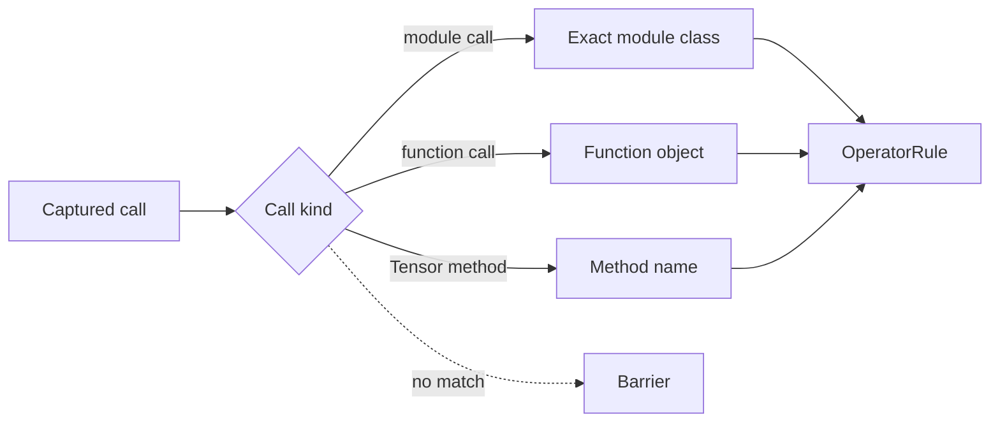
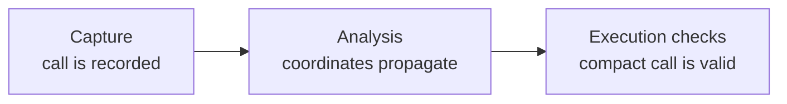
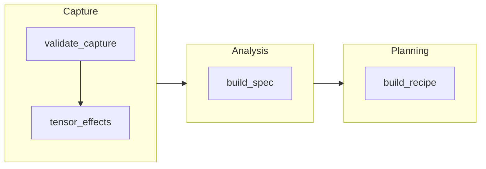

# Operator support

An operator rule tells the dependency graph how one kind of call connects tensor
coordinates. Support is decided **per captured call**, for its actual arguments
and the axes a request touches. One rule may support some overloads and
some axes of an operation, but not others.

This page lists the built-in coverage and explains how to add a rule. The
[operator API reference](../apidocs/torch_kirigami/torch_kirigami.dep_graph.operation.md)
documents the rule and effect classes.

## How a call finds its rule

`OperatorRegistry` keeps three separate tables, one for each kind of call target
that FX records:



| Call form | Registration | Matches |
| --- | --- | --- |
| `SomeModule(...)` | `registry.register(SomeModule, rule)` | The exact module class. Subclasses do not inherit the rule. |
| `F.some_function(...)`, `torch.some_function(...)`, or your function | `registry.register(function, rule)` | The function object. |
| `tensor.some_method(...)` | `registry.register_method("some_method", rule)` | The Tensor method name. |

`F` is `torch.nn.functional`. The registry matches the call target, not
mathematical equivalence. Supporting one spelling does not imply support for
other aliases. Built-in equivalent spellings, such as the function and method
forms of `detach`, `masked_fill`, or `relu_`, share one rule. Equal names do not
guarantee equal semantics. Tensor `unfold` returns windows along one axis,
while functional `unfold` extracts image patches, so the two use different rules.

A call without a rule usually does not fail the build. It becomes a barrier that
blocks the requests that reach it, as described in
[model support](../guides/model-support.md#how-failures-are-scoped). The
exception is capture safety: the library cannot know whether an unregistered call
writes its inputs, so the build fails if such a call receives a parameter or
another tensor that capture does not isolate.

### Subclasses and wrappers

A subclass of `nn.Linear` with a custom `forward` might compute something else,
so it gets no rule automatically. If the subclass only changes initialization or
naming, register the base rule for it explicitly. The same applies to any module
whose rule you reuse: you take responsibility for its coordinate semantics.

FX traces through an ordinary Python function and records the operations inside
it, so a helper built from supported operations needs no rule. Register a function
with `opaque=True` to keep it as a single call. The function must still be
FX-compatible. For function and method calls, `Operation.module` is `None`, and
the rule reads weights and other operands through `Operation.argument()`.

## Three stages of support

A call can pass one stage and fail the next:



Capture records the call and its storage effects. Analysis maps coordinates
through relations and checks constraints. Execution checks prove that the compact
call runs with the original arguments and produces the expected output. A rule that
propagates coordinates may still meet a constraint that rejects the request, and a
valid impact may still lack a safe model edit.

## Built-in coverage

The table summarizes the main structural behavior of each family and its main
limit. The default registry has the exact registrations.

| Family | Structural behavior | Main limit |
| --- | --- | --- |
| Linear | Input and output features, weight rows and columns, bias. Module and functional forms. | Exact registered spelling. Original call arguments must stay valid. |
| Convolution | Conv and ConvTranspose 1D–3D: ordinary, grouped, and depthwise channels. Grouped weights compact per group and keep group order. | Spatial and kernel axes stay fixed. Group balance applies. |
| Normalization | BatchNorm, LayerNorm, GroupNorm, InstanceNorm, RMSNorm, local response normalization, PReLU, and `normalize`. Affine parameters and statistics follow the feature axis. | GroupNorm keeps its group count and balances channels. Statistics recompute over the smaller domain. |
| Embedding | Embedding width and its consumers, module and functional. | Vocabulary rows stay fixed. With `max_norm`, capture warns and lets native updates persist. |
| Pooling and interpolation | Batch and channel correspondence. Max-pooling values and indices stay paired. | Spatial coordinates stay fixed. |
| Padding | Axes that padding does not change. | Padded or cropped axes stay fixed. |
| Elementwise | Arithmetic, comparisons, activations, broadcasting, `where`, `masked_fill`, and augmented assignment. | In-place forms need a proof of safe storage use. |
| Casts and storage calls | dtype and device conversion, `clone`, `detach`, `contiguous`. | Results that may alias input storage must pass alias checks. |
| Matrix operations | `matmul`, `mm`, `bmm`, `addmm`, `baddbmm`, `dot`, `vdot`, `mv`, `outer`, `ger`. Free and contracted axes. | Original ranks and broadcasting must stay valid. |
| Einsum | String equations with explicit or implicit outputs, repeated labels, reductions, and ellipsis broadcasting. | No sublist format. Outputs may alias inputs. |
| Concatenation and splitting | `cat`, `stack`, `split`, `chunk`, `unbind`. | Stack and unbind port counts stay fixed. |
| Indexing | `...`, `None`, integers, and positive-step slices with known sizes. [Bracket indexing](#bracket-indexing) with one fixed vector or mask. | Indexing must keep its original coordinates. |
| Shape transforms | `permute`, `transpose`, `movedim`, `reshape`, `view`, `flatten`, `unflatten`, `squeeze`, `unsqueeze`. | Incompatible sizes, changed ranks, or unproven view strides block the request. |
| Repeat and expand | `repeat`, `tile`, `repeat_interleave`, `expand`, `expand_as`, `broadcast_to`. | Static positive repeat factors. `repeat_interleave` needs scalar repeats and an explicit axis. |
| Tensor windows | `Tensor.unfold` maps every axis except the unfolded one. | Positive integer size and step. Window axes stay fixed. The result is a view. |
| Grouped coordinate transforms | GLU, ChannelShuffle, PixelShuffle and PixelUnshuffle, 2D Unfold and Fold. | Compatible shuffle patterns. Spatial and kernel positions stay fixed. |
| Reductions and softmax | Sum, mean, product, extrema, `any`, `all`, logsumexp, softmax, and log_softmax. | Results recompute over the smaller domain. An explicit empty dimension list or tuple in `any` and `all` preserves every axis. Most index-returning reductions are unsupported. |
| Fourier transforms | FFT variants and frequency shifts, for axes outside the transform. | Transform axes stay fixed. |
| Scaled dot-product attention | Q/K contraction, V width, batch and head broadcasting, masks, grouped-query attention. | Head axes must be explicit. Causal Q/K token axes stay fixed. |
| `nn.MultiheadAttention` | Packed or separate projections with balanced embedding-width changes. | Head count stays fixed. The rule does not remove whole heads at a fixed external width. |
| `ChannelGate` | Activation axis, scale, and mask shrink together. | Only after `register_gate_operators()`. |

There is no general support for tensor-dependent control flow, dynamic index
remapping, quantized or sparse storage, RNNs and `PackedSequence`, mixture-of-experts
routing, matrix decompositions, losses, or coordinate transforms such as `roll`,
`flip`, diagonals, and general `tensor_split`. Requests that reach these calls are
blocked unless you supply a rule.

### Bracket indexing

`x[..., [0, 2]]` keeps positions 0 and 2 of the last axis and all positions of the
other axes. When one axis uses an index vector or mask, every other axis must be a
full slice. `x[:, [0, 2]]` is supported. `x[1:, [0, 2]]` and `x[0, [0, 2]]` are not.

The index may be:

- a literal list of integers or booleans;
- a fixed one-dimensional tensor with dtype `int32`, `int64`, or `bool`,
  registered as a buffer or a non-trainable parameter. For example, use
  `self.register_buffer("indices", torch.tensor([0, 2]))` with `x[..., self.indices]`.

The graph and saved plans guard registered index values. A boolean mask fixes
the width of its indexed axis because the mask must still match that width.
An integer vector can allow the axis to shrink if the same indices still refer
to the same original positions. For example, with indices `[0, 2]` on a
four-channel input, removing channel 3 leaves both reads unchanged.

Scalar booleans such as `x[True]`, scalar or multi-dimensional index Tensors,
runtime-computed indices, `uint8` masks, several index vectors, and indexed writes
block the affected requests. A slice can also block a request when, after
compaction, it would select different original positions.

### Native and explicit attention

`nn.MultiheadAttention` ties the output projection to the query and output width
and to its packed or separate input projections. It keeps the head count and
balances retained features across head partitions.

An explicit scaled-dot-product graph exposes head axes. Rules can describe
removing whole key-value groups or changing the query-head multiplier. With
`is_causal=True`, Q/K token positions stay fixed, because removing tokens would
change the implicit triangular mask. KV-cache handling is outside this library.

## Default candidate axes

Dependency rules decide what a removal implies. Separately, some rules nominate
axes for automatic [candidate discovery](../guides/pruning.md#discover-default-candidates).
The default registry nominates these:

| Module | Candidate axis | One candidate |
| --- | --- | --- |
| `Linear` | Output features, weight axis 0 | One feature |
| Conv1d/2d/3d, ordinary or grouped | Output channels, weight axis 0 | One channel. A valid request may need a balanced set. |
| ConvTranspose1d/2d/3d | Logical output channels | One channel, subject to group balance |
| Depthwise convolution | Logical output channels | The output block of one input channel |
| `Embedding` | Embedding width, weight axis 1 | One feature |
| `MultiheadAttention` | Embedding width, output projection axis 0 | One feature. The fixed head count requires balanced changes. |

Functional calls and most coordinate or normalization rules propagate
dependencies without nominating an axis. A `Linear` input axis, for example, is
reached by propagation from the layer upstream. A custom rule can nominate an axis
with `CandidateAxis`.

## Write an operator rule

Write a rule when a model uses a call that has no rule, or whose built-in rule does
not fit a custom subclass. Prefer a small declarative `OperatorSpec` built from
existing relations and constraints.

This module multiplies each element by a constant. Its rule says that output
position `i` corresponds to input position `i`, and that the output is fresh
storage:

```python
import torch
from torch import fx, nn

from torch_kirigami import (
    DependencyGraph,
    Operation,
    OperatorRegistry,
    OperatorRule,
    OperatorSpec,
    ReshapeRelation,
    TensorEffects,
)
from torch_kirigami.pruning import Pruner


class Half(nn.Module):
    def forward(self, input: torch.Tensor) -> torch.Tensor:
        return input * 0.5


class HalfRule(OperatorRule):
    def build_spec(self, operation: Operation) -> OperatorSpec:
        return OperatorSpec(
            relations=(ReshapeRelation(operation.inputs[0], operation.outputs[0]),),
        )

    def tensor_effects(self, node: fx.Node, module: nn.Module | None) -> TensorEffects:
        return TensorEffects(writes_inputs=(), outputs_are_fresh=True)


registry = OperatorRegistry.default().register(Half, HalfRule())

model = nn.Sequential(nn.Linear(4, 8), Half(), nn.Linear(8, 2)).eval()
x = torch.randn(2, 4)
graph = DependencyGraph.build(model, args=(x,), operators=registry)
pruner = Pruner(model, graph=graph)
plan = pruner.plan_remove([graph.parameter("0.weight").axis(0).select([1, 5])])
pruner.apply(plan)
assert model[0].out_features == model[2].in_features == 6
assert model(x).shape == (2, 2)
```

`ReshapeRelation` between equal shapes is the identity mapping. The rule is
correct only because `Half` treats each element independently and allocates new
output. Equal input and output shapes alone prove neither.

The same rule describes a function with the same behavior. `opaque=True` keeps the
function as one call:

```python
def half(input: torch.Tensor) -> torch.Tensor:
    return input * 0.5


class FunctionModel(nn.Module):
    def __init__(self) -> None:
        super().__init__()
        self.fc = nn.Linear(4, 8)
        self.out = nn.Linear(8, 2)

    def forward(self, input: torch.Tensor) -> torch.Tensor:
        return self.out(half(self.fc(input)))


registry = OperatorRegistry.default().register(half, HalfRule(), opaque=True)
model = FunctionModel().eval()
x = torch.randn(2, 4)
graph = DependencyGraph.build(model, args=(x,), operators=registry)
assert any(operation.node.target is half for operation in graph.operations())
pruner = Pruner(model, graph=graph)
plan = pruner.plan_remove([graph.parameter("fc.weight").axis(0).select([1, 5])])
pruner.apply(plan)
assert model.fc.out_features == model.out.in_features == 6
```

### Rule lifecycle

A registry selects one rule per captured call. One rule instance can serve many
calls. The library calls the rule's methods at different times:



| Method | Purpose |
| --- | --- |
| `validate_capture(node, module)` | Reject recognized unsafe calls before the metadata run. |
| `tensor_effects(node, module)` | Declare which inputs the call writes and whether outputs are fresh or alias an input. |
| `build_spec(operation)` | Return the call's structural facts as an `OperatorSpec`. Required. |
| `build_recipe(operation, spec, impact)` | Return special edits as an `OperatorRecipe`, or `None`. Called only during planning, never during propagation. |

The default `tensor_effects()` declares read-only inputs but does not promise
fresh outputs. Override it when the call writes an input, identifying the input
with `ArgumentRef`. Alias checks for in-place operations apply in all cases.

An `OperatorSpec` can hold relations, constraints, requirements, candidate axes,
partitioned layouts, an `OutputContract`, a shape expression, and guarded constants.
The records are described in the [dependency graph reference](dependency-graph.md).

`build_spec()` raises `UnsupportedOperation` for a case the rule cannot analyze.
The graph turns that into a barrier over the related requests. Any other
exception fails the build, so programming errors are not hidden behind a barrier.

### Execution flags

Two constructor flags control the execution checks:

- `evaluate_on_meta=True` lets the planner run the compact call on metadata
  tensors to check its output. Declared reshape, slice, index, and partition
  requirements need it. Otherwise the planner relies on declared output facts.
- `cache_meta_output=True` lets the planner reuse that result. Set it only when
  the result depends on argument metadata and module configuration alone. Reuse
  also requires fresh outputs and no input writes.

Both default to `False`. A rule with its own constructor must call
`super().__init__(...)` to change them.

### Parameterized modules

For an affine module, relate input features to weight columns, and output
features to weight rows and bias entries. If the module stores a width in an
attribute, add an `AttributeBinding` with a `ShapeExpr`. Use scoped ports and a
`PartitionedLayout` for packed or grouped storage. Give a logical channel domain a
stable candidate key. If a physical candidate axis is packed and cannot show the
retained logical width, supply an alignment axis that relations couple to it.

Override `build_recipe()` only when the shared descriptors cannot express an edit.
Ordinary cuts and declared attributes or layouts need no recipe. The planner
implements or rejects every requirement, and it checks the result in every case.

### What the rule author must prove

| Area | Obligation |
| --- | --- |
| Coordinates | Relations map original positions in both directions, including complete blocks and broadcast fibers. |
| Constraints | Unsupported axes, balance, and nonempty conditions are explicit. |
| Effects | Recognized writes are rejected before execution. Declared allocation matches actual storage behavior. |
| Shape provenance | Permitted argument changes name exact argument positions. Other semantic arguments stay fixed. |
| Bindings | Parameters and buffers use registered references. Structural constants have value guards. |
| Irreversibility | A custom conflict sets `irreversible=True` only when every larger request keeps it. |
| Persistence | The same model factory and rule definitions restore the compact model. |

### Testing a rule

Direct tests of `build_spec()` check coordinate mappings, but they prove neither
capture nor physical execution. Test the public path as well:
`DependencyGraph.build()`, `Pruner.plan()`, `Pruner.apply()`, then a forward and
backward pass on the compact model. Include a request that the rule should reject,
and check that the model is unchanged afterward. Add a save-and-load test when the
rule introduces persistent structure. The [verification guide](../development/verification.md)
describes the test levels.
