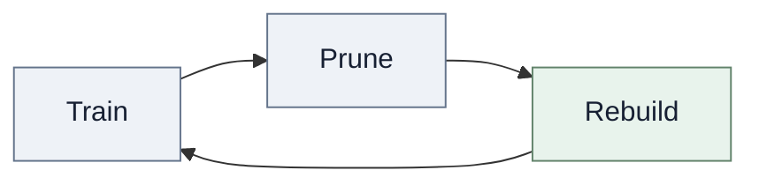

# Sparse training and iterative pruning

`torch_kirigami.sparsity` provides sparse losses, gates, parameter operations, schedules, and cumulative channel budgets. It does not own a task loss, optimizer, training loop, or pruning policy. The [workflow examples](../examples/workflows/README.md) combine these components with pretrained models and ImageNet data.

A sparse regularizer returns a scalar tensor. Ordinary autograd computes its gradient as part of the caller's total loss. The caller owns loss scaling, optimization, training duration, and recovery.

## Components and responsibilities

| Component | Library responsibility | Caller responsibility |
| --- | --- | --- |
| `Pruner`, `CandidateSpace`, `ParameterGroup` | Discover logical candidates and expose affected parameter regions | Choose candidate domains and parameter filters |
| `ScaleL1`, `GroupLasso`, `GroupSquaredL2` | Evaluate scalar penalties on current parameter values | Choose task loss, strength, duration, and optimizer |
| `ChannelGate`, `GateBinding`, `GateMagnitude` | Provide explicit activation scales, dependency links, and gate scores | Choose gate placement and candidate policy |
| `scale_groups_`, `zero_groups_`, `set_group_norms_` | Validate and update selected parameter regions | Choose timing, regrowth policy, and optimizer-state handling |
| `CumulativeChannelBudget` | Convert original widths and observed deletions into integer caps | Choose rounds and apply successful plans in order |
| Schedules and `SelectionWindow` | Evaluate scalar schedules and selection statistics | Track steps, thresholds, and stage transitions |

## Live parameter groups

Group extraction and comparison belong to `torch_kirigami.pruning`.
Loss functions belong to `torch_kirigami.sparsity`:

```python
from torch_kirigami.pruning import ParameterGroup, Pruner, unique_groups
from torch_kirigami.sparsity import GroupLasso, GroupSquaredL2
```

### Extract one group per candidate

`Pruner.parameter_groups(candidates, *, parameter_filter=None)` describes the parameter regions that each candidate would remove.
It does not choose candidates, create a plan, or change weights.
Call this query before planning when training needs candidate-specific groups.

1. The pruner propagates each candidate through the graph and its shared constraints.
2. It rejects incomplete impacts because they cannot identify every affected parameter.
3. It reads affected parameter selections and applies the optional filter.
4. It merges overlapping selections within each group and preserves the candidate order.

Each candidate produces one group with the same key, including candidates with equivalent parameter regions.
An incomplete impact or an empty group raises `PlanningError` with the candidate key. Extraction never skips a candidate.
An empty candidate iterable returns an empty tuple.
Extraction requires complete influence. It accepts complete impacts even when constraints fail, and does not compile execution recipes.
A group is therefore not proof that its candidate can be physically pruned.

For pruning-oriented sparse training, normally use candidates from `pruner.discover_candidates(targets=...)`. Discovery excludes proven irreversible conflicts, including partial or complete Fixed protection. For a custom space, use `space = pruner.filter_candidates(space)` before group extraction. This filter preserves explicit budget axes and records rejected candidate keys.

Explicitly supplied candidates can still describe protected or otherwise infeasible removals. Extraction preserves them because it describes parameter regions, not candidate feasibility. Penalizing such groups does not make those removals legal. This raw query remains available when the training objective deliberately includes fixed structure. `Fixed` protects structural dimensions, not parameter values or gradients. A legal input-column removal can affect a parameter even when `Fixed` protects its output axis.

Do not discard every individually unresolved or conflicting candidate: several candidates can jointly satisfy a condition. Only `Diagnostic.irreversible` declares that adding removals cannot resolve its conflict. Retained candidates are not guaranteed to have an executable combination. Sparse-group extraction does not compile recipes or solve arbitrary constraints.

The optional `parameter_filter(ref, parameter)` receives a `TensorRef` and its live `nn.Parameter`.
Returning `True` keeps that parameter's affected regions in the group.
`None` keeps every affected parameter. Buffers are always excluded.
This filter changes the sparse-loss groups. It does not restrict pruning or change metric scores.

### Explicit deduplication

`torch_kirigami.pruning.unique_groups(groups)` is a function, not a regularizer method.
It returns the first original group from each set of equivalent groups, in input order.
Groups are equivalent when they belong to the same graph and select the same parameter coordinates.
Keys and region decomposition do not affect this comparison.
Partially overlapping groups remain separate. The function does not combine coefficients.

For example, producer row 2 and consumer column 2 can produce equivalent groups through dependency propagation.
Extraction retains both entries and their candidate keys.
Call `unique_groups` only when the training objective should count those parameter regions once.
Assign coefficients after deduplication so they match the returned groups.
Equal parameter groups do not prove that the candidates have identical buffer effects, constraints, or execution requirements.

### Joint effects and live bindings

Extraction analyzes candidates separately. It does not compute their joint deletion effects.
For a joint group, use `Pruner.impact(candidates)`, validate `impact.complete`, then construct `ParameterGroup(graph, impact.parameters)`.
Joint analysis can include effects absent from every individual candidate.
Require nonempty parameter regions before constructing the group.
One joint group produces one norm over its parameter union.
Separate groups produce a sum of norms. These objectives generally differ.

A directly constructed `ParameterGroup` validates and merges its supplied selections, but it does not prove that they are complete dependency impacts.
Groups do not contain buffers, activation selections, constraints, or attribute-update requirements.

A group can contain regions from several parameters. `bindings()` returns current `(Parameter, Selection)` pairs after graph validation. Numerical optimizer updates do not invalidate a group. Rebuild the graph and groups after a structural change, parameter replacement, or other snapshot-invalidating change.

Sparse regularizers and parameter operations require all supplied groups to share one graph and one parameter device.
They require dense, real floating-point parameters and finite selected values.
`ParameterGroup` itself stores coordinates and does not enforce these numerical requirements.
The library does not gather distributed or sharded parameters.

## Scalar regularizers

Calling a regularizer returns a scalar loss tensor.
Let `W_g` contain the current parameter values in group `g`, and let `a_g` be its coefficient.
A group can contain regions from several modules. Repeated coordinates within that group count once.

| API | Objective |
| --- | --- |
| `ScaleL1(graph, parameters)` | Sum of absolute values for explicitly named one-dimensional parameters |
| `GroupLasso(groups, *, coefficients=None)` | `sum_g a_g * ||W_g||_2` |
| `GroupSquaredL2(groups, *, coefficients=None)` | `0.5 * sum_g a_g * ||W_g||_2**2` |

Coefficients default to one. Each coefficient must be a finite, nonnegative Python number.
Every supplied group contributes a separate term, including repeated and partially overlapping groups.
An element shared by two groups contributes to both terms.
Two equivalent groups with coefficients 1 and 2 therefore contribute the same loss as one group with coefficient 3.
There is no implicit deduplication, averaging, or group-size normalization. Multiply the returned scalar by the overall strength in the training loop.

`ScaleL1` accepts parameter paths or `TensorRef` values. It requires one-dimensional parameters and deduplicates aliases. It does not infer whether a parameter represents a BatchNorm or gate scale.
For example, BatchNorm uses one learned scale per channel, stored in its `weight` parameter.
`ScaleL1(graph, ("bn.weight",))` returns `model.bn.weight.abs().sum()` for a model with that BatchNorm module.
Adding a weighted version of this scalar to the task loss encourages small scales during training.
The [BN-guided pruning workflow](../examples/workflows/bn_guided_pruning.py) uses this loss, then scores candidate removals from the trained scales.
`ScaleL1` does not propagate dependencies, rank candidates, or physically prune the model.

Regularizers read current parameter values on every call. They preserve autograd connectivity and do not retain graphs across calls. They do not call `backward()`, change parameters or gradients, or read optimizer state. Frozen parameters remain in the objective. Built-in L2 penalties support first-order autograd only. Nonfinite values or results raise an error.
The loss stays on the selected parameters' device.
Its dtype is float64 if any selected parameter is float64, otherwise float32.

Custom subclasses can override `penalty(values)`. They receive each group's flattened selected values and define their own differentiation behavior.

### Ordinary training integration

This example shows the API with synthetic data. Use representative task data and pretrained weights to evaluate pruning quality.

```python
import torch
from torch import nn

from torch_kirigami import DependencyGraph
from torch_kirigami.pruning import Pruner, unique_groups
from torch_kirigami.sparsity import GroupLasso

model = nn.Sequential(nn.Linear(8, 12), nn.ReLU(), nn.Linear(12, 4))
x, target = torch.randn(2, 8), torch.randn(2, 4)
graph = DependencyGraph.build(model, args=(x,))
pruner = Pruner(model, graph=graph)
space = pruner.discover_candidates()
groups = unique_groups(pruner.parameter_groups(space.candidates))
regularizer = GroupLasso(groups)
optimizer = torch.optim.AdamW(model.parameters(), lr=1e-3)

optimizer.zero_grad()
task_loss = nn.functional.mse_loss(model(x), target)
loss = task_loss + 1e-4 * regularizer()
loss.backward()
optimizer.step()
```

The same contract works with SGD, AdamW, gradient accumulation, AMP, and clipping. When averaging `N` microbatches, scale the total loss consistently so the sparse term is not multiplied by `N`. Under AMP, combine losses before applying the gradient scaler. Unscale before clipping or reading Taylor statistics.

For Taylor scoring, collect task-only gradients in a separate pass. Choose the model mode explicitly. Evaluation mode can avoid changes to BatchNorm running statistics. The [single-pass pruning example](../examples/workflows/prune_finetune.py) restores the original module modes after collection.

## Explicit activation gates

`ChannelGate(size, axis, trainable=True)` multiplies an activation by one learned scale and one binary mask value at each position of the chosen axis. It preserves rank and supports negative axis values.

```python
from torch_kirigami import OperatorRegistry
from torch_kirigami.sparsity import ChannelGate, register_gate_operators

model = nn.Sequential(nn.Linear(8, 12), ChannelGate(12, axis=-1), nn.Linear(12, 4))
operators = OperatorRegistry.default()
register_gate_operators(operators)
graph = DependencyGraph.build(model, args=(x,), operators=operators)
```

Register gate operators before graph construction. Registration links the input and output axes to the gate's weight and mask. It also declares the `size` update needed during compaction. A gate adds no logical candidate axis. Gate multiplication creates fresh storage, which supports validation of an immediately following in-place activation.

The weight and mask start at one. `set_mask()` installs a fixed binary mask. It does not shrink the model. `trainable=False` freezes the weight while keeping the module and checkpoint structure. The library does not insert gates or rewrite arbitrary networks.

`GateBinding(graph, path).candidates(pruner, candidates)` finds candidates whose dependency closure removes at least one gate weight. `GateMagnitude(bindings)` sums `abs(weight * mask)` over newly affected gate scales. It rejects candidates with no bound gate. It does not train gates or recalibrate their statistics. Distinct masks paired with a shared weight contribute separately. Aliases sharing both weight and mask count once.

`Greedy` scores once per plan. `DynamicGreedy` updates scores after each accepted complete addition, which can contain several candidates. Both receive the current gate values. Neither strategy trains gates during selection. A score for one candidate is independent of score batch order and size for fixed model values and accepted impact. To request a joint score, provide one multi-selection candidate.

Retained gate values can differ from one after physical pruning. Save and restore with a model factory that has the same gate placements. See [persistence](persistence.md).

## Parameter operations

These operations update parameter values under `no_grad`. Call them outside a live forward or backward graph, usually after an optimizer step.

| Operation | Effect |
| --- | --- |
| `scale_groups_(groups, factor)` | Multiply the selected union once by a finite, nonnegative factor |
| `zero_groups_(groups)` | Set the selected union to zero without a persistent mask |
| `set_group_norms_(groups, targets)` | Rescale disjoint groups to explicit nonnegative L2 norms |

Scaling and zeroing update overlaps once. This differs from regularizers, which sum one loss term per supplied group.
Norm projection accepts equivalent groups only when their targets match. It rejects all other overlaps. A zero vector cannot receive a positive norm because it has no direction.

The operations validate and prepare values before mutation. Runtime or value failures during commit restore original values. Gradients and optimizer state remain unchanged. Momentum can regrow zeroed parameters. Reapply the operation or use a mask when zeros must persist. The operation rejects distinct tensor objects that share storage when an update could affect them.

## Cumulative channel budgets

Repeated `ChannelRatio(0.2)` requests apply 20% to each new snapshot and round again. `CumulativeChannelBudget` stores original widths and counts only observed, successfully applied removals.

For original width `W` and cumulative reduction ratio `r`, the final-width cap is `floor((1 - r) * W)`. Global scope applies the cap to the sum of original widths. Width 100 with `r=0.29` has a cap of 71. If an earlier round already meets the cap, the next round requests no additional deletion. A failed plan does not update the accounting state.

```python
import torch
from torch import nn

from torch_kirigami import DependencyGraph, OperatorRegistry
from torch_kirigami.pruning import CandidateSpace, Greedy, GroupMagnitude, Pruner
from torch_kirigami.sparsity import CumulativeChannelBudget

model = nn.Sequential(nn.Conv2d(3, 8, 1), nn.ReLU(), nn.Conv2d(8, 4, 1))
x = torch.randn(1, 3, 8, 8)
operators = OperatorRegistry.default()
graph = DependencyGraph.build(model, args=(x,), operators=operators)
pruner = Pruner(model, graph=graph)
space = pruner.discover_candidates()
account = CumulativeChannelBudget(graph, space, scope="local")
for ratio in (0.1, 0.2, 0.3):
    budget = account.budget(graph, space, ratio)
    round_space = CandidateSpace(space.candidates, budget.channel_axes)
    plan = pruner.plan(round_space, budget=budget, strategy=Greedy(GroupMagnitude()))
    model, result = pruner.apply(plan)
    graph = DependencyGraph.build(model, args=(x,), operators=operators)
    pruner = Pruner(model, graph=graph)
    space = pruner.discover_candidates()
    account.update(result, graph, space)
```

Start with a fresh model and graph-bound objects. Rebuild them after each application. Custom candidate definitions must recreate the same logical domains on the new graph.

Cumulative accounting requires named parameter axes. It validates domain paths, dimensions, declarations, widths, and model structure at each transition. External structure changes and incompatible domains raise errors. A domain whose declared candidates become irreversibly blocked can keep its original denominator through the rebuilt space's `excluded_channel_axes`. The cumulative baseline does not shrink.



The caller chooses each training stage and pruning round. A failed plan does not advance cumulative accounting. A successful apply replaces parameters, so the caller rebuilds graph-bound objects and creates a new optimizer before training resumes.

`state_dict()` returns portable accounting data. `load_state_dict()` validates it against a fresh graph and candidate space before changing state. The budget does not store scores, stage triggers, or training progress.

## Schedules and selection stability

Schedules are stateless. The caller supplies each nonnegative integer step and saves its own progress counter.

| API | Behavior |
| --- | --- |
| `Constant(value)` | Return one finite value |
| `Linear(start, end, finish, *, begin=0)` | Interpolate linearly and clamp at the endpoints |
| `Polynomial(start, end, finish, begin=0, power=1.0)` | Interpolate with the supplied positive power and clamp at the endpoints |
| `Piecewise(points)` | Return the latest milestone value. Set the first step to zero. |

`selection_similarity(left, right)` returns the mean per-domain Jaccard similarity of retained integer identities. Inputs map stable domain names to retained positions. Empty compared with empty returns one. Changed domain names raise an error. The result weights each domain equally, regardless of width.

`SelectionWindow(size)` averages the latest `size` adjacent comparisons. A size-two window needs three selections. `update()` returns `None` until the window fills. `reset()` starts a new coordinate universe. Its state methods preserve and validate comparison history.

## Training state

The compact checkpoint stores the model structure and parameter values. It does not store the caller's optimizer or training progress. Save those items separately when training must resume.

Save the step counter, optimizer state, learning-rate scheduler state, random-number state, and any algorithm-owned selection state in the training application. Rebuild graph-bound groups after restoring the compact model.

Create a fresh optimizer after physical pruning replaces parameters. A previous optimizer can still refer to removed parameter objects. The library does not migrate optimizer state across structural changes.

Thresholds, regularization triggers, reselection, and stage changes belong to the caller. Reset the window after physical pruning unless the caller maintains a valid mapping to original identities.

## Workflow and research scope

The workflow scripts show magnitude and Taylor pruning, iterative budgets, BatchNorm-scale L1, group Lasso, squared-L2 training, soft projection, explicit gates, and selection stability. They demonstrate library components. They do not claim to reproduce complete paper recipes or paper accuracy results.

Each workflow entry documents its candidate scope, training stages, and paper adaptations. The [workflow README](../examples/workflows/README.md) combines these explanations with runnable commands. Scores collected during training do not make later planning dynamic. Recovery training is a separate caller-owned stage.

Compact model checkpoints store the pruned model. Save optimizer state, progress, algorithm state, and random-number state separately when training must resume. See [training state](persistence.md#training-state-is-caller-owned).
